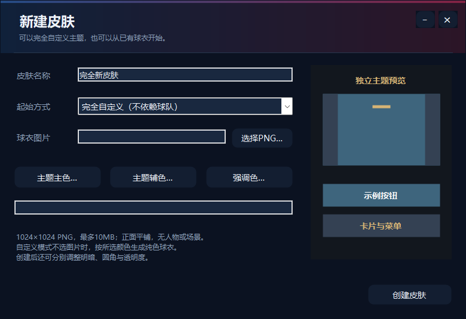
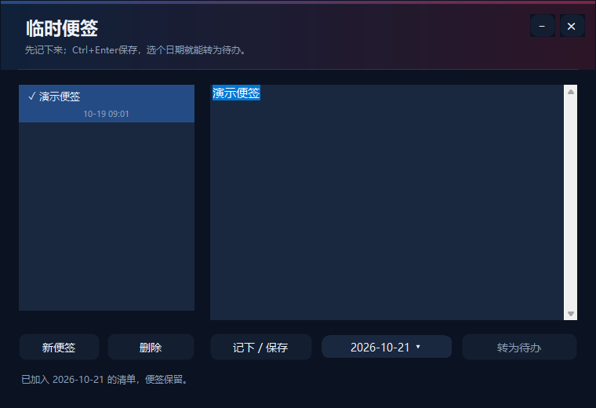
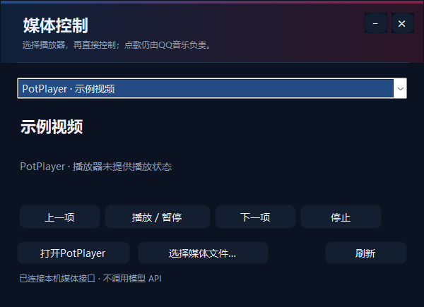
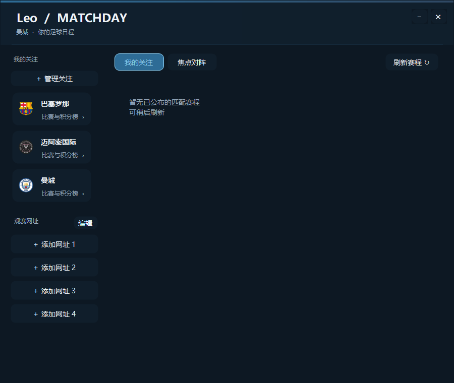

# Leo · Windows 桌面伙伴与本地动作入口

把应用启动、清单、便签、足球、音乐和媒体控制收进一个桌面伙伴。默认巴萨皮肤，也可以换球队、换配色，创建和分享自己的球衣皮肤。

**发布包与源码请区分：下方保留 v1.00.0 下载入口；main 已包含后续开发改进，工程版本为 1.04.0。本次同步源码与文档，不新建 Release 或安装包。**

[下载 Windows 安装包](https://github.com/LeoLi006/leo-desktop/releases/tag/v1.00.0) · [完整产品与扩展开发说明](src/PRODUCT_AND_DEVELOPER_GUIDE.md) · [日常使用说明](src/USER_GUIDE.md) · [大版本更新日志](src/RELEASE_NOTES.md) · [反馈问题](https://github.com/LeoLi006/leo-desktop/issues)

Leo 是独立运行的 **Windows x64** 桌面应用。应用搜索、文件路径、便签、清单和明确指令优先在本地执行；自由聊天和复杂意图理解使用你自行配置的兼容模型 API。只使用本地功能，无需填写 API Key。

## 想了解架构或自己扩展？

从[产品与扩展开发说明](src/PRODUCT_AND_DEVELOPER_GUIDE.md)开始：包含功能/依赖、底座结构、请求与结果接口、四种扩展路径、内部模块接入步骤、数据/恢复/分享边界、构建与定向验收要求。

| 需求 | 从哪里开始 |
| --- | --- |
| 只是使用或配置 Leo | [日常使用说明](src/USER_GUIDE.md) |
| 添加本机应用、包装已有动作、编写独立程序 | [选择扩展方式](src/PRODUCT_AND_DEVELOPER_GUIDE.md#5-选择扩展方式)、[现有包协议](src/MODULES.md) |
| 修改源码，新增可信内部模块 | [内部模块接入](src/PRODUCT_AND_DEVELOPER_GUIDE.md#9-开发可信内部模块)、[完整联合样例](src/Architecture/C04/MODULE-CLOSURE.md) |
| 判断哪些目标已完成 | [阶段验收](src/Architecture/STAGE-REVIEW.md)、[路线图](src/ROADMAP.md) |

主分支已完成主要能力执行迁移、内部普通模块入口闭环，以及现有应用包/扩展的兼容恢复、状态与分享核验。各入口复用注册表、结构化结果及原执行策略，明确操作优先本地完成；模型只在明确授权的工具范围内理解和规划。

当前仍需宿主显式组装服务、注册、刷新与释放。复杂窗口、任意代码独立交付、权限沙箱、完整协议协商和长期真实负载尚未完整验收。**能够导入stdio扩展，不等于能够热加载任意DLL，也不等于第三方代码受到系统权限隔离。**

以下v1.00.0介绍与截图作为既有发布记录保留；主分支后续接口及修复以新指南和对应源码提交为准。

## v1.00.0 带来了什么

这是对 v0.50.0 之后几轮本地更新的集中正式发布，保留原有个人配置，不要求重新建立清单或应用收藏。

- **同一套动作入口**：聊天、识别后的语音、搜索框、自定义组合共用动作分发器，明确指令无需绕经模型。
- **应用模块与扩展**：独立启停本机软件模块，自己添加EXE/LNK，配置图标、启动参数、工作目录和管理员启动；支持JSON动作扩展与ZIP独立进程扩展。
- **更完整的启动器**：快捷按钮拖拽排序、“更多”溢出菜单、拖入程序添加模块，以及文件和文件夹路径自动补全。
- **统一媒体控制**：QQ音乐负责快速点歌；PotPlayer及Windows媒体会话提供播放、暂停、切换与停止控制。
- **完整皮肤与主题**：五套内置球队皮肤、自定义主色/辅色/强调色、明暗、圆角、透明度，以及独立球衣与`.leoskin`皮肤包。
- **内容拖放与便签**：文件、图片、文字和网址进入统一动作面板；便签无需日期，之后可以转成指定日期的待办。
- **更清晰的右键菜单**：按清单与记录、应用与媒体、组合动作、外观组织，设置与退出保留直接入口。

### 界面预览

以下为使用演示数据的功能截图，不包含个人配置或真实聊天记录。足球截图展示界面布局，不代表当前赛程。

| 完全自定义皮肤 | 临时便签与待办关联 |
| --- | --- |
|  |  |

| 统一媒体控制 | 足球赛程 |
| --- | --- |
|  |  |

[查看内置球队主题](src/docs/screenshots/v0.50-five-themes.png) · [查看主题编辑器](src/docs/screenshots/v0.51-theme-editor.png)

## 下载安装

1. 打开 [v1.00.0 发布页](https://github.com/LeoLi006/leo-desktop/releases/tag/v1.00.0)，下载 **`Leo-v1.00.0-win-x64.zip`**。
2. 完整解压，运行 **`Install-Leo.cmd`**，选择Leo专用安装文件夹。
3. 第一次启动按需开启模块；需要语音时再按说明安装SenseVoice模型，需要聊天时再填写API配置。

安装包包含Windows桌面运行时，不需要先安装开发环境。更新时选择原来的安装目录，安装器会处理备份、校验与回退，保留个人配置、清单和模型。发布页提供同名`.sha256`校验文件。

发布页另有名称为`Leo-v1.0.0-win-x64.zip`的同内容兼容附件，供旧版更新器识别；**手动下载选择`v1.00.0`文件即可**。安装后的正式显示版本统一为v1.00.0。

## 常用入口

| 操作 | 入口或效果 |
| --- | --- |
| 单击伙伴 | 打开应用搜索，再点一次收起；搜索打开时锁定伙伴位置 |
| 拖动伙伴 | 移动位置；靠近屏幕边缘松手后吸附，支持多显示器工作区 |
| 悬停吸附后的头部 | 展开伙伴，恢复脚下按钮；也可以直接拖出 |
| 悬停完整伙伴 | 查看未完成事项及下一场关注比赛摘要 |
| 脚下常驻按钮 | 聊天、清单、工具下拉；下拉显示已启用的终端、Clash和Edge搜索 |
| 搜索框顶部快捷栏 | 足球、QQ音乐、PotPlayer及自定义应用；可拖拽排序，溢出项进入“更多” |
| 右键 → 清单与记录 | 每日清单、临时便签、通知收纳盒、临时专注 |
| 右键 → 应用与媒体 | 应用搜索、文字聊天、直接说话、音乐和媒体控制 |
| 右键 → 组合动作 | 执行、新建、编辑或删除自定义组合 |
| 右键 → 外观 | 切换皮肤、打开主题与球衣编辑器 |
| 右键 → 设置 | 名字、大小、快捷键、启动项、模块、API、迁移与运行检查 |
| Esc | 关闭当前功能窗口或收起面板，不直接退出伙伴 |

伙伴名字可自定义。切换皮肤时，窗口、按钮、菜单和提示同步换色；游戏或视频全屏时可自动隐藏。聊天窗口支持缩放，部分辅助窗口固定大小保持稳定。

## 应用、文件与模块

### 搜索与路径补全

- 按应用名、拼音、简称搜索，例如`wx`、`weixin`、`vsc`；右键应用图标设置自己的简称。
- 搜索结果两排、每排七个图标；支持收藏置顶、最近使用和可关闭的上下文排序。
- 输入完整文件或文件夹路径，回车通过Windows默认关联打开。
- 路径候选支持`↑ / ↓`选择、`Tab`补全并进入下一级、`Enter`打开、双击打开；支持中文、空格、引号和环境变量。
- 普通应用结果支持方向键、Tab、Enter、Shift+F10及Ctrl+L；输入“剪贴板”打开本地历史和收藏。

### 自定义应用模块

进入 **设置 → 功能 → 应用模块与图标**。终端、Clash Verge、QQ音乐、Edge与PotPlayer统一管理开关、程序路径及快捷图标；停用不会卸载或关闭对应软件。

把EXE/LNK拖到伙伴、顶部快捷栏或应用模块管理窗口，确认名称与路径后即可添加。自定义应用可设置启动参数、工作目录和Windows管理员启动；新增按钮位于快捷栏，顺序由你调整。程序移动后会查找同名候选，经确认才更新路径；取消不会改配置。

普通应用模块提供启动能力。Clash代理开关、QQ点歌、媒体控制等专用能力由对应适配器提供，不会因为添加一个EXE就自动获得。完整说明见[应用模块与启动器](src/USER_GUIDE.md#25-桌面入口升级v0530)。

### 可独立安装的扩展

**设置 → 功能 → 管理扩展模块**支持：

- JSON声明式模块：将已有动作封装成自己的指令。
- ZIP独立进程模块：通过stdio协议运行自己的程序，扩展新的逻辑，独立安装、更新、停用或移除。

扩展程序按当前用户权限运行，安装前应确认来源。模块协议、包格式、超时与取消规则见 [MODULES.md](src/MODULES.md)。

## 清单、临时便签与内容拖放

### 清单与日历

每日、每周、逾期视图；单次、每天或每周重复；双击改标题、拖到日历改期、右键快速操作、一键顺延及撤销。重复事项可仅跳过本次；提醒支持稍后10分钟或1小时、免打扰时段、清单备份与恢复。

**提醒需要Leo保持运行。** 退出或关机期间不响铃，重新启动后补报符合条件的提醒；免打扰和全屏隐藏期间暂缓弹窗。

### 临时便签

不用填日期，先记一句话。`Ctrl+Enter`或`Ctrl+S`保存，之后可选择日期、确认标题并转为待办，保留原便签并防止重复转换。支持修改、删除，以及未保存文字的处理提示。

搜索框输入“便签”打开窗口；输入“记一下 买牛奶”可在本地记下。便签单独保存在运行目录的`leo-notes.json`，目前不包含在配置迁移导出中。

### 统一拖放动作面板

| 拖入内容 | 可选动作 |
| --- | --- |
| 文件、文件夹 | 复制路径、打开所在文件夹、记便签、添加待办、选择应用打开 |
| EXE / LNK | 添加应用模块 |
| 视频、音频 | 用PotPlayer播放，随媒体模块启停 |
| 图片文件或位图 | 复制图片；直接位图可另存PNG |
| 文字、网址 | 复制文字、记便签、添加待办；网址可交给Edge打开 |

拖入后先选择动作，不会自动执行程序、移动或删除原文件。

## 足球、音乐与媒体

### 足球

默认关注巴塞罗那、曼城、迈阿密国际；支持管理关注、搜索与筛选俱乐部或国家队。目录含97支俱乐部及55支国家队，最多关注24支。

查看关注及焦点比赛、近期赛果、球队近期赛程和积分榜，详情在同一窗口切换。尚未开赛且时间确定的比赛可加入清单并提前10分钟提醒，赛程变化可同步关联安排。支持四个自存观赛网址，Leo不提供视频资源。

赛程通过专用数据源读取，断网或查询失败时可显示缓存及时间；比赛时间按本机时区显示。

### QQ音乐

定位为**快速点一首歌**：搜索歌名/歌手，把候选交给QQ音乐；未运行时尝试启动后继续执行。支持最近歌曲、暂停、切歌及桌面歌词控制。

歌单在QQ音乐客户端管理，Leo不维护或同步歌单。登录、会员权限、歌曲可播放性和部分控制兼容性由客户端决定。

### PotPlayer与统一媒体控制

从顶部PotPlayer按钮或 **右键 → 应用与媒体 → 媒体控制** 进入，选择播放器后控制播放、暂停、上一项、下一项和停止；可打开PotPlayer或选择本地媒体文件。

控制对象包括Windows公开的媒体会话，以及PotPlayer窗口的本机控制接口，不会向全部播放器广播按键。播放器若未提供状态，界面只报告已发送控制请求，不假称已播放。

## 自定义皮肤与球衣分享

默认巴萨，可选阿根廷、西班牙、迈阿密国际、曼城，覆盖待机、移动、思考与四向吸附等动作。

**外观 → 主题与皮肤编辑器 → 新建皮肤**支持完全独立的主色、辅色、强调色与标语，不必从某支球队继承。球衣规格是 **1024×1024 PNG、最多10MB、正面平铺纹样**；不选图片时可按配色生成纯色球衣。

还可预览和调整明暗、圆角、透明度，导入或导出`.leoskin`皮肤包。导入生成新的独立皮肤，不覆盖原有皮肤；包内仅保存球衣、主题与标语，不包含应用路径或个人记录。

[图片与皮肤包规格](src/SKIN_FORMAT.md) · [球衣模板](src/Assets/docs/jersey-template.png) · [动画与多屏停靠说明](src/ANIMATION-NOTES.md)

## 模型、语音与联网的分工

| 功能 | 是否调用模型API |
| --- | --- |
| 应用/路径搜索、清单、便签、剪贴板、设置、媒体控制 | 否 |
| 明确的本地口令、自定义组合、拖放动作 | 否 |
| 本地SenseVoice语音转文字 | 否，在本机识别 |
| 足球更新、歌曲搜索 | 需要联网访问专用数据源，不是模型调用 |
| 网页搜索 | 打开浏览器搜索 |
| 自由聊天、复杂意图理解、任务拆解 | 使用你配置的兼容模型服务 |

模型配置支持兼容的Chat Completions和Responses接口、自填Base URL及模型名称；中转服务能否流式回复、调用工具或返回用量，取决于服务实现。

默认每日最多100次模型生成请求，可调整，0表示不限；工具调用多轮回复按实际请求计算，已发出的失败或取消请求也计入。Token只记录服务实际返回值，不估算费用。达到上限后本地功能仍可使用。

本地识别后的文字若进入模型对话，会发送给你所配置的服务。Leo没有通用网页浏览能力，不会自动核验所有模型回答中的实时信息。

## 配置、隐私与恢复

- API Key使用Windows当前用户的DPAPI加密保存，不随源码或发布包提供；换电脑需重新配置Key。
- 运行目录中的设置、清单、便签、聊天、剪贴板、缓存、模型和备份属于个人数据，不上传GitHub。
- **设置 → 常规 → 配置迁移与恢复**可导出部分配置，导入前显示摘要、备份并提供恢复；API、聊天、剪贴板、便签和语音模型不包含在迁移文件中。
- 迁移文件可能含网址、待办、应用路径和简称，请作为个人文件保管。
- **设置 → 运行检查**处理启动项、路径、快捷键及语音模型问题；API连接检测由你手动触发。
- 在Issue、日志或截图中反馈问题时，请先隐藏Key、个人路径及私人内容。

## 默认快捷键

| 快捷键 | 功能 |
| --- | --- |
| Ctrl+Alt+Space | 打开或收起搜索框 |
| Ctrl+Alt+V | 打开聊天并直接语音输入 |
| Ctrl+Alt+L | QQ音乐桌面歌词 |
| Ctrl+Enter / Ctrl+S | 在便签窗口中保存 |
| Esc | 关闭当前功能窗口或收起面板 |

搜索、语音、歌词快捷键可在设置中修改或停用；歌词控制需要QQ音乐保留兼容的快捷键配置。

## 从源码构建

需要Windows x64、PowerShell 7、Git及.NET SDK 9，SDK策略见 [global.json](global.json)。固定依赖与校验清单位于`vendor`，构建脚本会验证依赖和锁文件。

```powershell
./scripts/Build.ps1 -Locked
./.build/Release/LeoLauncher.exe
```

开发时优先在独立的.build输出目录运行；不要将不同发布模式的输出直接混入个人安装。按变更运行相关定向检查，不要求每次重跑全部功能。最新[验证入口表](src/PRODUCT_AND_DEVELOPER_GUIDE.md#12-构建检查与贡献)覆盖扩展、状态、分享及联合恢复；旧发布检查保留为历史证据。

创建包含Windows运行时的干净发布包：

```powershell
./src/Packaging/Build-Package.ps1
```

语音模型不包含在仓库或安装包内，需要时执行`./scripts/Install-VoiceModel.ps1`。文字和本地启动功能可以先用。

## 常见问题

- **应用或软件路径失效**：在应用模块管理中编辑，或确认自动找到的候选；不要选择其它同名但来源不明的程序。
- **语音无文字**：检查SenseVoice模型、麦克风及录音音量。
- **没有提醒**：确认Leo正在运行，检查日期、免打扰及全屏隐藏状态。
- **媒体没有响应**：确认已选对播放器；QQ歌曲权限和客户端版本、Windows媒体会话状态都会影响控制结果。
- **足球或歌曲查询失败**：专用接口可能变化、限流或暂时不可达；足球保留缓存时请留意更新时间。
- **模型不支持流式/工具调用**：确认接口类型、模型和服务能力；用量不返回时可关闭相关请求选项。
- **升级与回退**：使用原安装目录，按安装器提示备份；旧版本源码通过Git标签查看，不复制成多套本地版本目录。

[完整使用说明](src/USER_GUIDE.md)包含更多操作入口、限制和排查步骤。

## 下载、反馈与权限

本仓库公开，普通访问者可以下载源码、下载发布包并在 [Issues](https://github.com/LeoLi006/leo-desktop/issues) 提问，**没有直接推送修改本仓库的权限**。Fork是独立副本，外部Pull Request也不会自动合并。

版本通过Git提交、标签及GitHub Releases管理。首页提供产品/开发指南、使用说明、模块协议、阶段验收、路线图与更新日志入口；历史内容通过提交和标签查阅。

## 项目结构

```text
src/          应用源码、定向检查、文档、当前功能截图
assets/       角色动画、辅助素材与球队标识
src/Assets/   扩展素材、球衣、球队目录与模板
scripts/      依赖准备、构建、安装及模型准备
vendor/       固定依赖及校验清单
licenses/     第三方依赖许可证和声明
```

`app`、`.build`、个人数据与模型不属于源码提交内容。

## 第三方软件、素材与许可

Leo是独立球迷主题项目，与FC Barcelona、QQ音乐、Clash Verge、PotPlayer、Microsoft或模型服务商没有官方隶属关系。

球队名称、队徽、第三方软件、模型和依赖的权利归各自权利人。[素材来源](assets/badges/SOURCES.md)、[新增球队目录](src/Assets/club-catalog-sources.txt)、[新增队徽](src/Assets/badges/SOURCES.txt)、[依赖许可](licenses/)、[语音模型来源](scripts/model.json)分别说明相关来源。

公开可查看源码不等于授予任意使用、修改或再分发许可。仓库当前未声明统一的项目开源许可证，第三方许可不会自动覆盖整个项目或全部素材。
