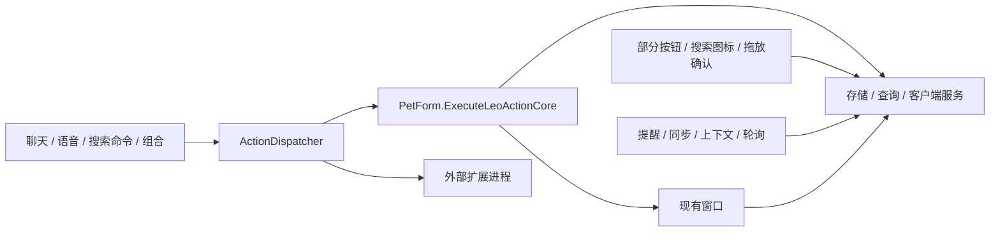

# Q1：现有能力、依赖和迁移边界

状态：2026-10-19 源码盘点；不是新协议发布。审计起点为 `856836c`，不读取 app 中的个人记录。关联：[契约草案](CONTRACT.md)、[测量与结论](BASELINE.md)、[兼容与迁移](MIGRATION.md)。

## 1. 谁负责什么

当前 `ModuleCatalog` 只有 core、terminal、clash、music、football、edge、media 七种内置归属。下面的 search、planner 等是盘点使用的逻辑责任域，**尚未注册为独立模块**，不擅自新增停用开关。

| 责任域 | 入口与关键调用链 | 依赖与后台活动 | 数据归属、退出与停用边界 |
| --- | --- | --- | --- |
| 桌宠宿主 | PetForm → HitSurface / FootTools；托盘、快捷键、显示器变化 | Windows 分层窗口、动画图集；animation 140ms 起，拖动/思考会调整；fullscreenTimer 750ms 含图层恢复；dockTimer、hoverTimer | leo-settings.json、leo-window-layouts.json、skin-library；ReleaseResources 释放绘制缓冲、图集、热键、附属窗。布局/主题是宿主服务，不作为业务模块卸载。 |
| 应用搜索（当前 core） | Leo 点击/快捷键 → LauncherForm；文字/语音/模型 → ActionDispatcher → app_*；普通图标 → Launch | Catalog STA 扫描；上下文 observer 1500ms，搜索 debounce 140ms，图标缓存/路径补全；依赖 Shell、注册表 | leo-history.json、Favorites/Aliases、ApplicationModules。ApplicationIndexing 关闭取消扫描、丢弃旧代结果、停止观察；ContextAware 单独控制上下文。普通图标启动仍是旁路。 |
| 路径、拖放（当前 core） | 搜索路径 → path_open；HitSurface → DropActionForm → 分发器；拖入 EXE/LNK → ApplicationEditor | 本地文件、Shell 关联、已配置应用启动参数；按需运行，无常驻扫描 | 仅用户确认后写应用配置；拖放待办确认后直接 TodoStore.Add 是旁路；打开文件可能执行程序。 |
| 剪贴板（当前 core） | 搜索“剪贴板”/clipboard_open → ClipboardHistoryService.Show；收藏文本动作 | Windows 剪贴板序号、隐私规则；历史轮询450ms；窗口刷新900ms | leo-clipboard.json、隐私字段在设置。关闭 ClipboardHistory 停轮询；关闭窗口停刷新，收藏与历史保留。不能把模块停用解释为清空剪贴板。 |
| 清单/日历/提醒（当前 core） | 独立 TodoForm、聊天 todo_*、拖放、足球加清单 → TodoStore | reminderTimer 15秒；重复生成、撤销、备份、免打扰；ReminderForm、托盘提醒 | leo-todos.json、leo-reminder-settings.json、清单本地备份。当前是核心能力，Q1 不改默认权限。关闭清单窗口不停止提醒。 |
| 临时便签（当前 core） | 快捷键 → QuickNoteForm → NoteStore；NotesForm、note_add/notes_open、转清单 | 按需窗口、事件订阅，无常驻联网；NoteStore 原子保存 | leo-notes.json；转待办后保留原便签关联。窗口释放不得释放共享存储或删除数据。 |
| 通知/专注（当前 core） | OperationFeedback → PresentFeedback → NoticeInbox；提醒、专注完成 | companionTimer 1秒；专注窗口 timer 1秒；普通成功是安静日志，错误/重要提醒才打扰 | leo-notices.json、leo-focus.json。宿主通知服务与通知收纳界面需要分层；关闭窗口不等于删除日志。 |
| 聊天/语音（当前 core） | ChatForm → QuickRouter / NaturalTodo；复杂请求 → ChatApi → AppTools → 分发器；SpeechIO → 同一文字处理 | 用户配置的兼容 API；流式 HTTP；SenseVoice/sherpa-onnx 按需加载、NAudio 采集，本地 TTS；无常驻录音 | leo-ai.json、leo-chat-history.json、leo-api-budget.json、leo-api-usage.json、models/sensevoice。窗口生命周期取消请求/识别；密钥不进入模块描述、日志和样例。模型不是动作执行器。 |
| Clash（clash） | proxy_* → ClientOperations.Proxy → ClashProxy；脚下按钮直接进 ClientOperations | Clash Verge、本地状态检测/客户端启动；FootTools proxyTimer 1200ms；等待就绪与结果核对 | ModuleExecutables.clash；停用取消 Leo 等待及轮询，不退出 Clash、不自动关闭系统代理。外部状态不属于 Leo 数据。 |
| QQ 音乐（music） | music_* → MusicForm → QQMusic / QQNative / QQPlayback；窗口按钮直接调用服务 | 公开搜歌 HTTP、QQ 客户端、系统媒体或原生控制；ClientOperationHub 按资源排队 | leo-music.json（点歌历史，不是歌单）；关闭窗取消搜索；停用停止 Leo 后续任务，不保证音乐停止。发送歌曲只证明已交给客户端。 |
| 足球（football） | football_* → FootballForm / FootballFeed / TeamData；match_add → TodoStore；球队/国家队详情 | ESPN HTTP、队徽资产；matchSyncTimer 600000ms；窗口请求生命周期、缓存回退 | leo-football-cache.json、leo-team-*.json、leo-football-following.json、leo-watch-links.json。停用取消足球请求和同步；已经创建的待办保留，不默认删除提醒。 |
| Edge（edge） | web_search/web_open/watch_open → ProcessStartInfo；脚下搜索直接启动 | Edge 或指定应用路径；无 Leo 常驻浏览器进程 | ModuleExecutables.edge、观赛网址。本机 URL 不进入接口样例；停用不关闭已打开网页。 |
| 管理员终端（terminal） | terminal_open → TerminalStart；脚下按钮直接 Process.Start | Windows Terminal/PowerShell 与 UAC；按需 | ModuleExecutables.terminal；用户取消 UAC 不算软件损坏，不以自动重试再次提权。 |
| 媒体/PotPlayer（media） | media_* → MediaControl；MediaForm 已走分发器 | Windows GSMTC、PotPlayer；按需会话读取、消息发送、文件启动 | ModuleExecutables.media；会话 ID 是本次查询结果，不可跨机器持久化；关闭窗/停用不结束播放器。 |
| 自定义本机应用 | local:<GUID> → LocalApplicationModule → local_app_open → LocalApplications.Start | 用户指定 EXE/LNK、参数、工作目录、提权与图标；按需 | Preferences.ApplicationModules、ShortcutOrder、EntryDisplayModes；停用不删除记录，移除不卸载外部程序；修复路径须确认。 |
| 外部扩展 | ext:<module>:<command> → ExtensionLeoModule；actions 再分派 / stdio → ModuleWorker | LeoModule/1 JSON/ZIP、进程、超时、取消；不在主进程加载第三方 DLL | modules/<id> 程序、module-data/<id> 状态；移除留数据；正在执行/排队不更新；进程边界不是权限沙箱。 |
| 自定义组合 | combo_name / scene_watch、右键组合 → SceneRunner → BuildComboStep → 分发器 | 串行旧步骤、comboBusy、部分失败文本；尚无通用数据引用/补偿 | leo-custom-combos.json；旧 leo-scenes.json 的兼容读取。组合不是拥有全部能力的特殊模块，不绕过启停检查。 |
| 设置、主题、方案、检查、更新 | SettingsForm → ApplySettings；ThemeEditor、UsageProfiles、HealthChecks、UpdateNotifier | 设置提交/热键回滚；主题按需挂接；更新初次30秒、以后每日资格检查；运行检查只读/用户修复 | leo-settings.json、leo-profiles.json、皮肤资产与窗口位置。自动更新失败静默，只发现新版提醒；数据导出与发布导出不是同一功能。 |

数据文件名以当前代码为准；`q1_audit.py` 会生成动作逐项清册和文件引用，完整 60+ 动作不依赖本表人工转录。归属一律使用当前 ModuleCatalog.Owner，而非理想化的责任域。

## 2. 已核实的旁路与重复策略

| 编号 | 证据 | 现在缺什么 | 后续迁移与验证 |
| --- | --- | --- | --- |
| P01 | FootTools.cs：terminal.Click、search.KeyDown、ChangeProxy | 与 terminal_open/web_search/proxy_* 不共享动作级回执/来源 | 先迁移无复杂 UI 的应用动作；按钮只生成请求，底层启动器继续复用。 |
| P02 | Launcher.cs：Launch；ShortcutBar.cs：音乐/足球窗口入口 | 普通图标启动、界面打开未全经过分发器 | 保持历史记录只记一次、焦点行为不变，不能简单嵌套重复启动。 |
| P03 | MusicForm.cs：SearchAsync、QQPlayback.ToggleAsync、QQNative.ToggleLyrics | 窗口与模型共享服务，但未共享动作级取消/状态 | 搜索结果标识生命周期、发送与播放证据分开；避免分发器反调窗口造成递归。 |
| P04 | Football.cs/TeamFootball.cs、MatchSync.cs | 详情、刷新、后台同步各有请求入口 | 公共查询服务返回缓存时间/失败来源；UI 与后台各持订阅，不互相取消。 |
| P05 | TodoView.cs、PlannerEditing.cs、DropActions53.cs：TodoStore 直接修改 | 没有统一请求 ID/来源；直接 UI 修改有自己的撤销 | 统一写入动作后只由同一存储提交、发事件；不再叠加第二套撤销栈。 |
| P06 | ChatForms.cs/QuickActions.cs：本地选择、足球视图、fallback callbacks | 并非所有本地路径都只经注册表；无宿主 fallback 是预览/独立窗兼容 | 先记录路径和来源，再用适配器收拢，不能直接删除 fallback。 |
| P07 | Settings.cs / UsageProfiles.cs / RuntimeFeatures.cs | 启停触发散落，部分活动由窗口生命周期控制 | 用生命周期注册表替代集中补丁；Q1 只记录，不移动实现。 |
| P08 | ActionDispatcher.cs 与 ClientOperations.cs | 前者按 action+value 合并，后者按资源串行；第一调用者取消可能影响共享操作 | 先明确“订阅取消/工作取消”、读写合并与 toggle 不可重放，再迁移；不把当前行为写成目标保证。 |
| P09 | ModuleCatalog.Owner + LeoActions.ReadOnly | 字符串前缀归属；ReadOnly 混合“无写入”和“不会重复操作” | C02 另列 effect、idempotency、concurrency，旧 ReadOnly 不直接成为新权限规则。 |

## 3. 底座与模块的界线

- 宿主必须保留：桌宠交互/图层/吸附、入口承载、配置与数据服务、执行调度、日志、窗口与主题服务、依赖检测、模块管理。宿主服务不应反向依赖足球/音乐 UI。
- 可选业务：外部应用控制、足球、媒体，以及未来经审批拆出的搜索/清单/聊天能力。当前 core 子域先不改启停权限。
- 隐藏入口只影响呈现；停用能力拒绝新动作并取消其拥有的任务/计时器；卸载仅移除可独立交付的程序包；删除个人数据必须是另一项明确操作。
- 关闭窗口释放窗口订阅和请求，不应关闭共享客户端、不应停止独立提醒。任务归属须标明 window/module/host，而不是仅持有一个全局 CancellationToken。
- 本机进程崩溃可能影响宿主；异常捕获不等于原生崩溃隔离。第三方模块保持独立进程，协议不承诺权限隔离。

## 4. 优先级

先统一本机应用启动这一条窄链路：它有真实旁路、输入输出简单、可隔离验证。下一阶段不同时拆清单、聊天和足球，不建立第二套设置。每迁移一个动作，旧入口经兼容映射进入同一执行器，验证后才扩大范围。
