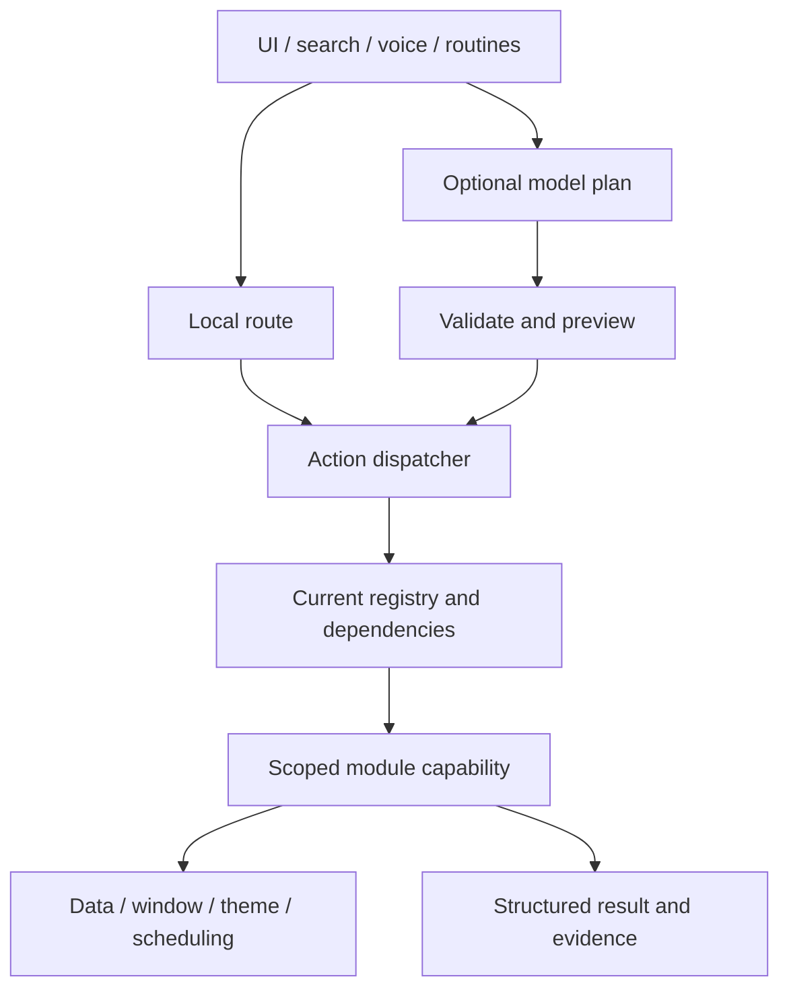

# Architecture and integration reference

[简体中文](README.md) | **English**

This reference consolidates Q1–Q6, M05/M06, R02, C04 and extension-delivery reports. Historical reports remain in Git; duplicate current-status pages are retired.

[Full guide](../PRODUCT_AND_DEVELOPER_GUIDE.en.md) · [Module protocol](../MODULES.en.md) · [Roadmap](../ROADMAP.en.md) · [Verification](../PERFORMANCE.en.md)

## Execution path



Capability identities and inputs must match real actions. Entries collect input; execution rechecks ownership, enablement and configuration generations. ActionResult reports status, error code, evidence and retryability. Accepted is not playback confirmation, cached is not current fact, and cancellation is not rollback of committed effects.

## Service boundaries

| Service | Rule |
| --- | --- |
| Configuration and dependencies | Expose only module-scoped data; passive checks do not launch or repair clients |
| Data | Separate query snapshots, edit drafts and formal commits; publish after persistence |
| Presentation | Fixed ports/results; host manages placement, focus, Esc and dispatch |
| Theme | Read-only snapshots/subscriptions; unsubscribe hidden windows, refresh on reopen, discard stale notifications |
| Scheduling | Reuse IPeriodicTask and ownership; define frequency, switch and disposal |
| Diagnostics | Bounded deduplicated types, counts and error codes; no payload/path/argument logging by default |

Closing the planner still permits reminders; closing clipboard UI does not disable listening. Disabling stops owned work and rejects stale clicks; re-enable must not duplicate subscriptions. Late results after cancellation, configuration changes or exit must pass generation/ownership checks.

## Internal integration sequence

1. Choose stable unique IDs, compatibility rules and scoped injected services.
2. Implement structured execution, strict adaptation and contract metadata aligned with real validation.
3. Register the instance; the host explicitly binds entries to preferences, registry and dispatcher.
4. Provide optional data-only entries; the directory projects buttons/menus/search and identity-checks clicks.
5. Host refreshes the launcher; draft BindReadOnlyView bindings cannot execute.
6. Disable then cancel/refresh; remove the same instance, cancel, dispose host services and refresh.
7. New windows still need fixed host ports/construction; model tools require explicit exposure.

## Reusable source examples

| Example | Purpose |
| --- | --- |
| [MinimalModule.cs](Contracts/MinimalModule.cs) | Minimal contract and structured capability |
| [ScopedNotesExample.cs](C04/ScopedNotesExample.cs) | Scoped data service, registration, entries and disposal |
| [MinimalEntry.cs](Entries/MinimalEntry.cs) | Data-only entry |
| [MinimalApplicationServices.cs](C04/MinimalApplicationServices.cs) | Application service scope |
| [MinimalClientServices.cs](C04/MinimalClientServices.cs) | Client service scope |
| [MinimalPresentation.cs](C04/MinimalPresentation.cs) | Fixed presentation request |
| [WorkerFixture.cs.txt](Extensions/WorkerFixture.cs.txt) | Stdio fixture worker |

Samples are registered explicitly in isolated tests, never added to real user configuration by default. ContractInventory and EntryInventory generate inventories from isolated preferences. Runtime inventories can contain local references and must not be published blindly. Existing historical JSON reports are not a complete current capability inventory.

## Routines and data handoff

Match query→planner and note→task use actual identities, structured results and existing preview rules. Retries avoid duplicate creation and partial commits are reported accurately. Verify data changes, disablement, cancellation and save failure. Temporary model plans have at most four steps, cannot expand reading permissions or trust external text as instructions.

## Delivery and privacy

Application/skin/profile exports project allowlisted fields rather than entire Preferences. Extensions use compatibility/dependency checks, staging, promotion and recovery, retaining state on removal. Review public names, slogans and image contents manually.

Not completed: independent delivery of all built-ins, arbitrary-code sandbox/signature trust, full external protocol negotiation, fully declarative complex UI, general parallel compensation, a global request ledger and long-term real-world qualification. Internal integration is not DLL drop-in installation.

Isolated inventory generation (build first; never target a personal runtime directory):

```powershell
./.build/Release/LeoLauncher.exe --contract-inventory <absolute-output-directory>
./.build/Release/LeoLauncher.exe --entry-inventory <absolute-output-directory>
```

These export inventory.json and GENERATED.md for isolated examples; generated runtime strings are not guaranteed bilingual. Do not publish inventories generated from real private settings.
