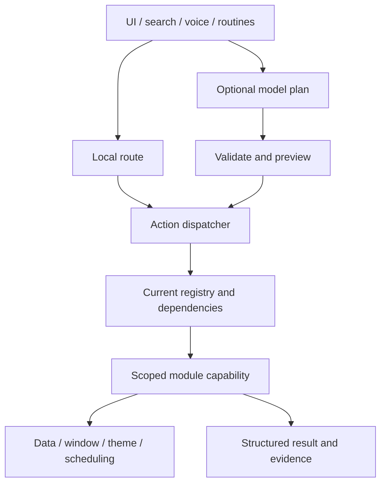

# 架构与接入参考 / Architecture and integration reference

本页归并Q1–Q6、M05/M06、R02、C04及扩展交付批次说明。旧报告可从Git历史查阅；不再维护多份重复的当前状态。
This reference consolidates Q1–Q6, M05/M06, R02, C04 and extension-delivery reports. Historical reports remain in Git; duplicate current-status pages are retired.

[完整指南 / Full guide](../PRODUCT_AND_DEVELOPER_GUIDE.md) · [模块协议 / Module protocol](../MODULES.md) · [路线图 / Roadmap](../ROADMAP.md) · [验证 / Verification](../PERFORMANCE.md)

## 执行链 / Execution path



能力身份、输入与实际动作必须一致；入口只收集输入，执行前重新核对归属、启停和配置代次。ActionResult明确状态、错误码、完成证据及可重试性。accepted不是播放成功，cached不是实时事实，取消不是撤销已提交操作。
Capability identities and inputs must match real actions. Entries collect input; execution rechecks ownership, enablement and configuration generations. ActionResult reports status, error code, evidence and retryability. Accepted is not playback confirmation, cached is not current fact, and cancellation is not rollback of committed effects.

## 服务边界 / Service boundaries

| 服务 / Service | 规则 / Rule |
| --- | --- |
| 配置与依赖 / Configuration and dependencies | 只提供本模块所需快照，被动检查不启动/修复程序 / Expose only module-scoped data; passive checks do not launch or repair clients |
| 数据 / Data | 查询快照、编辑草稿、正式提交分开；提交成功再发布 / Separate query snapshots, edit drafts and formal commits; publish after persistence |
| 窗口与反馈 / Presentation | 固定窗口端口和结构化结果；宿主处理位置、焦点、Esc和投递 / Fixed ports/results; host manages placement, focus, Esc and dispatch |
| 主题 / Theme | 只读快照和订阅；隐藏退订、重开刷新、关闭丢弃过期通知 / Read-only snapshots/subscriptions; unsubscribe hidden windows, refresh on reopen, discard stale notifications |
| 调度 / Scheduling | 复用IPeriodicTask与活动归属；明确所有者、频率、开关和释放 / Reuse IPeriodicTask and ownership; define frequency, switch and disposal |
| 诊断 / Diagnostics | 有界去重的类型、数量和错误码；不默认记录路径/参数/正文 / Bounded deduplicated types, counts and error codes; no payload/path/argument logging by default |

关闭清单窗口仍需提醒；关闭剪贴板窗口不等于停用监听。停用模块必须停止归属任务、拒绝旧点击；重新启用不得重复挂接。配置变化、取消和退出后迟到结果必须通过代次/所有权检查。
Closing the planner still permits reminders; closing clipboard UI does not disable listening. Disabling stops owned work and rejects stale clicks; re-enable must not duplicate subscriptions. Late results after cancellation, configuration changes or exit must pass generation/ownership checks.

## 内部模块接入顺序 / Internal integration sequence

1. 选唯一稳定ID和旧格式兼容规则，限定服务注入。Choose stable unique IDs, compatibility rules and scoped injected services.
2. 实现IStructuredLeoModule、IActionRequestAdapter、IModuleContractSource；描述与真实校验一致。Implement structured execution, strict adaptation and contract metadata aligned with real validation.
3. Registry.Register注册；宿主显式EntryContributions.Bind配置、注册表与分发器。Register the instance; the host explicitly binds entries to preferences, registry and dispatcher.
4. 可选IModuleEntryContributor提供纯数据；目录统一投影按钮/菜单/搜索，点击经身份网关。Provide optional data-only entries; the directory projects buttons/menus/search and identity-checks clicks.
5. 宿主刷新launcher；草稿BindReadOnlyView不能执行。Host refreshes the launcher; draft BindReadOnlyView bindings cannot execute.
6. 停用后CancelDisabled并刷新；移除同实例Unregister，取消、释放宿主服务并刷新。Disable then cancel/refresh; remove the same instance, cancel, dispose host services and refresh.
7. 新窗口仍需宿主固定端口与构造；模型工具需显式授权，不因入口可见自动开放。New windows still need fixed host ports/construction; model tools require explicit exposure.

## 可复用样例 / Reusable source examples

| 样例 / Example | 用途 / Purpose |
| --- | --- |
| [MinimalModule.cs](Contracts/MinimalModule.cs) | 最小契约与结构化能力 / Minimal contract and structured capability |
| [ScopedNotesExample.cs](C04/ScopedNotesExample.cs) | 限定数据服务、注册、入口及释放 / Scoped data service, registration, entries and disposal |
| [MinimalEntry.cs](Entries/MinimalEntry.cs) | 纯数据入口 / Data-only entry |
| [MinimalApplicationServices.cs](C04/MinimalApplicationServices.cs) | 应用服务边界 / Application service scope |
| [MinimalClientServices.cs](C04/MinimalClientServices.cs) | 客户端服务边界 / Client service scope |
| [MinimalPresentation.cs](C04/MinimalPresentation.cs) | 固定窗口请求 / Fixed presentation request |
| [WorkerFixture.cs.txt](Extensions/WorkerFixture.cs.txt) | stdio测试进程 / Stdio fixture worker |

样例只供隔离测试显式注册，不默认添加到用户界面。契约与入口清册可由ContractInventory和EntryInventory按隔离配置生成；运行时清册可能含本机引用，不能直接公开。仓库旧JSON报告是历史证据，不是当前完整能力目录。
Samples are registered explicitly in isolated tests, never added to real user configuration by default. ContractInventory and EntryInventory generate inventories from isolated preferences. Runtime inventories can contain local references and must not be published blindly. Existing historical JSON reports are not a complete current capability inventory.

## 组合与数据衔接 / Routines and data handoff

比赛查询→加入清单、便签→待办沿真实编号、结构化结果和原预览规则；重试不重复新增，部分提交如实反馈。数据变化、停用、取消和保存失败均需验证。模型最多四步临时计划，不能扩大旧读取权限，不能把外部文字当作指令。
Match query→planner and note→task use actual identities, structured results and existing preview rules. Retries avoid duplicate creation and partial commits are reported accurately. Verify data changes, disablement, cancellation and save failure. Temporary model plans have at most four steps, cannot expand reading permissions or trust external text as instructions.

## 交付与隐私 / Delivery and privacy

应用包、皮肤包和方案只投影白名单字段，不序列化整份Preferences；详见模块协议和皮肤规范。扩展更新经过兼容/依赖检查、暂存、提升和失败恢复，移除保留状态数据。共享名称、标语、图像内容仍需人工检查。
Application/skin/profile exports project allowlisted fields rather than entire Preferences. Extensions use compatibility/dependency checks, staging, promotion and recovery, retaining state on removal. Review public names, slogans and image contents manually.

仍未完成：全部内置模块独立交付、任意代码沙箱/签名信任、完整外部协议协商、所有复杂窗口声明化、通用并行/补偿、全局请求账本及长期真实负载验收。普通内部模块可接入不等于随便放DLL即可安装。
Not completed: independent delivery of all built-ins, arbitrary-code sandbox/signature trust, full external protocol negotiation, fully declarative complex UI, general parallel compensation, a global request ledger and long-term real-world qualification. Internal integration is not DLL drop-in installation.


隔离清册生成入口（先完成构建；输出目录不要使用个人运行目录）：
Isolated inventory generation (build first; never target a personal runtime directory):

```powershell
./.build/Release/LeoLauncher.exe --contract-inventory <absolute-output-directory>
./.build/Release/LeoLauncher.exe --entry-inventory <absolute-output-directory>
```

这两个入口导出隔离示例的inventory.json与GENERATED.md，不表示所有运行时字符串自动具备中英对照。不要将真实配置生成的清册直接上传。
These export inventory.json and GENERATED.md for isolated examples; generated runtime strings are not guaranteed bilingual. Do not publish inventories generated from real private settings.
