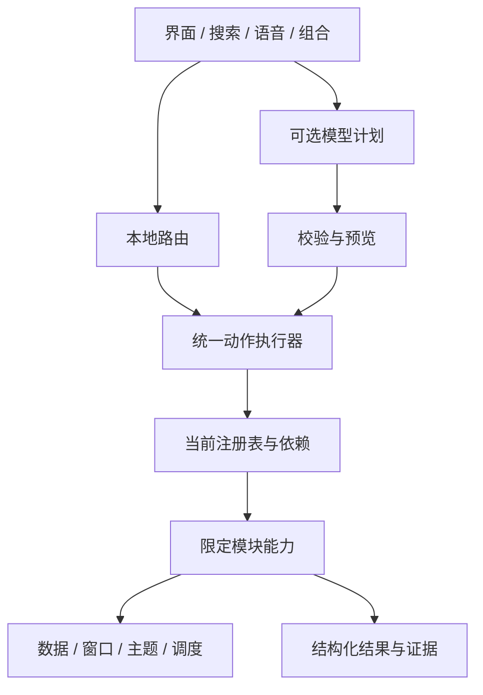

# 架构与接入参考

**简体中文** | [English](README.en.md)

本页归并Q1–Q6、M05/M06、R02、C04及扩展交付批次说明。旧报告可从Git历史查阅；不再维护多份重复的当前状态。

[完整指南](../PRODUCT_AND_DEVELOPER_GUIDE.md) · [模块协议](../MODULES.md) · [路线图](../ROADMAP.md) · [验证](../PERFORMANCE.md)

## 执行链



能力身份、输入与实际动作必须一致；入口只收集输入，执行前重新核对归属、启停和配置代次。ActionResult明确状态、错误码、完成证据及可重试性。accepted不是播放成功，cached不是实时事实，取消不是撤销已提交操作。

## 服务边界

| 服务 | 规则 |
| --- | --- |
| 配置与依赖 | 只提供本模块所需快照，被动检查不启动/修复程序 |
| 数据 | 查询快照、编辑草稿、正式提交分开；提交成功再发布 |
| 窗口与反馈 | 固定窗口端口和结构化结果；宿主处理位置、焦点、Esc和投递 |
| 主题 | 只读快照和订阅；隐藏退订、重开刷新、关闭丢弃过期通知 |
| 调度 | 复用IPeriodicTask与活动归属；明确所有者、频率、开关和释放 |
| 诊断 | 有界去重的类型、数量和错误码；不默认记录路径/参数/正文 |

关闭清单窗口仍需提醒；关闭剪贴板窗口不等于停用监听。停用模块必须停止归属任务、拒绝旧点击；重新启用不得重复挂接。配置变化、取消和退出后迟到结果必须通过代次/所有权检查。

## 内部模块接入顺序

1. 选唯一稳定ID和旧格式兼容规则，限定服务注入。
2. 实现IStructuredLeoModule、IActionRequestAdapter、IModuleContractSource；描述与真实校验一致。
3. Registry.Register注册；宿主显式EntryContributions.Bind配置、注册表与分发器。
4. 可选IModuleEntryContributor提供纯数据；目录统一投影按钮/菜单/搜索，点击经身份网关。
5. 宿主刷新launcher；草稿BindReadOnlyView不能执行。
6. 停用后CancelDisabled并刷新；移除同实例Unregister，取消、释放宿主服务并刷新。
7. 新窗口仍需宿主固定端口与构造；模型工具需显式授权，不因入口可见自动开放。

## 可复用样例

| 样例 | 用途 |
| --- | --- |
| [MinimalModule.cs](Contracts/MinimalModule.cs) | 最小契约与结构化能力 |
| [ScopedNotesExample.cs](C04/ScopedNotesExample.cs) | 限定数据服务、注册、入口及释放 |
| [MinimalEntry.cs](Entries/MinimalEntry.cs) | 纯数据入口 |
| [MinimalApplicationServices.cs](C04/MinimalApplicationServices.cs) | 应用服务边界 |
| [MinimalClientServices.cs](C04/MinimalClientServices.cs) | 客户端服务边界 |
| [MinimalPresentation.cs](C04/MinimalPresentation.cs) | 固定窗口请求 |
| [WorkerFixture.cs.txt](Extensions/WorkerFixture.cs.txt) | stdio测试进程 |

样例只供隔离测试显式注册，不默认添加到用户界面。契约与入口清册可由ContractInventory和EntryInventory按隔离配置生成；运行时清册可能含本机引用，不能直接公开。仓库旧JSON报告是历史证据，不是当前完整能力目录。

## 组合与数据衔接

比赛查询→加入清单、便签→待办沿真实编号、结构化结果和原预览规则；重试不重复新增，部分提交如实反馈。数据变化、停用、取消和保存失败均需验证。模型最多四步临时计划，不能扩大旧读取权限，不能把外部文字当作指令。

## 交付与隐私

应用包、皮肤包和方案只投影白名单字段，不序列化整份Preferences；详见模块协议和皮肤规范。扩展更新经过兼容/依赖检查、暂存、提升和失败恢复，移除保留状态数据。共享名称、标语、图像内容仍需人工检查。

仍未完成：全部内置模块独立交付、任意代码沙箱/签名信任、完整外部协议协商、所有复杂窗口声明化、通用并行/补偿、全局请求账本及长期真实负载验收。普通内部模块可接入不等于随便放DLL即可安装。

隔离清册生成入口（先完成构建；输出目录不要使用个人运行目录）：

```powershell
./.build/Release/LeoLauncher.exe --contract-inventory <absolute-output-directory>
./.build/Release/LeoLauncher.exe --entry-inventory <absolute-output-directory>
```

这两个入口导出隔离示例的inventory.json与GENERATED.md，不表示所有运行时字符串自动具备中英对照。不要将真实配置生成的清册直接上传。
