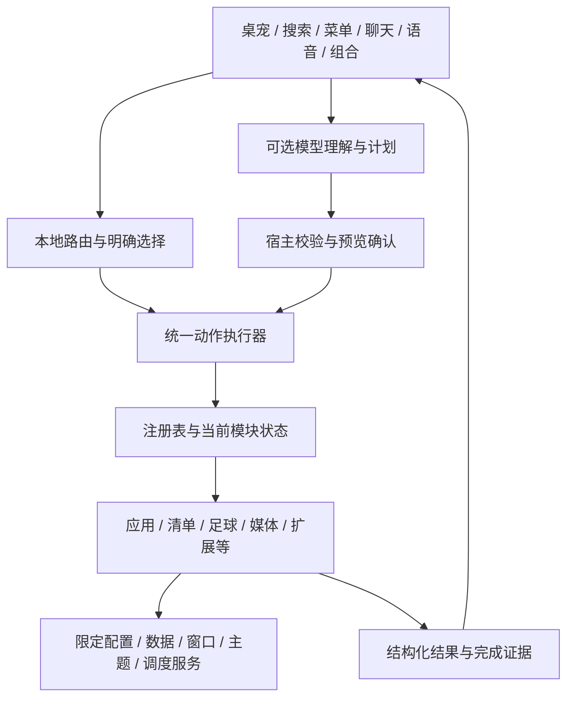

# Leo 产品与扩展开发说明

本文面向想使用、理解或自行扩展 Leo 的读者。实现依据为主分支42fea41及其之前的阶段交付；本次以v1.05.0发布Windows安装包，接口实现基于下述提交及后续打包修订。仓库main、工程版本与Release标签可能不同，请用对应提交的文档与源码开发。

[首页](../README.md) · [日常操作说明](USER_GUIDE.md) · [模块包与stdio协议](MODULES.md) · [路线图](ROADMAP.md) · [阶段验收与限制](Architecture/README.md)

## 目录

1. [产品定位与运行条件](#1-产品定位与运行条件)
2. [现有功能和依赖](#2-现有功能和依赖)
3. [底座结构与实现方法](#3-底座结构与实现方法)
4. [请求、结果与接口](#4-请求结果与接口)
5. [选择扩展方式](#5-选择扩展方式)
6. [配置一个本机应用](#6-配置一个本机应用)
7. [编写声明式动作扩展](#7-编写声明式动作扩展)
8. [编写独立进程扩展](#8-编写独立进程扩展)
9. [开发可信内部模块](#9-开发可信内部模块)
10. [接入组合与大脑](#10-接入组合与大脑)
11. [数据、分享与恢复](#11-数据分享与恢复)
12. [构建、检查与贡献](#12-构建检查与贡献)
13. [验收要求与排查](#13-验收要求与排查)
14. [当前限制与阅读索引](#14-当前限制与阅读索引)

## 1. 产品定位与运行条件

Leo是Windows桌面伙伴、应用启动器和本地动作入口。桌宠承载交互，模块提供能力，统一执行底座负责校验、取消和完成证据；可选模型负责模糊理解与有界计划。目标是按需组合已有桌面能力，而不是用模型取代所有本地操作。

- 目标平台：Windows x64。图形界面基于.NET 9 Windows桌面技术，主体为WinForms；部分媒体等能力使用Windows接口。当前没有macOS/Linux移植承诺。
- 普通使用：从已有Release下载并完整解压，按其中安装说明操作；该包的功能以其标签为准。无需API也能使用本地功能。
- 源码开发：Windows、Git、PowerShell及符合[global.json](../global.json)的.NET 9 SDK。主工程目标net9.0-windows；框架依赖构建需匹配的Windows桌面运行时。
- 外部软件、联网数据、模型服务及语音模型按需配置。停用对应模块不等于卸载或关闭第三方软件。

主分支还提供可选电脑状态监测、现有邮件客户端入口、18种快捷图标和中英文界面。火绒仅提供快速打开，不读取安全状态；邮件不接收账号、密码或邮件正文。

主分支已有内部模块化及现有扩展恢复试点，尚不是任意代码可热插拔的完整插件平台。内部C#接口未发布为稳定外部SDK；独立安装应遵循下述已有包协议。

## 2. 现有功能和依赖

| 能力 | 已有内容 | 必要条件及边界 |
| --- | --- | --- |
| 桌宠与主题 | 自定义名字/大小、多屏边缘吸附、全屏自动隐藏；巴萨默认及阿根廷、西班牙、迈阿密、曼城；独立皮肤及配色/圆角/透明度 | 动画及主题由宿主管理；不是所有窗口都可自由缩放，沿用各自窗口规则 |
| 应用与文件 | 应用名/拼音/简称搜索、最近使用、收藏排序、键盘操作、路径补全、文件关联打开、自定义EXE/LNK与启动参数 | 本地索引及上下文排序可开关；添加EXE只得到启动能力，不自动得到软件专用控制 |
| 清单 | 每日/每周/逾期、日历、自然输入、重复/例外、改期/顺延/撤销、提醒/稍后提醒/免打扰、备份恢复 | 常见自然输入本地解析；提醒需要Leo运行，不保证关机期间唤醒 |
| 便签与拖放 | 一句话速记、搜索/置顶、转待办；拖入文件/文字/图片/网址显示适用动作 | 转换使用真实编号和既有确认；拖放不是自动执行任意内容 |
| 剪贴板 | 历史、收藏、敏感内容保护、过期规则 | 监听可停用；正文不默认送模型，保护规则不等于能识别所有秘密 |
| 足球 | 俱乐部与国家队关注、近期/未来比赛、球队近期赛程与积分榜、缓存、比赛加入清单和提醒、观赛网址 | 联网查询由专用数据模块完成，不消耗模型Key；受数据源、限流及赛程变更影响，缓存不等于实时事实 |
| 音乐与媒体 | QQ音乐快速点单首歌及控制、歌词入口；PotPlayer/Windows媒体会话控制 | 依赖对应客户端、歌曲权限、媒体会话/快捷键状态；不是QQ歌单同步器或播放器替代品 |
| 应用适配 | Clash系统代理、管理员终端、Edge网址/搜索及用户自定义应用 | 按需启用并指定路径；专用适配有启动等待和状态核验，不能把提交请求当成效果已完成 |
| 聊天与语音 | 流式文字、本地指令、受控工具计划、取消；SenseVoice本地识别 | 自由聊天/复杂理解使用自配模型服务；本地识别需单独模型及麦克风，识别本身不需要模型API |
| 协调与管理 | 自定义组合、使用方案、模块状态与运行检查、安静日志/必要提醒、专注、更新检查 | 明确指令与固定组合优先本地；被动依赖通过不证明外部程序正在正常运行 |

通常无需模型API：启动应用、路径、便签/清单的明确操作、代理/媒体控制、固定组合；足球/歌曲查询需要其自己的网络来源。需要模型API：自由回复、模糊意图理解及临时计划。语音文本经同样的本地/事实/模型路由，不是所有话语都交给模型。

## 3. 底座结构与实现方法



| 部分 | 主要源码 | 实现职责 |
| --- | --- | --- |
| 宿主组装与界面 | [Program.cs](Program.cs)、[Settings.cs](Settings.cs) | 创建模块与所需服务、绑定入口、应用配置及退出释放；不是所有组装点都已自动化 |
| 能力注册 | [CapabilityRegistry.cs](CapabilityRegistry.cs) | 按动作查找当前能力，校验注册/归属，保留旧接口适配 |
| 动作执行 | [ActionExecution.cs](ActionExecution.cs)、[ActionContracts.cs](ActionContracts.cs) | 来源/期限/参数检查、取消、现有合并/串行策略、回执与错误；不承诺通用并行和补偿 |
| 契约 | [ModuleContracts.cs](ModuleContracts.cs)、[补充描述](ModuleContracts.Additional.cs) | 参数适配、依赖、运行类型、结果及策略的一致性校验；说明不是完整JSON Schema |
| 界面贡献 | [EntryContributions.cs](EntryContributions.cs)、[ModuleEntryContributions.cs](ModuleEntryContributions.cs)、[渲染器](ModuleEntryRendering.cs) | 纯数据描述搜索/菜单/快捷按钮，点击重新核验身份；显示隐藏与能力停用分开 |
| 配置和数据 | [ApplicationHostServices.cs](ApplicationHostServices.cs)、[ModuleHostServices.cs](ModuleHostServices.cs)、[AtomicJson.cs](AtomicJson.cs) | 限定读取、先保存后发布及已有业务Store；没有重写成一个全局数据库 |
| 窗口和主题 | [ModulePresentation.cs](ModulePresentation.cs)、[ModuleThemeService.cs](ModuleThemeService.cs) | 固定窗口端口、结构化反馈、UI投递/代次及只读主题订阅；复杂窗口仍需宿主接入 |
| 生命周期 | [ModuleActivities.cs](ModuleActivities.cs)、[IPeriodicTask.cs](IPeriodicTask.cs) | 已接入后台活动的所有者、启停/取消/计数；非周期索引、动画及输入计时器有各自归属 |
| 组合与大脑 | [Q4说明](Architecture/README.md)、[Q5说明](Architecture/README.md) | 已有顺序执行、恢复核验、有界计划与显式能力授权 |
| 包与状态 | [应用包](ApplicationPackages.cs)、[扩展适配](ExtensionCapability.cs)、[扩展安装](ActionDispatcher.cs)、[状态投影](ModuleStatus.Contracts.cs) | 既有目录及数据格式、兼容检查、异常回退和被动状态 |

实现采用兼容适配与逐批迁移：一个明确动作只保留一套执行策略，各入口收集输入并展示结果，不自行复制启动/保存/重试逻辑。主要执行迁移和内部试点已完成，但部分业务仍持有专用Store或配置，复杂窗口与设置未全部声明化。

## 4. 请求、结果与接口

这里区分三个版本空间，不能混用：

| 名称 | 用途 | 是否可当成外部插件协议 |
| --- | --- | --- |
| LeoModule/1 | 已有声明式JSON与独立进程包/stdio请求 | 可以，按MODULES.md的格式使用 |
| leo-action/1 | 宿主内结构化动作请求 | 不是公开HTTP服务，也不是worker可任意调用的宿主RPC |
| leo-host-contract/1 | 宿主内部模块、参数/结果与依赖描述 | 内部校验格式；不等于稳定发布SDK或完整跨进程服务协议 |

### 4.1 内部动作请求

ActionRequest保留旧字符串Value；StructuredActionRequest以Parameters对象表示参数，包含Protocol、ActionId、Source、可选RequestId/TraceId/Deadline。具体适配器拒绝多余字段或非法目标；不能假设任意动作都接受同样的value包装。

应用启动的结构化形状示例（编号替换成用户已配置的真实应用ID）：

```json
{
  "Protocol": "leo-action/1",
  "ActionId": "local:0123456789abcdef0123456789abcdef",
  "Parameters": { "applicationId": "0123456789abcdef0123456789abcdef" },
  "Source": "ui"
}
```

这是对象形状说明，不是可以POST的URL。通过ActionDispatcher.ExecuteStructuredAsync提交；不允许调用方附加路径、参数或管理员覆盖。local_app_open旧Value仍映射为同一local:<ID>执行路径。

### 4.2 结果与完成证据

ActionResult包含RequestId、TraceId、Source、ActionId、ModuleId、ExecutionId、Status、Message、ErrorCode、Data、Evidence及Retryable。现有通用结果以succeeded/failed/cancelled为主，流程内部还记录步骤及未知状态；不能把路线图中的全部理想状态当成已经实现。

| Evidence示例 | 可以推断 | 不能推断 |
| --- | --- | --- |
| snapshot / cached | 返回了查询/缓存快照 | 一定是最新联网数据 |
| accepted | 系统或客户端接收请求 | 窗口已就绪、已播放或实际外部效果完成 |
| committed | 对应本地写入已提交 | 多个Store形成一个原子事务 |
| window-shown / state-observed | 相应窗口显示/实际状态已核验 | 其他未核验效果也已完成 |
| completed | 本次协议或工作完成 | 任意第三方外部效果可信成立 |
| unknown | 效果没有确证 | 可以显示成功或自动重放 |

ActionPayload可标记PrivateData与简短DiagnosticMessage；业务Data不能默认写入长期诊断。取消可能发生在提交之后，已提交的写入应如实反馈；重试不能从头盲目重放外部副作用。相同在途请求的合并不是永久请求去重，也不是每个“下一首”都能合并。

### 4.3 内部模块可实现的接口

| 接口 | 用途与要求 |
| --- | --- |
| ILeoModule | Id/Name/Version/Enabled/Actions与旧ExecuteAsync；基础能力身份 |
| IStructuredLeoModule | Describe策略、ConfigurationIsCurrent、最大输入、结构化执行及FailureCode |
| IActionRequestAdapter | 将该模块允许的结构化参数严格转换为原ActionRequest |
| IModuleContractSource | DescribeModule与被动ReadDependencies；与实际动作/策略一致，状态使用ready/missing/unknown/degraded |
| IModuleEntryContributor | DescribeEntries返回纯数据，提供搜索/菜单/按钮；不返回任意控件或执行委托 |
| IBrainContributor | 显式选择可向模型暴露的动作与校验；实现基础模块不会自动获得模型权限 |
| IDisposable / 取消令牌 | 宿主明确资源所有者；模块关闭、停用和移除按原生命周期处理 |

相关真实样例：[最小契约模块](Architecture/Contracts/MinimalModule.cs)、[限定服务与联合模块](Architecture/C04/ScopedNotesExample.cs)。它们不随正常启动自动注册。

## 5. 选择扩展方式

| 想做什么 | 推荐方式 | 是否修改宿主源码 |
| --- | --- | --- |
| 添加一个程序及参数/图标 | 本机应用配置；分享时可导出数据型应用包 | 不需要 |
| 给已有动作起名或增加口令 | LeoModule/1声明式模块 | 不需要 |
| 执行自己的独立程序逻辑 | LeoModule/1 stdio ZIP | 不需要，但只能按现有请求/响应协议工作 |
| 新增与宿主服务、窗口、结构化数据深度协作的能力 | 可信内部模块及限定服务 | 需要，显式组装/注册并重新编译 |
| 换服装或界面配色 | 主题编辑器与.leoskin | 不需要写代码 |
| 保存模块开关/入口习惯 | 使用方案 | 不会携带程序本身，也不是功能实现 |

当前不能把任意C# DLL放进目录就自动加载，不能把worker回复当成宿主工具指令，也不能通过声明式模块绕过停用/参数/确认限制。内置功能随宿主发布，不等于已经能独立物理卸载。

## 6. 配置一个本机应用

1. 设置 → 功能 → 应用模块与图标，添加EXE/LNK，或拖入程序后确认。
2. 配置名称、图标、参数、工作目录及是否管理员启动；路径是本机配置，不写进公开应用包。
3. 在入口显示中选快捷栏、仅菜单或仅搜索；调整排序不会改变模块是否启用。
4. 用模块状态检查路径/工作目录，再主动启动验证。路径检查通过不代表程序已运行。
5. 若要分享，使用“导出所选模块包”核对公开名称；接收者导入后需填写自己的程序路径。不要打包整个运行目录。

数据型应用包是LeoApplicationPackage、协议1，固定八个字段；不支持夹带程序、脚本、启动参数或管理员授权。更新须保持应用及包身份，升级版本并经本机配置确认。详见[应用包实现](ApplicationPackages.cs)和[Q6说明](Architecture/README.md)。

## 7. 编写声明式动作扩展

新建UTF-8 JSON文件，例如daily-plan.json：

```json
{
  "Format": "LeoModule/1",
  "Id": "daily-plan",
  "Name": "计划入口",
  "Version": "1.0.0",
  "Runtime": "actions",
  "HostMin": "1.4.0",
  "Dependencies": ["windows", "leo-module/1"],
  "Commands": [
    { "Id": "today", "Title": "查看今日计划", "Phrases": ["查看今日计划"], "Action": "todos_open", "Value": "" }
  ]
}
```

在设置 → 功能 → 管理扩展模块导入。示例只打开现有清单，不会新建待办。搜索标题/口令可调用；缺省仅搜索，可在原入口设置中显示到菜单或快捷栏。动作身份为ext:daily-plan:today，贡献身份为ext:daily-plan/today，两者不能互换。

- 模块Id为2～40位、命令Id为1～40位小写字母/数字/连字符，首位为字母；每包1～16条命令。名称、口令、Value等上限见[完整协议](MODULES.md)。
- Action必须来自实际公开动作清单[LeoActions.cs](LeoActions.cs)。部分动作包含宿主私有句柄或额外确认，不因名字存在就能在扩展中构造可执行请求；不允许递归组合/文本再分派/再次运行扩展。
- Value是固定字符串；复杂目标继续使用其原JSON字符串规则。结构化扩展入口只接受空对象或允许的value字段，声明式固定值不能被非空覆盖。
- HostMin/HostMax是可选数值版本闭区间；省略不设额外范围。不是SemVer表达式或协议协商。
- 当前依赖可被动声明windows、leo-module/1、leo-host-contract/1、stdio/v1及module:<其他扩展ID>；未知、缺失、循环、停用或不兼容依赖不自动下载。module:不是通用应用路径/版本求解语法。
- 固定local_app_open会检查实际应用的启用及文件/工作目录状态；通用启动接口存在不等于固定目标可用。

不要凭文档猜业务参数：用对应Capability适配器及隔离夹具核对。保持已发布ID，更新增加Version；旧版本不能直接覆盖新版。

## 8. 编写独立进程扩展

ZIP根目录至少包含module.json和可运行的worker.exe；依赖文件按支持的相对目录加入。声明示例：

```json
{
  "Format": "LeoModule/1",
  "Id": "hello-worker",
  "Name": "独立能力示例",
  "Version": "1.0.0",
  "Runtime": "stdio",
  "Executable": "worker.exe",
  "TimeoutSeconds": 15,
  "Commands": [ { "Id": "ping", "Title": "测试独立能力", "Phrases": ["测试独立能力"], "Action": "worker:ping", "Value": "" } ]
}
```

宿主仅在用户触发时启动程序，附带--leo-module；向stdin写一行UTF-8 JSON后关闭输入。读取字段protocol、requestId、command、value、dataDirectory、origin、theme。command为ping，而不是worker:ping。

最小响应：

```json
{"ok":true,"message":"独立能力已响应"}
```

自行实现时：读取一行→校验protocol/command及value→执行有界任务→stdout输出一行响应→正常退出。失败输出ok:false及简明原因。日志写stderr，不能在stdout输出启动横幅、进度或多行调试内容。可参考[仓库worker夹具](Architecture/Extensions/WorkerFixture.cs.txt)；它用于测试，不是生产业务模板。

- 每次调用是一次进程协议，不是常驻插件会话；默认15秒，允许1～120秒，输出行最多64KB、message最多4000字符。
- 超时/取消由宿主回收其拥有的辅助进程。自己启动的副作用、网络写入和其他应用不自动撤销，须设计安全的重试和提交判断。
- 私有状态只存请求给出的dataDirectory；不要把Key或个人状态写进包目录。该目录是数据约定，不是系统权限沙箱。
- ZIP最多64MB、展开256MB/2000文件；只允许exe/dll/json/png/txt/md/dat/bin。不要夹带pdb、脚本、绝对路径、重复项或链接，主exe必须在根目录。
- 发布前在干净Windows环境验证worker可启动。框架依赖程序需接收者已有对应运行时，Leo不会自动下载安装；自包含程序也须满足包限制。
- 程序权限等同当前用户。Leo不会把响应message作为代码、宿主命令或模型可信指令执行。新增宿主工具或复杂窗口需要内部受控接入，stdio回复不能自行突破协议。

导入前查看来源与动作。更新/卸载沿原管理窗口，模块运行中禁止包替换/移除；异常回退及双重故障限制见[兼容与恢复](Architecture/README.md)。

## 9. 开发可信内部模块

这条路径适合修改源码并维护自己的Leo构建。不要将internal接口的可用性描述为已发布的外部SDK。

1. **定义边界**：稳定模块/动作ID、输入输出、读写/外部效果、依赖、超时、请求合并/串行规则和数据负责人。无窗口能力无需新增窗口。
2. **限定服务**：由宿主组装所需配置、数据、窗口和调度，注入模块。只提供模块需要的数据；不要传整份Preferences、任意Form或全能服务定位器。
3. **实现契约**：参照最小样例实现IStructuredLeoModule、IModuleContractSource及必要的参数适配；依赖查询保持被动，未知如实返回，不在Describe/ReadDependencies里启动程序或联网。
4. **校验注册**：宿主Registry.Register注册可信实例；可选贡献模块不得替换宿主动作。复用已有动作时，调用原受控路径，不复制另一套启动/保存算法。
5. **贡献入口**：如需要，实现IModuleEntryContributor。Id遵循模块命名空间，ModuleId/ActionId归属一致，Parameters为合法对象JSON；模式为shortcut/menu/search，Host按用户显示配置渲染。不要把控件、委托或任意可执行对象放描述中。
6. **绑定与刷新**：宿主使用EntryContributions.Bind绑定偏好/目录/执行器；注册或状态变更后显式刷新launcher.RefreshModules。配置草稿使用只读绑定，不获得执行器。
7. **生命周期**：后台活动/主题订阅/窗口请求必须有所有者、取消、代次检查及释放。隐藏窗口与停用模块不同；关闭清单窗口不停止宿主提醒。停用先更新配置、CancelDisabled并停止归属活动，再刷新；移除注册后由宿主释放服务，保留用户数据。
8. **验证**：先使用内存Store、假启动器、假流与可控等待；覆盖正常/失败/取消/迟到结果/重复触发/停用/移除和旧编号兼容，再考虑真实客户端测试。

例如在宿主已有commands（ActionDispatcher）的组装处，最小无UI样例可这样注册并调用；这段代码需编译进Leo，不是导入JSON或加载DLL：

```csharp
var module = new MinimalContractModule();
commands.Registry.Register(module);
using var parameters = System.Text.Json.JsonDocument.Parse("{}");
var result = await commands.ExecuteStructuredAsync(
    new StructuredActionRequest("leo-action/1", "example_status",
        parameters.RootElement.Clone(), "ui"), cancellationToken);
```

样例本身没有入口贡献或模型贡献；需要三类入口时使用ScopedNotesExample中已有实现并完成宿主绑定/刷新。测试样例不要未经确认注册到正常启动。

[完整内部接入顺序](Architecture/README.md)列出必须由宿主完成的组装点。新复杂窗口仍须增加固定端口及创建逻辑；不能宣称新增任意业务只需放一个文件。现有窗口服务负责位置/焦点/退出规则，主题服务提供快照与订阅，不能由模块另开全局计时器反复遍历所有控件。

## 10. 接入组合与大脑

**组合：**优先将已验证的动作按既有顺序执行器组合，传结构化真实编号/结果引用，保留原超时、取消、完成步骤和未知状态核验。不默认引入大型工作流引擎，不做未声明的自动补偿。完整并行、复杂条件、任意脚本和流程包分享未交付。

**大脑：**只有实现显式贡献并经宿主筛选的能力才进入BrainCatalog；扩展安装/入口出现不代表模型可以调用。当前最多4步临时计划，受参数、目标、配置指纹、预算与预览确认限制。

- 能本地解析的指令不调用模型；实时事实交给已有数据模块，模型不编造比赛、歌曲或事项编号。
- 停用、依赖不可用或配置改变必须影响可调用范围，执行前再次校验。
- 读便签/清单需要明确请求；剪贴板正文、私有会话句柄不默认给模型。新接口不能借“统一”扩大原权限。
- 外部文本与worker输出是数据，不能自行变成执行指令；公开工具不能接受任意路径/管理员覆盖。
- 已确认计划与保存组合复用执行底座，反馈按实际证据；部分提交不写成整体成功，取消不写成撤销全部效果。

真实权限和缓存确认边界见[两条链路验收](Architecture/README.md)。模型“读取便签后新建待办”不等于拥有原便签的关联转换权限。

## 11. 数据、分享与恢复

运行目录保存个人配置、业务文件、模型与扩展状态。复制运行目录属于私有备份，不应直接作为公开源码或发布包上传。仓库app、.build、模型、日志及业务数据由忽略规则排除；忽略规则不会自动移除已经跟踪的敏感文件。

| 动作 | 数据语义 |
| --- | --- |
| 隐藏入口 | 保留能力，只改按钮/菜单显示；搜索/既有合法调用仍按其规则可用 |
| 停用模块 | 拒绝相应能力并停止归属活动；不会代为卸载或关闭已开的外部程序 |
| 移除应用/扩展 | 移除可执行入口；应用包保留本机绑定墓碑，扩展module-data保留 |
| 删除个人数据 | 不是停用或卸载的隐含步骤，需要独立明确操作 |
| 导入皮肤 | 成功即加入皮肤库；当前活动皮肤仍等主题设置保存后切换，取消编辑不等于撤销已完成的库导入 |
| 导入方案 | 加入方案库，不立即应用或启动程序；切换另经预览确认 |

AtomicJson与专用Store承担已有原子替换、备份或提交语义；不能把多个文件和目录的操作称为全局原子事务。ZIP提升失败尝试恢复旧包；恢复本身也失败时保留材料并报错。清理旧目录失败可能是“新版已生效附警告”，不能盲目重复安装。

三类公开分享包的字段、取消和故障边界见[分享核验](Architecture/README.md)。配置迁移备份的目的与公开分享不同；不要将Key、用户目录、聊天、剪贴板、清单或日志夹带进包。公开名称、标语、图像及模块选择本身仍需发布者自行检查。

## 12. 构建、检查与贡献

```powershell
git clone https://github.com/LeoLi006/leo-desktop.git
cd leo-desktop
./scripts/Build.ps1 -Locked
./.build/Release/LeoLauncher.exe
```

构建脚本校验vendor固定依赖并使用锁文件，输出.build/Release。开发运行会在自己的输出目录产生配置；先用隔离副本，避免将开发构建覆盖到正在使用的个人安装。不要混用框架依赖输出与已有自包含发布文件。Install-Local.ps1是仓库本地安装辅助，不是跨版本数据迁移保证；发布包由独立打包脚本制作，本次文档同步没有运行打包。

| 需要验证什么 | 已有定向入口（项目根目录执行） |
| --- | --- |
| 旧扩展契约/入口及仓库worker | ./src/Test-ExtensionContracts.ps1 |
| 可选兼容范围与包恢复 | ./src/Test-ExtensionPackages.ps1 |
| 原模块状态投影 | ./src/Test-ModuleStatusContracts.ps1 |
| 三类分享格式与保存故障 | ./src/Test-SharingBoundaries.ps1 |
| 安装/方案/入口/状态/移除重新加载的联合路径 | ./src/Test-DeliveryRecovery.ps1 |

这些脚本已有构建时可加-SkipBuild。部分worker夹具使用Windows .NET Framework编译器，脚本会明确报缺失；不要自动下载未知工具。只运行变更直接影响的检查，未知命令行测试标志可能进入正常启动，应先核对Program.cs中实际入口。

贡献步骤：分支上改动→写清模块/动作/数据/后台影响与兼容办法→运行相关隔离检查→检查Git差异及敏感内容→提交PR并附验证和限制。不要提交app、模型、Key、真实录音、个人记录、临时报告或整套旧版本目录；用提交/标签追踪历史。

项目未通过本说明新增统一许可证。修改、分发代码或素材前查看仓库当前许可状态及licenses中的第三方要求；球队素材、软件商标和模型依赖的权利不能因源码公开而自动转授。

## 13. 验收要求与排查

扩展提交前至少满足：

- 唯一、稳定的身份；版本递增、旧动作和数据兼容，不靠重命名逃避升级约束。
- 输入长度/类型/未知字段/真实目标检查；不把描述字符串当完整校验器。
- 依赖读取无副作用，缺依赖不下载/启动；停用后旧控件和旧请求不能绕过拒绝。
- 取消/关闭/重新启用后的迟到结果不复活旧窗口或写入新一代配置；释放自有订阅、计时器、流和辅助进程。
- 保存失败不发布未保存快照；明确已经提交与未知状态，不重复外部效果。
- 同一能力的搜索、按钮、菜单、语音/聊天或组合复用原执行规则，隐藏与停用分开。
- 只记录必要类型、数量及错误码；正文、Key、路径/参数不默认进入可分享诊断。
- 合理资源即可；没有明显问题不为追求更低占用反复重测，不把短测当长期无泄漏证明。

| 现象 | 首先检查 |
| --- | --- |
| 导入前被拒绝 | Format/大小写/ID/版本、宿主数值范围、依赖及ZIP根目录/扩展名限制 |
| 模块存在但入口不见 | 启停、显示模式、描述归属/隔离状态；内部接入是否显式刷新 |
| 状态“未检测” | 契约绑定、配置草稿与活动版本、unknown/degraded依赖；不要改成假成功 |
| 声明式扩展不能执行 | 目标动作参数、实际应用编号及启停/文件/工作目录；不能只查通用接口存在 |
| worker失败 | 手动隔离验证exe依赖、单行stdout协议、退出码、超时与输出长度；不要用真实私有数据排错 |
| 请求取消后仍有外部效果 | 区分提交前/后、检查所有权和证据；不能宣称取消自动回滚第三方操作 |
| 升级失败 | 区分未生效、已生效但清理失败、恢复也失败；保留材料，避免无条件重复写操作 |

报Issue时提供提交/版本、Windows环境、模块类型、复现步骤、预期/实际和脱敏错误类型。不要公开Key、整个运行目录、真实聊天/剪贴板或个人日志；必要截图先检查隐私。

## 14. 当前限制与阅读索引

已验证的是内部模块与现有交付的受限闭环。仍未完整交付：任意代码模块独立安装/升级/物理卸载、权限沙箱/签名信任、完整外部版本协商、全部复杂窗口/设置声明化、通用并行/补偿、完整全局请求账本和长期真实负载验收。

| 文档 | 适合解决的问题 |
| --- | --- |
| [USER_GUIDE](USER_GUIDE.md) | 日常操作与按功能排查 |
| [MODULES](MODULES.md) | JSON/ZIP字段、stdio线协议和限制 |
| [架构与接入参考](Architecture/README.md) | 宿主服务、组装顺序、数据和交付限制，及真实源码样例 |
| [皮肤规范](SKIN_FORMAT.md) | 球衣/标识/独立主题的图片和分享格式 |
| [验证与性能](PERFORMANCE.md) | 历史测量条件、定向检查和长期验证限制 |
| [ROADMAP](ROADMAP.md) | 已完成子集、待观察问题及剩余目标 |

文档中的示例不自动注册、不自动执行，也不是安全承诺。发现与实际源码不一致时，先按对应提交的适配器/校验器核实并提交问题，避免凭空补造接口。

## 界面语言

设置 → 常规提供简体中文和英文切换。展示层资源、动态控件、菜单原始标识、数据排除、日期文化和新增文本要求见[界面多语种开发说明](Localization/README.md)。用户内容与协议值不翻译，界面语言不等于语音识别或模型回复语言；未知扩展和技术细节回退原文，不为翻译发起网络请求。


---

# Product and developer guide — English

This reference describes main through source commit `42fea41`. The release version is `1.05.0`, consolidating implementation through the stated commit and subsequent packaging revisions. Use documentation and source from the same commit.

## 1. Product and requirements

Leo is a standalone Windows x64 desktop companion, launcher and local action hub. Optional modules provide capabilities; the host validates requests, owns resources and reports evidence. A separately configured model handles open-ended conversation and bounded planning. Local functionality does not require an API key.

The UI uses .NET 9 WinForms with selected Windows/WPF integrations. Development requires Windows, PowerShell, Git and the SDK specified in `global.json`. Framework-dependent builds need the matching Windows desktop runtime. External applications, network sources and local speech models are configured separately.

Internal interfaces are not a stable external SDK. Built-in modules are shipped with the host; disabling a module does not uninstall or close its external application.

## 2. Features and dependencies

| Capability | Existing behavior and boundary |
| --- | --- |
| Companion and appearance | Editable name/size, multi-monitor docking, hover reveal and fullscreen hiding. Barcelona default, Argentina, Spain, Inter Miami, Manchester City and custom skins; windows follow the theme. Some auxiliary windows have fixed sizes. |
| Launcher and files | Name/pinyin/alias matching, recent apps, pinned ordering, keyboard navigation, path completion, drag/drop choices, custom EXE/LNK arguments, working directory and administrator launch. An EXE entry grants launch behavior only. |
| Planner and notes | Daily/weekly/overdue views, calendar, local natural input, recurrence/exceptions, rescheduling/undo, reminders/snooze/quiet hours and backups. Quick notes support search, pins and conversion to tasks. Reminders require Leo to be running. |
| Clipboard | History, pins, expiration and sensitive-content protection. Listening can be disabled; detection is not a guarantee that every secret is recognized. Clipboard text is not sent to a model by default. |
| Football | Configurable club/national-team following, schedules/results, team fixtures and standings, cached fallback, watch links and match-to-task reminders. Dedicated network sources can fail or change; cached data is not necessarily current. |
| Music and media | QQ Music single-song search/request, playback controls and lyrics shortcut; PotPlayer and Windows media sessions. Client state, permissions and media availability still apply. Playlist synchronization is not provided. |
| Application adapters | Optional Clash system proxy, terminal, Edge and custom programs. Launch/wait/execute/verify follows each adapter's existing policy. Accepted requests are not automatically confirmed effects. |
| Computer status and mail | Optional read-only CPU/memory/network/disk and process view, Task Manager shortcut and optional resource alerts. Huorong personal is a launch shortcut, not a security-state integration. Mail opens an existing client or QQ/Gmail website: no mailbox credentials, email retrieval or unread monitoring. |
| Chat and speech | Streaming chat, local commands, controlled tool plans and cancellation; local SenseVoice recognition requires its model and microphone. UI language does not change recognition or model reply language. |
| Management | Sequential custom routines, usage profiles, module status, runtime checks, quiet logs, focus and update checks. Passive dependency readiness does not prove a client is operational. |

Local commands, application launches, explicit task/note operations and fixed routines avoid model calls. Football and song queries use their own network sources. Free conversation, ambiguous intent and temporary planning use the user's configured model endpoint.

## 3. Host structure

| Layer | Source and responsibility |
| --- | --- |
| Composition | `Program.cs`, `Settings.cs`: create services/modules, bind entries, apply settings, dispose resources. Explicit composition remains necessary. |
| Registry and execution | `CapabilityRegistry.cs`, `ActionExecution.cs`, `ActionContracts.cs`: identity, validation, deadlines, cancellation, action-specific merging/serialization and results. |
| Contracts | `ModuleContracts.cs`, `ModuleContracts.Additional.cs`: descriptions aligned with real adapters, policies, dependencies and result evidence. Descriptions are not full JSON Schema. |
| UI contributions | `EntryContributions.cs`, `ModuleEntryContributions.cs`, `ModuleEntryRendering.cs`: data-only search/menu/button descriptors and identity-checked clicks. Hiding an entry does not disable its capability. |
| Scoped services | `ApplicationHostServices.cs`, `ModuleHostServices.cs`, `ModulePresentation.cs`, `ModuleThemeService.cs`: limited configuration/dependencies, fixed window requests, structured feedback and read-only theme subscriptions. |
| Ownership and storage | `ModuleActivities.cs`, `IPeriodicTask.cs`, `AtomicJson.cs` and existing stores: cancellation, generations, owned periodic work, atomic file replacement and recovery. No global multi-store transaction is claimed. |
| Delivery | `ApplicationPackages.cs`, `ExtensionCapability.cs`, `ModuleWorker.cs`, `ModuleStatus.Contracts.cs`: existing package formats, compatibility, rollback, worker lifecycle and passive status. |

UI, speech and routine entries reuse the same execution path. Modules should not duplicate persistence, client startup or retry logic. See the [architecture reference](Architecture/README.md) for composition and data boundaries.

## 4. Requests, results and interfaces

Three version spaces are distinct:

| Identifier | Meaning |
| --- | --- |
| `LeoModule/1` | Existing external manifest and one-shot stdio worker protocol. |
| `leo-action/1` | Internal structured action envelope, not an HTTP endpoint or unrestricted worker RPC. |
| `leo-host-contract/1` | Internal module/action/dependency metadata, not a stable third-party SDK. |

`ActionRequest` retains a legacy string `Value`. `StructuredActionRequest` contains `Protocol`, `ActionId`, object `Parameters`, `Source` and optional `RequestId`, `TraceId`, `Deadline`. Each adapter validates allowed fields and real targets. A local application request uses the configured application identity, not caller-supplied path or privilege overrides:

```json
{"Protocol":"leo-action/1","ActionId":"local:0123456789abcdef0123456789abcdef","Parameters":{"applicationId":"0123456789abcdef0123456789abcdef"},"Source":"ui"}
```

Submit through `ActionDispatcher.ExecuteStructuredAsync`. Legacy `local_app_open` maps to the same executor.

`ActionResult` carries request/trace/source/action/module/execution identities, `Status`, `Message`, `ErrorCode`, `Data`, `Evidence` and `Retryable`. Common statuses are succeeded/failed/cancelled; routines additionally track steps and unknown outcomes. `snapshot`/`cached` means a query result, `accepted` means a request was accepted, `committed` means the corresponding local write completed, `window-shown`/`state-observed` records an observed effect. `unknown` must not be presented as success or blindly replayed. Cancellation after commit cannot undo the write. In-flight merging is not a permanent deduplication ledger.

`ActionPayload.PrivateData` and diagnostic summaries separate private results from shareable diagnostics. Never log result bodies by default.

| Internal interface | Purpose |
| --- | --- |
| `ILeoModule` | Stable identity, version, enablement, actions and legacy execution. |
| `IStructuredLeoModule` | Execution policy, configuration generation, limits, structured execution and failure mapping. |
| `IActionRequestAdapter` | Strict conversion of permitted structured parameters to the existing request. |
| `IModuleContractSource` | Module description and passive dependency states: ready/missing/unknown/degraded. |
| `IModuleEntryContributor` | Data-only entry descriptions; no arbitrary controls/delegates. |
| `IBrainContributor` | Explicit model exposure. Basic registration or an installed extension does not automatically grant model access. |
| Cancellation/disposal | The host identifies ownership; modules release their subscriptions, streams, timers and helper processes. |

## 5. Choose an extension path

1. **Local application:** configure an EXE/LNK, icon, arguments, working directory and optional administrator launch; no source changes. Share only a data-only application package, with recipient-local path binding.
2. **Declarative extension:** a `LeoModule/1` JSON manifest wraps existing permitted actions with titles and phrases.
3. **Worker extension:** a `LeoModule/1` ZIP contains `module.json` and a root worker EXE, invoked only on user action via a one-request stdio exchange.
4. **Trusted internal module:** modify/rebuild the host for deep service, structured data or window integration. Explicit composition and lifecycle wiring are required.
5. **Appearance/profile:** `.leoskin` shares clothing/theme; usage profiles share selected behavior/layout. Neither format implements a capability.

For complete external field examples, limits, compatibility and rollback rules, read [MODULES.md](MODULES.md). No arbitrary DLL drop-in loading or automatic dependency downloads are provided. Worker responses are data, not host commands.

## 6. Internal module integration

Start with [MinimalModule.cs](Architecture/Contracts/MinimalModule.cs) and [ScopedNotesExample.cs](Architecture/C04/ScopedNotesExample.cs). Samples are opt-in test examples, not production registrations.

1. Define stable module/action IDs, input/output, effects, dependencies, timeout, serialization/merging and data ownership.
2. Inject only scoped services. Do not pass all `Preferences`, an arbitrary dispatcher, a raw data path or host `Form` when unnecessary.
3. Implement strict adaptation, structured execution and contract metadata; reject unknown fields and invalid real targets. Keep configuration reads inside the execution error boundary.
4. Register the instance through the existing registry; descriptions must match its real actions and policies.
5. For search/menu/buttons, implement data-only contributions with owned IDs and current parameters. The host binds `EntryContributions.Bind(prefs, registry, dispatcher)` and explicitly refreshes the launcher. Settings drafts use a read-only binding.
6. On disable, update configuration, cancel disabled work and refresh entries. On removal, unregister the same instance, cancel, dispose host-owned services and refresh. Saved data is not implicitly deleted.
7. Add model exposure only through explicit brain contribution and permissions. New complex windows need fixed presentation ports and host construction; an entry descriptor cannot create arbitrary controls.
8. Verify valid/invalid input, duplicates, disable/remove/stale clicks, cancel/timeout, save failure, service failure, disposal and old data compatibility using isolated fixtures.

Read-only snapshots must not mutate backing data. Edit drafts are not formal commits. Save first, publish the committed snapshot second. Closing a window is distinct from disabling a module: reminders/listeners that should continue remain host-owned.

## 7. Routines and controlled brain

Existing routines execute sequential steps with timeouts, cancellation, result references and recovery checks. Preserve completed steps, and verify unknown external effects before retrying. Parallel graphs, arbitrary scripts and general compensation are not delivered.

The brain derives permitted tools from explicit contributions and current state. Temporary plans contain at most four steps; host validation checks parameters, real IDs, configuration fingerprints and budgets, with preview/confirmation for effects. Ambiguous input asks for clarification. Actual query results supply match/song/task IDs. Reading notes/tasks requires explicit user intent; clipboard text and private session handles are not supplied by default. External content must not become trusted execution instructions.

## 8. Data, sharing and recovery

Runtime directories contain private settings, keys, tasks, notes, clipboard, logs, models and extension state. Do not upload them. Ignore rules do not sanitize already-tracked files.

| Format | Shareable content | Excluded by default |
| --- | --- | --- |
| `LeoApplicationPackage`, protocol 1 | Eight fixed metadata fields: Format/Protocol/Id/Version/Name/HostMin/HostMax/Dependencies. | Local paths, arguments, working directory, admin authorization, executable and business data. |
| `LeoSkin/1` | Public name, palette/motto/options, OriginalKit/HasBadge, jersey and optional badge. | Local identity/paths, pet name, planner quotes, accounts and business data. |
| `leo-profile-1` | Profile identity/name, module/entry choices, order, supported background settings and shortcuts. | Program paths/arguments/icons, API config, chat, clipboard, tasks and notes. |

Review user-supplied public names, slogans and image content yourself. Exports are not private backups. Application import produces a draft until settings save; profile import adds to the library and switching is separately previewed. Successful skin import adds a library item; cancelling the later editor does not undo that completed import.

Atomic replacement and backups protect individual files. There is no cross-file/process/power-loss transaction guarantee. Update promotion attempts rollback; if rollback also fails, preserve recovery material and report failure. If the new version is active but old-directory cleanup failed, report a warning instead of blindly replaying installation. Extension removal retains its data directory.

## 9. Build, validation and contribution

From the repository root:

```powershell
./scripts/Build.ps1 -Locked
./.build/Release/LeoLauncher.exe
```

The build checks pinned dependencies and produces `.build/Release`. Keep development data isolated from a real installation; do not mix framework-dependent output with a self-contained release. Packaging and publishing are separate operations.

Use only directly relevant checks, such as `src/Test-ExtensionContracts.ps1`, `src/Test-ExtensionPackages.ps1`, `src/Test-ModuleStatusContracts.ps1`, `src/Test-SharingBoundaries.ps1` and `src/Test-DeliveryRecovery.ps1`; inspect scripts before invoking unfamiliar flags. Reports belong in ignored `.build`. See [verification notes](PERFORMANCE.md) and [localization requirements](Localization/README.md).

A contribution should explain capability/data/lifecycle impact, preserve old IDs and formats, validate failures and cancellation, attach relevant evidence and disclose limitations. Do not commit credentials, recordings, personal records, models, binaries or temporary reports. Check current repository licensing and third-party notices before redistribution; public source does not automatically license team imagery, trademarks or models.

## 10. Troubleshooting and current limits

Import failures: check exact manifest casing, IDs, numeric versions/ranges, dependencies, archive layout and size/type limits. Missing entries: check enablement, display mode, isolation diagnostics and explicit refresh. Unknown dependency status is not success. Worker failures: test runtime requirements, single-line stdout, exit code, output limits and timeout in isolation. Cancellation after an external submission can leave an actual effect; inspect evidence before retrying.

The delivered subset includes unified execution, internal entries/services and the existing package recovery path. It does not include independent physical delivery of every built-in module, arbitrary-code sandbox/signature trust, full protocol negotiation, all complex windows/settings as descriptors, a global request ledger, general parallel compensation or completed long-term real-world qualification. Short tests cannot prove multi-day leak freedom.

Issue reports should include commit/version, Windows environment, reproduction, expected/actual behavior and sanitized error types. Never attach a whole personal runtime directory.
