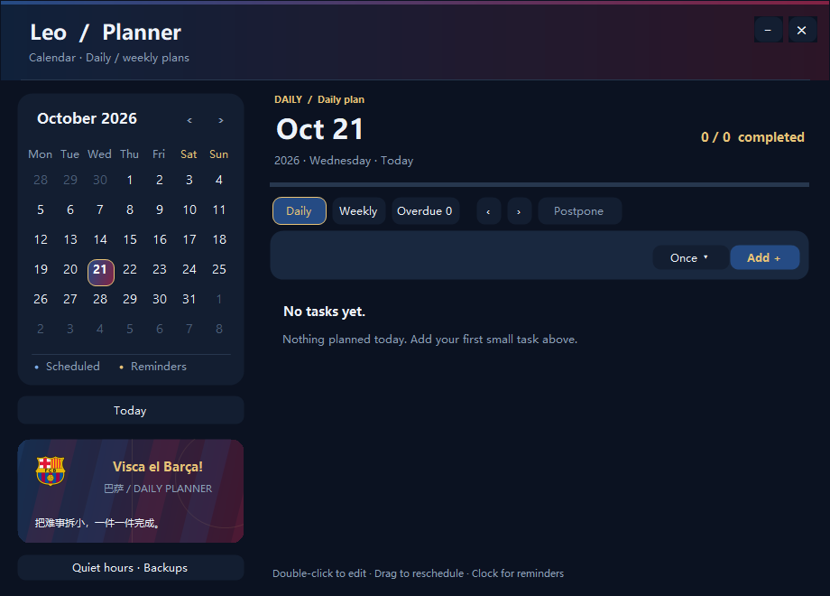

# Leo quick start

[简体中文](QUICK_START.md) | **English**

For v1.05.0. Read the first two sections once; afterward use the task lookup table. **App search, tasks and quick notes work without a model API. You do not need API setup to get started.**

[Download Windows version](https://github.com/LeoLi006/leo-desktop/releases/tag/v1.05.0) · [Full user guide](USER_GUIDE.en.md) · [Troubleshooting](#if-something-is-wrong)

## Get started in three minutes

1. **Install:** download `Leo-v1.05.0-win-x64.zip`, extract everything, then run `Install-Leo.cmd`. For an update, choose your existing Leo installation folder.
2. **Find an app:** click the sheep, type an app name, then click a result or press Enter. Click the sheep again to hide search.
3. **Remember one task:** click the planner icon below the sheep, enter a task and add it. Alternatively right-click the sheep→Planner & notes→Daily planner.
4. **Make it yours:** right-click→Settings. General changes name, size and startup; Features enables only the tools you want. Click Save settings when finished.

Want only a pet? No API or other application is required. Settings→General→Profiles lets you preview a pet-only template and confirm the switch; alternatively disable unwanted features yourself.

## Learn the four entry points

| Entry | Where/how | What it opens |
| --- | --- | --- |
| **Click the sheep** | Click again to dismiss app search | Apps, file paths, clipboard and the top shortcut bar |
| **Below the sheep** | Chat, planner and an expand-tools button | Chat/planner; enabled terminal, Clash and Edge utilities after expansion |
| **Right-click the sheep** | Grouped menu | Records, notes, focus, apps/media, routines, appearance, settings and exit |
| **Top of app search** | Click the sheep first | Visible football, QQ Music, media and custom apps; overflow goes under More |

Icons/order can be customized. Hover top shortcuts for names or use text menus rather than identifying features by pictures alone.

**Cannot find the sheep?** Check monitor edges: docking can leave only its head visible; hover to reveal it. Find Leo among Windows hidden tray icons and right-click for Settings. Default Ctrl+Alt+Space opens search. Leave fullscreen first if fullscreen hiding is enabled.

## Where do I find it?

“Right-click” below means the sheep. Optional functions must be enabled. Scroll down inside long settings pages.

| I want to… | Go here |
| --- | --- |
| Find an app, folder or file | Click the sheep→search field |
| Pin an app or set aliases | Right-click an app result icon |
| Add my own program/change its icon | Settings→Features→Apps & icons… |
| Enable football, QQ Music, Clash, etc. | Settings→Features→check it, then Save settings |
| Keep a feature but hide its button | Settings→Features→Entry visibility…; confirm, then Save settings |
| Daily/weekly tasks, calendar or overdue tasks | Planner icon below the sheep, or Planner & notes→Daily planner |
| Capture one line | Planner & notes→Quick capture… |
| Search/pin notes or convert to a task | Planner & notes→Quick notes… |
| Clipboard history and pins | Click sheep→search `clipboard` |
| Notifications/operation logs | Planner & notes→Notification inbox |
| Temporary focus | Planner & notes→Focus |
| Football, followed teams and standings | Football shortcut at top of app search, or Apps & media→football entry |
| Request a song, pause or lyrics | QQ Music top shortcut, or Apps & media→Music |
| PotPlayer/system media controls | Media top shortcut, or Apps & media→Media controls |
| Admin terminal, Clash or web search | Expand utilities below sheep, or corresponding Apps & media entry |
| Computer status, Task Manager or Huorong | Enable Computer status; use its top shortcut or Apps & media→Module entries |
| Open/configure email client | Enable Mail client; use its top shortcut or Apps & media→Module entries |
| Chat or speak | Chat icon below sheep, or Apps & media→Text chat…/Speak now… |
| Run several actions together | Routines→new custom routine option |
| Skin, theme or jersey | Appearance→skin submenu / Theme & skin editor… |
| Name, size, language or startup | Settings→General |
| Change keyboard shortcuts | Settings→Hotkeys |
| Configuration backup/migration or updates | Settings→General→migration/recovery or update check |
| Diagnose a feature/path problem | Settings→Checks, or the module-status button near bottom of Features |

> **Missing an entry? Do not reinstall first.** Check its switch in Features, then Entry visibility. Menu only hides shortcuts; Search only hides both buttons and menus. Confirm that dialog, then click Save settings. Hiding is different from disabling.

## Common tasks

Expand only the section you need.

<strong>Find an app, pin it and set short aliases</strong>

1. Click the sheep and search an app name, pinyin or existing alias.
2. Right-click its result and choose Pin or the alias option. Separate multiple aliases with spaces.
3. Search the alias next time. Drag pinned icons to reorder; up to 14 pins are supported.

Enter a full file/folder path to open it. Use arrows to select, Tab to complete a path and Enter to open. First launch may need time for app indexing.

<strong>Add a program or change its name, icon and position</strong>

1. Settings→Features→Apps & icons: add an executable/shortcut. Alternatively drop an EXE/LNK onto the sheep and confirm.
2. Select the path, name and icon. Most users can leave arguments/working directory blank.
3. Confirm the editor, then Save settings. Choose Shortcut bar in Entry visibility if you want a visible button.

Drag top shortcuts to reorder. More contains overflow items and the ordering dialog. Search-only capabilities do not have shortcut buttons.

<strong>Add tasks, repeat them, reschedule and set reminders</strong>

1. Open Daily planner, select a date in the calendar, enter a title and add it.
2. Switch Daily/Weekly views at the top; use the one-time/repeat selector to change recurrence. Check a task to complete it; double-click its title to edit.
3. Drag a task onto a calendar date to reschedule. Right-click it for reminder/rescheduling actions. Recurring tasks can apply an action to only this occurrence.

Overdue collects older incomplete work; postponement moves unfinished tasks. Quiet hours/backups are at the lower left. Leo must keep running for reminders. Chinese natural-date expressions have a confirmation preview; English UI does not imply equivalent English date parsing. English titles can use an explicitly selected date/time.

Illustration from isolated sample data; dates, skin and user-supplied quotes may differ.

<strong>Quick notes, clipboard and dropped content</strong>

- **Capture:** Planner & notes→Quick capture; Enter saves and Esc cancels. Default Ctrl+Alt+N.
- **Manage notes:** search/pin in Quick notes. Select a note, convert to a task and choose its date.
- **Clipboard:** search `clipboard`. If new items are missing, enable Save clipboard history in General. Protection options are in the same page.
- **Drop content:** files, images, text or links dropped onto the sheep show applicable actions; they do not automatically execute every action.

<strong>Follow teams, view fixtures and save watch links</strong>

1. Open football and use ＋ Manage teams on the left to select clubs/national teams and save.
2. Click a followed team for recent matches/standings. Use the in-window back control to return.
3. A match card's planner/reminder action adds it to tasks after checking date/reminder. Edit Watch links on the left to save four URLs; clicking one opens Edge.

Updates need network access. Check cache timestamps after failure. Leo opens your selected websites; it does not supply match broadcasts.

<strong>QQ Music, PotPlayer, proxy and browser search</strong>

1. Enable the needed tools in Features. If an application cannot be found, choose its installed program in Apps & icons.
2. Search a song/artist in QQ Music's Leo window, choose a result and play. Leo starts the client if necessary. Playback, pause and lyrics depend on client readiness/song access; manage playlists in QQ Music itself.
3. Media controls target PotPlayer or available Windows media sessions. Clash is in expanded utilities below the sheep; the Edge icon expands a search field.

Ctrl+Alt+L toggles QQ Music lyrics by default; change it in Hotkeys. Disabling Leo's music/proxy module does not close the client or undo an enabled proxy.

<strong>Computer status, Huorong and email</strong>

These start disabled. Enable Computer status or Mail client in Features and save first.

- Computer status shows CPU/memory/network and process ranking. Bottom buttons open Task Manager/Huorong; Huorong's path is configured there. Background high-usage alerts have a separate checkbox.
- Mail opens an existing client; configure its path in the mail window. QQ/Gmail web entries are available. Configure campus email in the original mail client.

Leo does not kill processes, scan for viruses or retrieve email messages. Those operations stay in the original applications.

<strong>Chat, voice and multi-action routines</strong>

- Click the chat icon. Start with its existing local task/query choices. Free chat requires your endpoint, model and key in Settings→API, saved separately.
- Right-click the chat icon or use Apps & media→Speak now. Default Ctrl+Alt+V. The current package excludes the SenseVoice model; use text until the model is prepared. Checks helps verify the model/microphone setup.
- Routines→new custom routine: name it, add steps and save. Run it by name in that menu; edit/delete is there too.

Fixed routines use no model API. Plans requiring confirmation display before execution. Stop does not undo steps already completed.

<strong>Appearance, profiles, shortcuts and updates</strong>

- Appearance switches skin/opens the editor. Name, size and interface language are in General.
- General→Profiles previews a set of feature/entry choices. Review differences before confirming.
- In Hotkeys, click a field and press the combination, then save. Backspace/Delete disables it. Choose another combination if occupied.
- General contains update checks and configuration migration/recovery. Backups can contain personal tasks/URLs; do not publish them.

## Default shortcuts

| Keys | Action |
| --- | --- |
| Ctrl+Alt+Space | Toggle app search |
| Ctrl+Alt+N | Quick capture |
| Ctrl+Alt+V | Open chat and speak; speech model must be prepared |
| Ctrl+Alt+L | QQ Music lyrics; enabled/configured music client required |
| Esc | Dismiss current window/panel, not Leo itself |

If customized, follow the actual values in Settings→Hotkeys.

## If something is wrong

| Symptom | First step |
| --- | --- |
| Missing button | Check Features, Entry visibility and More overflow |
| Settings seem unchanged | Save General/Hotkeys/Features; API saves separately |
| App not found | Allow indexing, try full name, check Enable local app indexing, or add it manually |
| Invalid client path/music or proxy unresponsive | Checks, then reselect the program in Apps & icons |
| No reminder | Check Leo is running, task date/time, quiet hours and focus |
| Cannot speak | Check model/microphone; use text rather than reinstalling the entire app |
| No fresh football data | Check network/cache time and refresh later |
| Need operation history/errors | Planner & notes→Notification inbox; routine success is quiet |
| Want to exit | Right-click sheep/tray icon→Exit Leo; Esc only dismisses the current window |

Still stuck? [Report an issue](https://github.com/LeoLi006/leo-desktop/issues) with version, clicks, expected/actual behavior and sanitized screenshots. Never attach a key or the entire runtime folder.

For more operations read the [full user guide](USER_GUIDE.en.md). Architecture/protocol/developer documents are optional for product users.
