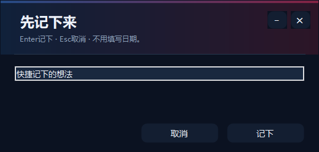

# Leo快速操作指南

**简体中文** | [English](QUICK_START.en.md)

适用v1.05.0。第一次使用先看前两节；以后按“我想做什么”查入口即可。**不用聊天，也能使用应用搜索、清单、便签等本地功能，不需要填写API。**

[下载Windows版](https://github.com/LeoLi006/leo-desktop/releases/tag/v1.05.0) · [完整使用手册](USER_GUIDE.md) · [常见问题](#遇到问题先看这里)

## 三分钟开始用

1. **安装**：下载`Leo-v1.05.0-win-x64.zip`，完整解压，再双击`Install-Leo.cmd`。更新时选择原来的Leo安装文件夹。
2. **找应用**：单击桌面上的小羊，输入应用名，点击结果或按回车打开。再单击小羊收起搜索框。
3. **记一件事**：点小羊脚下的清单图标，输入事项并添加；也可以右键小羊→清单与记录→每日清单。
4. **调成顺手的样子**：右键小羊→设置。常规页改名字、大小和开机启动；功能页只开启你需要的工具。完成后点“保存设置”。

只想养桌宠？不用配置API或安装别的软件。可在“设置→常规→使用方案…”预览纯桌宠相关模板，确认后切换；也可自己关闭不用的功能。

## 先认清四个入口

| 入口 | 在哪里、怎么用 | 主要能做什么 |
| --- | --- | --- |
| **单击小羊** | 打开应用搜索，再点一次关闭 | 找应用、输入文件路径、打开剪贴板、使用顶部快捷栏 |
| **小羊脚下** | 常驻聊天、清单和展开工具按钮 | 打开聊天/清单；展开后使用已启用的终端、Clash和Edge搜索 |
| **右键小羊** | 打开分组菜单 | 记录、便签、专注、应用媒体、组合动作、外观、设置和退出 |
| **搜索框顶部快捷栏** | 先单击小羊打开搜索框 | 已显示的足球、QQ音乐、媒体及自定义应用；放不下的在“更多”里 |

图标可自定义，实际顺序取决于你的设置；不要只凭图案找功能。搜索框顶部按钮可悬停看名称，右键菜单也有文字入口。

**找不到小羊？** 看屏幕四边，可能吸附后只露头；鼠标停上去会展开。也可在Windows右下角隐藏图标中找到Leo，右键打开设置；默认`Ctrl+Alt+Space`可唤起应用搜索。全屏自动隐藏开启时，先退出全屏再找。

## 我想做什么：入口速查

以下“右键”均指右键小羊；有些功能需先启用。设置中页面较长时，请向下滚动。

| 我想做什么 | 从这里进入 |
| --- | --- |
| 搜索/打开应用、文件夹或文件 | 单击小羊→搜索框 |
| 收藏应用、设置简称 | 搜索结果的应用图标上右键 |
| 添加自己的程序、换快捷图标 | 右键→设置→功能→应用模块与图标… |
| 开启/关闭足球、QQ音乐、Clash等 | 右键→设置→功能→勾选后保存设置 |
| 功能开着，但不想显示按钮 | 右键→设置→功能→入口显示…；确定后还要保存设置 |
| 每日/每周清单、日历、逾期事项 | 脚下清单图标，或右键→清单与记录→每日清单 |
| 快速记一句话 | 右键→清单与记录→一句话速记… |
| 查看/搜索便签、置顶、转待办 | 右键→清单与记录→临时便签… |
| 剪贴板历史和收藏 | 单击小羊→搜索“剪贴板” |
| 通知和操作日志 | 右键→清单与记录→通知收纳盒 |
| 临时专注 | 右键→清单与记录→临时专注 |
| 看比赛、管理球队、查积分榜 | 搜索框顶部足球按钮；也可右键→应用与媒体→足球入口 |
| 点一首歌、暂停、歌词 | 搜索框顶部QQ音乐按钮，或右键→应用与媒体→音乐 |
| PotPlayer/系统媒体控制 | 搜索框顶部媒体按钮，或右键→应用与媒体→媒体控制 |
| 管理员终端、Clash、Edge搜索 | 脚下展开工具按钮；或右键→应用与媒体中对应入口 |
| 电脑状态、任务管理器、打开火绒 | 启用“电脑状态”后，从顶部对应按钮或右键→应用与媒体→模块入口进入 |
| 打开/配置邮箱客户端 | 启用“邮箱客户端”后，从顶部对应按钮或右键→应用与媒体→模块入口进入 |
| 文字聊天/直接说话 | 脚下聊天图标；或右键→应用与媒体→文字聊天…/直接说话… |
| 一次执行多个操作 | 右键→组合动作→＋ 新建自定义… |
| 换皮肤、改主题或球衣 | 右键→外观→皮肤 / 主题与皮肤编辑器… |
| 名字、大小、语言、开机启动 | 右键→设置→常规 |
| 修改快捷键 | 右键→设置→快捷键 |
| 备份/迁移配置、检查更新 | 右键→设置→常规→配置迁移与恢复… / 检查更新… |
| 功能出问题、检查程序路径 | 右键→设置→运行检查；或功能页下方“模块状态与处理…” |

> **某入口不见，先别重装。** 到设置→功能检查是否启用，再到“入口显示…”检查它是否被设成“仅菜单显示”或“仅搜索调用”。改好后点击“确定”，回到设置再点“保存设置”。隐藏入口不等于关闭功能。

## 常用功能怎么操作

只展开你需要的部分，不必全部读完。

<strong>找应用、收藏、设置wx这类简称</strong>

1. 单击小羊，输入应用名称、拼音或已有简称。
2. 找到图标后右键，选择“收藏置顶”或“设置简称…”。多个简称用空格分开。
3. 以后直接输入简称即可；收藏图标可拖动调整顺序。最多置顶14个。

输入完整文件夹/文件路径也可打开，例如`D:\资料`；方向键选择候选，Tab补全路径，回车打开。普通应用搜索第一次可能要等索引完成。

<strong>添加自己的软件，改名称、图标和位置</strong>

1. 右键→设置→功能→“应用模块与图标…”，添加程序或快捷方式；也可以把EXE/LNK拖到小羊上，按提示确认。
2. 选择程序位置、名称和图标。普通用户可以先不填启动参数和工作目录。
3. 确认编辑，再回设置点“保存设置”。要显示按钮，在“入口显示…”选择“快捷栏显示”。

顶部快捷按钮可拖拽排序；溢出项在“更多”中，也可从“调整快捷顺序…”操作。只有搜索调用的能力不会出现快捷按钮。

<strong>加待办、设置重复、改期和提醒</strong>

1. 打开每日清单，先在日历选日期，输入事项并添加。也可以输入“明天下午三点取快递”，核对弹出的解析结果再确认。
2. 顶部“每日 / 每周”切换视图；“单次 ▾”选择重复方式。任务前的勾选用于完成，双击标题修改。
3. 把事项拖到左侧日历日期上可改期。右键事项可找提醒、改期及其他操作；重复事项可只处理本次。

“逾期”集中显示过去未完成事项，“顺延未完成”可批量后移。提醒设置后需要Leo保持运行。免打扰时段及清单备份在左下角“提醒时段 · 备份”。

<strong>便签、剪贴板、拖文件</strong>

- **速记**：右键→清单与记录→一句话速记，输入后回车保存，Esc取消；默认快捷键`Ctrl+Alt+N`。

图中为演示文字，回车即可记下，不用填写日期。
- **便签管理**：临时便签中搜索、置顶；选中后点“转为待办”并选日期，不需要重打内容。
- **剪贴板**：搜索“剪贴板”打开历史/收藏。没有新记录时，到设置→常规开启“保存剪贴板历史”；保护选项在“剪贴板保护…”。
- **拖放**：把文件、图片、文字或网址拖到小羊上，按出现的动作面板选择；不同内容显示不同选项，不会自动执行所有动作。

<strong>关注球队、看比赛和保存观赛网址</strong>

1. 打开足球窗口，点左侧“＋ 管理关注”，选择俱乐部或国家队并保存。
2. 点击关注球队可看球队近期比赛和积分榜，用窗口内返回入口回到赛程。
3. 比赛卡片上的清单/提醒入口可将比赛加入待办，核对日期与提醒再确认。左侧“观赛网址→编辑”可存四个常用网址，之后点击用Edge打开。

赛程需要联网；更新失败可能显示旧缓存，先看更新时间。Leo只打开你填写的网站，不提供比赛直播内容。

<strong>QQ音乐、PotPlayer、代理和网页搜索</strong>

1. 在设置→功能开启需要的功能。找不到软件时，在“应用模块与图标…”指定已安装程序。
2. QQ音乐窗口输入歌名/歌手，搜索后选择歌曲并播放；未启动客户端时Leo会先启动。播放、暂停和歌词依赖客户端就绪与歌曲权限，歌单仍到QQ音乐操作。
3. “统一媒体控制”用于PotPlayer或可用的系统媒体会话。Clash在脚下展开工具中切换代理；Edge点搜索图标后展开输入框。

默认`Ctrl+Alt+L`切换QQ音乐歌词；可在快捷键页修改。关闭Leo中的Clash/音乐功能，不会自动关闭外部软件或撤销已开启代理。

<strong>电脑状态、火绒和邮件</strong>

这些功能默认关闭：先到设置→功能启用“电脑状态”或“邮箱客户端”，保存后再打开。

- 电脑状态看CPU、内存、网络和进程排行；底部按钮打开Windows任务管理器或火绒。火绒路径也在该窗口配置。高占用后台提醒需单独勾选。
- 邮箱入口使用现有邮件软件，按窗口提示指定客户端；QQ/Gmail也有网页入口。校园邮箱在原邮件客户端配置。

Leo不会替你结束进程、杀毒或读取邮件；这些操作继续在原软件里完成。

<strong>聊天、语音和一次完成多个操作</strong>

- 点脚下聊天图标打开文字窗口；可先试首页“看看今天的清单”等明确操作。自由聊天需要在设置→API填写自己的服务地址、模型和Key，并单独保存。
- 语音可右键脚下聊天图标，或右键→应用与媒体→直接说话；默认`Ctrl+Alt+V`。当前安装包不含SenseVoice语音模型，未准备好时先用文字；可在运行检查确认模型和麦克风状态。
- 组合：右键→组合动作→“＋ 新建自定义…”，命名并添加需要的步骤，保存后从同一菜单点击组合名称执行；编辑/删除也在该菜单。

固定组合无需模型API。需要确认的模型计划先展示给你，确认后才执行；“停止”不等于撤销已经完成的操作。

<strong>换外观、保存习惯、改快捷键和更新</strong>

- 右键→外观可切换皮肤或打开编辑器；名字、大小、界面语言在设置→常规。
- 常规页“使用方案…”可预览并切换一套功能/入口设置；先看差异，再确认。
- 快捷键页点击输入框，按新的组合后保存；Backspace/Delete可停用。冲突时换另一组。
- 常规页“检查更新…”手动检查，“配置迁移与恢复…”用于私有备份/换电脑。备份可能含个人事项和网址，请勿公开上传。

## 默认快捷键

| 按键 | 作用 |
| --- | --- |
| Ctrl+Alt+Space | 打开/收起应用搜索 |
| Ctrl+Alt+N | 一句话速记 |
| Ctrl+Alt+V | 打开聊天并开始说话；需已准备语音模型 |
| Ctrl+Alt+L | QQ音乐歌词；需启用音乐并配置客户端 |
| Esc | 关闭当前窗口或收起面板，不直接退出Leo |

如果你改过按键，以设置→快捷键中的实际内容为准。

## 遇到问题先看这里

| 现象 | 先做这一步 |
| --- | --- |
| 找不到某个按钮 | 设置→功能确认启用，再检查“入口显示…”；顶部还有“更多” |
| 改完设置没变化 | 常规/快捷键/功能要点“保存设置”；API有自己的保存按钮 |
| 搜不到软件 | 等索引完成，试完整名称；检查常规页“启用本机应用索引”，或手动添加程序 |
| 软件路径失效、音乐/代理没反应 | 运行检查核对路径；功能→应用模块与图标重新选择程序 |
| 提醒没出现 | 确认Leo在运行，检查日期、提醒时间、免打扰和专注状态 |
| 不能说话 | 运行检查确认语音模型与麦克风；先用文字功能，不需要重装整个Leo |
| 足球没有新内容 | 看网络及更新时间，稍后刷新；缓存可能不是最新赛程 |
| 想看操作记录或错误 | 右键→清单与记录→通知收纳盒；普通成功不会反复打扰 |
| 想退出 | 右键小羊或托盘Leo图标→退出Leo；Esc只是关闭当前窗口 |

还没解决：打开[问题反馈](https://github.com/LeoLi006/leo-desktop/issues)，写清版本、点了什么、预期和实际情况；截图先遮住个人信息。无需附API Key或整个运行文件夹。

想了解更多操作，再看[完整使用手册](USER_GUIDE.md)。只想使用产品，不必阅读架构、协议和开发文档。
