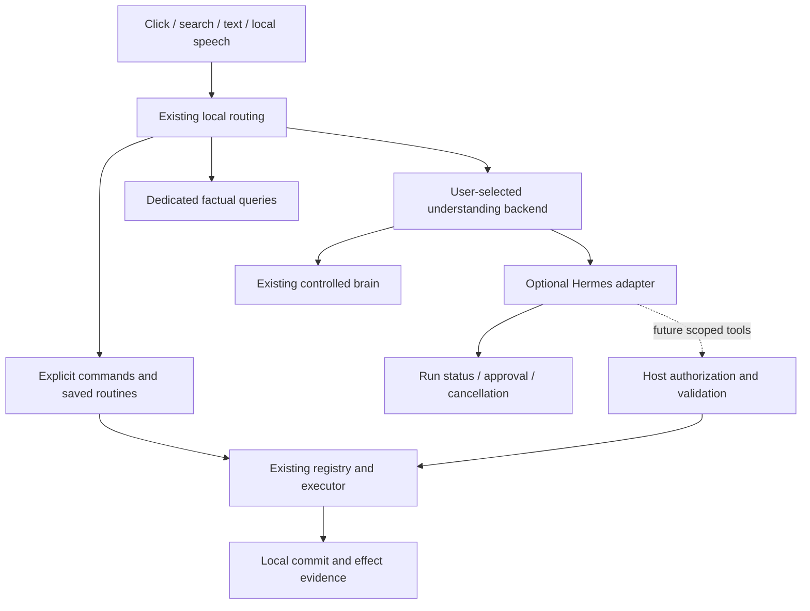

# Historical candidate roadmap: external agents — paused

[简体中文](ROADMAP.md) | **English**

> **Positioning update:2026-10-22.** The accepted direction is a configurable companion and capability handoff. R1–R5 below are retained historical proposals: automatic progression is paused, not approved or the default priority. Start with [positioning-led research](RESEARCH.en.md), choose direct use/thin integration/own work for a real frequent scenario, then reprioritize. Hermes is one candidate.

Updated2026-10-22. Source baseline:21fcaf4; published application:v1.05.0. This is an implementation proposal, not approval or a claim of completion. See [renewed research](RESEARCH.en.md) for evidence and limitations.

## 1. Product goal

Keep Leo as a desktop companion, quick entry point and local capability host. Make explicit actions fast, offer an optional brain for complex requests, and make execution understandable, stoppable and controlled.

Pet-only users should need no model service, agent runtime or additional background process. Existing local actions should retain their direct path. Football, productivity and advanced users should compose existing usage profiles and module switches.

Shift from further internal interface splitting to testing whether the existing foundation can connect a mature agent at reasonable cost while preserving responsiveness, reliability and clean shutdown. Hermes is the first candidate, not a selected production dependency.

## 2. Delivered baseline: preserve rather than rebuild

| Existing result | Boundary |
| --- | --- |
| Capability registry, structured parameters/results, cancellation and legacy actions | Already used by major capabilities; do not create another executor |
| Search/menu/shortcut contributions, scoped services and lifecycle | Ordinary module integration verified; complex windows still need host composition |
| Planner, notes, football, clipboard and client controls | Retain stores, data sources and permissions |
| Sequential routines, recovery and confirmed plans of at most four steps | Continue owning local effects; do not silently turn this into an unlimited agent loop |
| App packages, declarative/worker extensions and recovery | Not an arbitrary-code sandbox or independent delivery of every built-in |
| Provider relay, SenseVoice, usage profiles and Chinese–English UI | Remain usable; no replacement required for the experiment |
| Targeted stability checks and install rollback | Short checks do not prove multi-day leak freedom |

Evidence: [architecture](Architecture/README.en.md), [developer guide](PRODUCT_AND_DEVELOPER_GUIDE.en.md), [verification](PERFORMANCE.en.md). Historical Q/C/M batches are not new unfinished implementation tasks.

## 3. Responsibilities and routing

External adapters, run events and the tool bridge above are proposed, not installed functionality.

| Request | Default route | Model policy |
| --- | --- | --- |
| App launch, explicit task changes, playback/proxy, saved routine | Existing local executor | No model call |
| Current fixtures or other dedicated facts | Existing provider/cache | Query itself needs no model; requested interpretation is separate |
| Free conversation or ambiguous intent | Configured current brain | Preserve relay settings |
| Explicit multi-turn/long-running task | Selected, enabled external backend | One planner owns a task; no nested competing brain loops |
| Offline backend, missing dependency or cancellation | Explain state; keep local capabilities | No silent resend to another paid service or replay of unknown effects |

The model endpoint, Hermes endpoint and their credentials are separate. Do not copy them automatically. Explain model usage separately from tool network access.

## 4. Staged checklist

Review evidence at each gate before continuing; dates are not promised. Approve concrete implementation batches separately and combine related work rather than installing after every small interface change.

### R1: scenarios and minimal run events — first priority

Purpose: make existing task state reliable and visible, establishing reusable presentation semantics.

- [ ] R1.1 Fix isolated acceptance scenarios: explicit local command, factual query, pending plan, cancellation and late results after window close. Reuse existing fixtures.
- [ ] R1.2 Map existing ActionResult, Workflow and conversation state to submission/running/awaiting-confirmation/stopping/terminal states. Add only proven missing semantics, not a second execution authority.
- [ ] R1.3 Present compact status, necessary tool progress and stop control inside the existing chat area. No large task center or hidden model reasoning display.
- [ ] R1.4 Check window close, backend disconnect, duplicate/out-of-order events, late completion and repeated clicks. Distinguish stop requested from stop confirmed; unknown is not success.

Deliver scenarios, minimal mappings, related UI and failure evidence. Acceptance: local commands still make zero model calls; no new idle polling; one failed task does not break Leo or local actions.

If existing results already express a state, reuse them. Do not add abstraction without evidence.

### R2: isolated Hermes integration experiment — not production

Requires R1 state/cancellation semantics. Prove benefit and cost before selecting a backend.

- [ ] R2.1 Record a specific Hermes version/commit, install shape, license and API capabilities. Check actual Windows and relay compatibility; OpenAI-format support does not imply every tool feature works.
- [ ] R2.2 Use a trusted fake service for health/capabilities/run identity/events, approval denial, cancel, timeout, disconnect and reconnect. Only then seek approval for a real isolated backend. No personal key in default tests.
- [ ] R2.3 Compare HTTP run APIs for the minimum loop against JSON-RPC only when required interactions are missing. ACP is not the default first integration.
- [ ] R2.4 Use one non-office, read-only scenario: produce viewing suggestions from explicitly supplied fixture schedules, with real tool progress. Compare the existing brain for steps, delay, request counts, recovery and maintenance burden.
- [ ] R2.5 Measure host plus added processes, time to readiness and shutdown leftovers in the same isolated environment. Disabled/pet-only mode must start no agent, install dependencies or contact a service.

Deliver a compatibility matrix, isolated prototype, comparison and integrate/defer/reject decision. Do not chase a fixed memory target: demonstrate meaningful user benefit, no clearly unacceptable resource increase, cancellation and removability. Stop if the only benefit is another chat window.

Real backend and paid-relay trials require separate approval of cost/data scope. Approving this roadmap does not authorize installing Hermes or paid tests.

### R3: optional external-brain product loop — conditional

Requires a clear R2 pass and approved integration scope.

- [ ] R3.1 Select existing brain/external backend in settings; external is off by default. Check connections on request/use, not with a new permanent health poll.
- [ ] R3.2 Select one validated protocol. Explain unsupported versions/capabilities; restrict effects when approval/stop features are unavailable rather than pretending support.
- [ ] R3.3 Reuse chat, local recognition and run display. Assign session/run/process/credential ownership. Connect an existing user backend first; do not simultaneously build an installer.
- [ ] R3.4 Keep local operations and readable results on failure. Reconnect to check the same run, never resubmit because an event stream disconnected. Stopping an existing external service is a separate operation.
- [ ] R3.5 Distinguish local effects from backend tool effects. Backend completion text is not host evidence that a Leo action happened.

Deliver an experimental, disableable/recoverable module. Acceptance: local-only behavior unchanged, no owned leftovers after shutdown, no keys in migration exports, usable Chinese/English layouts. Do not bundle Hermes by default before this gate passes.

### R4: expose Leo capabilities to an external agent — read-only first

Requires stable R3 and a concrete need for agent-to-Leo calls. Approve separately; this is not implicit in R3.

- [ ] R4.1 Evaluate the official MCP C# SDK version, target framework, dependencies and license; use only necessary components. MCP tool exchange does not replace the run protocol or LeoModule/1.
- [ ] R4.2 In isolation expose two allowlisted read-only tools: module status and cached fixture summaries. Use existing registry queries; no generic action executor, arbitrary paths, shell or complete configuration access.
- [ ] R4.3 Define connection/session/request authorization scope and input/output limits. Recheck enablement on every call. Pass only necessary environment to stdio processes; loopback HTTP still needs authentication.
- [ ] R4.4 Preserve source/request identity, cancellation and evidence. An external agent's own shell/file tools can bypass the bridge; a tool allowlist is not a sandbox for the whole agent.
- [ ] R4.5 After read-only acceptance, separately test suggestion→user confirmation→one new task. Only host UI can confirm exact parameters/target/expiry, never the model. Retry/failure must not duplicate creation.

Deliver a constrained bridge and isolated example. Acceptance: disable/remove rejects stale calls immediately, no default body/path export, no unknown-result replay. Strong isolation needs an explicit OS execution environment; MCP and separate processes alone do not provide it.

### R5: productize after proving benefit

- [ ] R5.1 Reuse usage profiles for pet-only, local productivity and optional agent use. Football remains independently optional; do not duplicate mode configuration.
- [ ] R5.2 Suggest saving only confirmed, repeatedly useful routines as editable actions. Do not mine private chats or create skills automatically in the background.
- [ ] R5.3 If needed, add inspectable/editable/deletable preferences. Prioritize explicit “remember this” requests; no default raw-chat, clipboard or credential ingestion.
- [ ] R5.4 Use focused checks and everyday observation. Packaging, screenshots, automatic dependency installation and uploads need separate scope. Preserve old configuration and rollback when a mode is unavailable.

## 5. Deferred work

| Deferred | Reconsider when |
| --- | --- |
| Whole Electron/React migration or embedded Hermes Desktop workspace | A concrete WinForms product gap cannot be fixed locally and migration benefit is proven |
| Arbitrary-code market, full plugin SDK, independently delivered built-ins | External developer demand exists and permissions/compatibility/update ownership are specified |
| Full mailbox, antivirus engine, player or general task manager | Existing-app integration cannot serve a real case; retain current quick entries/read-only status |
| Everything integration or Flow-based search rewrite | A reproducible search coverage/latency problem exists; keep outside the agent experiment |
| Global database, memory platform, multi-agent fleet or general parallel compensation | Current single-task/bounded routines demonstrably cannot meet an acceptance case |
| Automatic Hermes installation, default background agent, importing all skills | Maintenance, dependency size, trust and shutdown have separate validation/approval |

## 6. Shared acceptance rules

- Preserve IDs, settings, storage formats, hidden-versus-disabled behavior and existing permissions.
- Validate direct changes/chains only; distinguish fake-service evidence from real integration. Do not sum historical results into a new full-suite claim.
- Avoid retesting unaffected functionality or tuning for extreme numbers. Investigate clear continuing resource growth or shutdown leftovers.
- Report local work, remote runs and committed writes separately. No global exactly-once or automatic rollback-on-cancel claim.
- Approve each batch, commit locally, and update the program once only when behavior changes. Uploads, packages and Releases require explicit requests.

## 7. Conditions for resuming

Use the [positioning-led survey](RESEARCH.en.md) to identify a real scenario and current operation path before selecting any task here. Do not default to approving R1 or installing Hermes. Each implementation still requires separate scope/approval.
