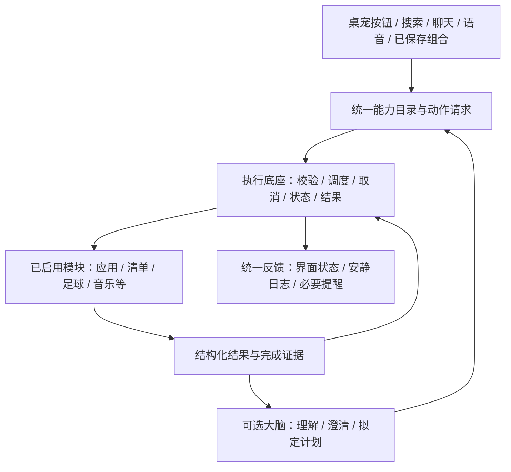

# Leo 路线图：稳定底座、可插拔能力与大脑协调

> 基线：v1.04.0，源码提交 beb8be2。重写日期：2026-10-19。
>
> 本文是后续方向和任务清单；每批须单独审批。Q1～Q6、M05 第一至第五批已获批准，交付记录见文末；后续批次仍须单独批准。
>
> 推进方式：主动提出下一批范围供用户审批；批准后集中执行与验证。只有运行行为改变才按需更新本地程序；安装包、GitHub 发布材料与上传等用户要求发布时再处理。阶段不预设发布日期。

## 1. 目的与成功标准

让 Leo 从“有很多功能的桌宠”发展为“可靠、轻量、按需装配的桌面控制入口”。桌宠负责陪伴和交互，公共底座负责稳定运行，模块提供能力，大脑理解需求并协调执行。

后续改进围绕五个结果判断，而不是围绕新增功能数量判断：

| 目标 | 完成后应有什么不同 |
| --- | --- |
| 稳定 | 一个模块超时、崩溃或配置损坏，不拖垮桌宠和其他模块；错误能定位、能恢复。 |
| 高效 | 明确指令直接本地执行；停用能力停止其后台活动；新增模块不会给所有用户增加常驻负担。 |
| 普适 | 用户按需启用能力；缺少 QQ 音乐、Clash 或模型 API 时，其他功能仍成立。 |
| 可扩展 | 普通新模块按同一契约注册能力，无需修改桌宠、聊天、搜索和菜单中的多个集中分支。 |
| 可协调 | 同一动作从不同入口执行具有一致结果；多个模块能交换结构化数据，组合过程可看、可停、可纠正。 |

不以一次大重构实现这些目标。采用兼容适配、试点迁移、比较验证、逐步替换的方式；新增抽象必须解决实际重复或故障。

## 2. 当前起点：有什么，缺什么

以下是已存在的能力，不重新立项，也不等于目标架构已经完成。

| 范围 | 当前基础 | 需要补齐的边界 |
| --- | --- | --- |
| 动作入口 | `ActionDispatcher`、`ActionRequest`、`ILeoModule`，文字、语音、搜索和组合已有接入 | 参数仍主要是字符串，结果主要是字符串；部分内置业务与集中分支耦合，需要逐项盘点旁路。 |
| 扩展 | 应用模块、JSON 动作扩展、ZIP 独立进程与 `LeoModule/1` | 能独立安装的外部扩展与随主程序发布的内置能力并不等价；缺少统一版本协商、服务边界和开发验收规范。 |
| 执行 | 请求合并、取消、超时、状态、回执与部分后台释放 | 要按动作语义区分可合并、须串行、不可重试；统一生命周期和模块间取消边界。 |
| 组合 | `CustomCombo`、`ComboStep` 和旧场景执行 | 还不是通用的数据传递、条件等待、失败处理与恢复机制。 |
| 大脑 | 模型聊天、流式回复、本地语句识别和工具调用 | 能力说明应来自同一注册表；计划、上下文、执行证据与部分失败需要统一表达。 |
| 产品设置 | 使用方案、入口显示、模块启停、主题与窗口行为 | 复用现有界面，逐步改为统一描述驱动，不能再建立第二套设置体系。 |
| 性能与数据 | v1.03.0 绘制复用、故障边界、核心 JSON 原子保存；v1.04.0 安静日志 | 已有测量是短时隔离样本，仍需真实运行基线、分模块后台成本及更长持续检查。 |

已有可用体验继续保留：应用搜索、收藏和简称、路径与拖放、清单、便签、足球、音乐、媒体控制、多屏吸附、主题和使用方案。当前清单与聊天等默认入口先保持原样；内部模块化不自动改变用户布局或停用权限。

历史依据：[使用说明](USER_GUIDE.md)、[当前模块协议](MODULES.md)、[性能记录](PERFORMANCE.md)、[相关工作调研](RESEARCH.md)。后续接口以通过审批的新规范为准，不把本文中的建议名称当作已发布 API。

## 3. 目标结构与职责

| 层次 | 应承担 | 不应承担 |
| --- | --- | --- |
| 公共底座 | 桌宠渲染、窗口规则、主题服务、配置与数据服务、模块生命周期、动作执行和反馈规则 | 根据球队名猜测聊天意图、为某个播放器写特殊菜单分支等具体业务。 |
| 功能模块 | 自己的能力、参数、业务规则、依赖检查、结果核验和模块数据 | 各自实现一套全局快捷键、设置保存、错误弹窗和重复任务调度。 |
| 交互入口 | 收集输入、展示候选或结果、把明确选择交给执行底座 | 直接绕过统一策略执行系统操作。 |
| 大脑 | 发现可用能力、理解模糊意图、补齐信息、提出组合、依据实际结果回答 | 充当执行成功的判据，绕过模块停用和权限，代替所有本地操作。 |

对外契约统一，内部实现允许不同：简单应用可保持声明式；可信内置模块可在进程内；耗时或第三方代码优先评估独立进程。不强迫所有模块拥有窗口，也不强迫所有模块启动常驻进程。

## 4. 阶段 0：先摸清现状与资源成本

目标：先确定要迁移什么、不能破坏什么、用什么证明改进。

- [x] **F00 能力清册**：列出已有动作、入口、调用链、依赖、后台活动、数据文件和当前负责人模块；标出绕过分发器的直接调用。
- [x] **F01 底座边界**：明确哪些是不可拆的宿主服务，哪些是可停用业务；区分“隐藏入口、停用能力、卸载程序包、删除个人数据”。
- [ ] **F02 基线与资源账本**：覆盖纯桌宠、常用模块、静止吸附、全屏隐藏、窗口切换和模块启停；记录启动、CPU、分配量、私有内存、句柄、窗口响应与请求数。（Q1 已完成隔离场景与当前进程资源基线；全局请求计数、真实冷启动及个人业务负载待相应迁移批次定向补齐，不冒充全量完成。）
- [x] **F03 兼容与迁移清单**：固定旧动作 ID、`LeoModule/1`、组合、使用方案和配置的保留规则；为每批定义回退办法。

验收：能从清册追踪一项能力的所有入口与后台活动；同一测试可重复运行；报告区分冷/热启动、真实/预览、托管分配/常驻内存，不给所有电脑硬套同一 MB 阈值。性能门槛先由同机多次样本确定，不能测完后为通过而临时放宽。

## 5. 阶段 1：制定能力契约

目标：新增模块有清楚且足够小的格式可遵循。先写规范和验证器，再迁移业务。

- [ ] **C01 模块描述**：唯一 ID、名称、模块版本、宿主/协议兼容范围、运行类型、依赖、启用方式、配置版本与数据归属。（Q1 草案已完成；Q2 固定并实现应用最小子集，完整契约仍待后续迁移。）
- [ ] **C02 动作描述**：稳定动作 ID、说明、输入/输出结构、依赖、超时、是否有副作用、是否可重复、并发资源、是否支持取消/重试/补偿。（Q1 草案已完成；Q2 固定并实现应用最小子集，完整契约仍待后续迁移。）
- [ ] **C03 请求与结果**：请求 ID、来源、调用链 ID、参数、期限与取消；结果区分成功、失败、取消、跳过、部分完成、等待用户选择，包含结构化数据、错误码和完成证据。（Q1 草案已完成；Q2 固定并实现应用最小子集，完整契约仍待后续迁移。）
- [ ] **C04 宿主服务接口**：配置/数据、日志、主题、窗口、依赖检测、受控动作调用与任务调度；模块只能使用明确提供的服务。（Q1 草案已完成；Q2 固定并实现应用最小子集，完整契约仍待后续迁移。）
- [ ] **C05 入口贡献描述**：声明搜索候选、菜单、按钮、配置项和可选窗口；基础入口由宿主生成，复杂窗口走明确扩展点，不把任意 UI 控件当作跨进程协议。（Q1 草案已完成；Q2 固定并实现应用最小子集，完整契约仍待后续迁移。）
- [ ] **C06 兼容适配器**：为旧字符串参数和结果、旧动作 ID 与旧扩展协议制定映射；不同时维护两套独立的执行策略。（Q1 草案已完成；Q2 固定并实现应用最小子集，完整契约仍待后续迁移。）

验收：应用启动、清单新增、足球查询和媒体控制四种现有能力都能用契约描述；输入和结果可校验；未知字段/版本有明确处理；没有 UI 的模块也能接入。规范草案经审批后才固定为发布协议，不能直接把当前 `LeoModule/1` 改成不兼容格式。

## 6. 阶段 2：统一注册、生命周期与执行底座

目标：让统一格式真正决定运行行为，而不只是多一份 JSON。

- [ ] **R01 能力注册表**：集中发现已安装、已启用和当前可用的动作；按钮、搜索、聊天及组合读取同一来源，不再分别维护名称和能力清单。
- [ ] **R02 生命周期**：统一加载、依赖检查、启用、按需启动、停用、释放和卸载；任务、计时器、监听、窗口及辅助进程有归属，可集中回收。
- [ ] **R03 执行状态机**：统一排队、运行、等待、成功、失败、取消和部分完成；关闭入口后的行为由任务归属决定，而不是所有任务都跟着窗口消失。
- [ ] **R04 并发与重试规则**：按资源串行或并行；查询可合并，连续“下一首”等用户意图不能随便合并；只有已声明可安全重试的动作自动重试。
- [ ] **R05 故障边界**：进程外模块具备握手、超时、输出限制、取消和退出回收；异常只影响对应模块。原生进程级故障不宣称可用异常捕获恢复。
- [ ] **R06 反馈与观测**：结果连接安静日志与必要提醒；能够定位请求、模块、步骤和耗时，诊断默认不保存 Key、聊天正文、剪贴板或完整业务参数。

验收：同一动作从四种入口执行得到同类结果；停用后没有该模块遗留的宿主活动；挂起一个扩展时其他能力可用；取消后的迟到返回不能变成成功；重试不会盲目重复外部副作用。独立进程是故障边界，不自动等于系统权限沙箱。

## 7. 阶段 3：用现有功能试点，再渐进迁移

目标：证明加模块可以少改宿主，避免仅凭抽象设计宣布模块化完成。

- [x] **M01 简单试点**：选一个已配置应用，迁移启动、依赖检查、参数和按钮贡献；验证新增第二个同类应用无需改集中分支。（Q2 本机应用试点通过。）
- [x] **M02 有数据试点**：迁移便签能力，验证搜索、保存、窗口和配置服务；使用现有数据适配，不趁机重写清单存储。
- [x] **M03 跨模块试点**：以足球查询和清单新增做数据桥接，统一比赛标识、来源、缓存时间、时区、提醒参数及去重结果。
- [ ] **M04 兼容验收**：旧快捷键、搜索、语音、组合、使用方案和数据继续工作；迁移前后做同机性能与故障对照。
- [ ] **M05 逐模块替换**：试点通过后，再按依赖迁移清单、足球、音乐、代理、媒体、剪贴板、聊天与语音。每批只迁移有限模块，保留回退适配。
- [ ] **M06 删除过渡重复**：稳定验证后移除对应旧分支和重复配置；不长期保留“新接口一套、旧 UI 另走一套”。

验收：开发者用统一接口新增一个普通模块，不必修改 `PetForm`、聊天工具列表、搜索判断和菜单构造中的多处业务代码。若特殊能力必须扩展宿主，先说明缺失的通用扩展点，不能偷偷加入该模块专用判断。

迁移目录可以逐步整理，不以一次移动所有文件或更换 UI 框架作为完成标志。内置模块先做到逻辑可插拔；独立更新、物理卸载还须通过阶段 6，不能提前承诺。

## 8. 阶段 4：让确定的组合可靠运行

目标：已有组合共用执行底座，不依赖模型也能协调模块。

- [ ] **W01 流程格式**：步骤 ID、动作引用、参数、上一步结果引用、依赖、条件、等待条件、超时和失败策略；先支持有限组合，不直接开放任意脚本。
- [ ] **W02 执行与预览**：先展示将影响的对象与步骤，再由统一执行器调度；只并行没有依赖且资源不冲突的步骤。
- [ ] **W03 部分失败处理**：记录已完成和未完成步骤，允许停止、跳过或明确重试；已经有外部效果的步骤不能因重跑整个流程而重复执行。
- [ ] **W04 取消、补偿和恢复**：取消停止后续步骤；仅有明确补偿能力的动作可以补偿。进程重启后的未知状态先核验，不自动重放未确认的写操作。
- [ ] **W05 迁移原组合**：旧自定义组合可导入新流程；入口、名称和配置尽量不变，明确说明不能映射的内容。

验收闭环：

1. “准备看球”按配置等待代理就绪，再打开网址；媒体已就绪的步骤可跳过，失败位置清楚。
2. “将选中比赛加入清单”传递真实比赛数据，重复执行返回已有事项，不重复添加。
3. 取消后不继续启动后续软件；恢复时不会无条件重复播放或重复新增事项。

是否引入 Workflow Core 等引擎，依据当前短组合无法满足的具体需求和小实验决定；不为几步组合默认加入完整服务端或流程设计器。

## 9. 阶段 5：让大脑协调已有能力

目标：模型负责理解与组织，执行底座负责兑现；不是增加一个通用办公聊天软件。

- [ ] **B01 动态能力发现**：从注册表生成可用工具说明，只提供启用且满足依赖的能力；停用后同步从模型可调用范围移除。
- [ ] **B02 三条处理路径**：明确指令本地直接执行；实时事实交给对应数据模块获取；模糊理解、总结与临时规划才按需调用模型。
- [ ] **B03 有界上下文**：保存本次用户选择、当前任务和必要的结果引用；带来源、范围和有效期，允许清除；不默认持续采集屏幕、剪贴板或窗口内容。
- [ ] **B04 临时计划**：模型产出可校验的动作计划而非任意代码；缺参数、目标有歧义或存在影响较大的操作时，由宿主按规则补问或确认。
- [ ] **B05 统一执行与事实反馈**：临时计划和保存组合使用同一执行器；回复依据实际结果，明确已完成、失败、取消和未核实部分。
- [ ] **B06 预算与降级**：限制调用次数、步骤数、时间和上下文规模；模型超时、接口不支持工具或达到上限时，本地入口和已保存组合仍可用。

验收：

- 没有 Key、断网或模型预算耗尽时，搜索、便签、清单、本地动作与固定组合不依赖模型继续工作。
- “明天提醒我看下一场关注球队的比赛”先获取数据；多场候选需要选择；不能用模型猜测开赛时间或编造已设提醒。
- 相同计划从聊天确认与固定组合执行时，遵守同一参数校验、并发和反馈规则。
- 模型不能直接调用未启用动作、私自扩大参数范围或通过伪造结果绕过执行；外部文本不能成为宿主指令。
- 用户可在执行过程中接管；模型的后续解释不阻碍立即取消。

上下文记忆用于让当前任务衔接顺畅，不以建立无限期个人行为档案为目标。现有中转站配置继续可用，不要求迁移至某一家供应商。

## 10. 阶段 6：形成真正可维护的模块交付方式

目标：模块开发与分发不再依赖修改整套 Leo，但不急于建设在线市场。

- [ ] **D01 开发模板与验证器**：提供声明式应用、可信内置适配和独立进程三个最小示例；覆盖格式、版本、超时、停用和资源释放检查。
- [ ] **D02 模块包与兼容**：独立模块标明支持的宿主/协议范围和依赖；导入前检查，缺少依赖不自动下载或执行陌生程序。
- [ ] **D03 安装与升级事务**：程序包、配置和个人数据分离；升级前备份，失败保留可运行版本；卸载默认保留数据，删除数据另行明确选择。
- [ ] **D04 能力管理界面**：整合现有模块状态、设置和入口管理；由描述展示能力、来源、依赖、成本与处理入口，不重复建设第二个配置中心。
- [ ] **D05 分享边界**：区分模块包、皮肤包、使用方案和流程包；默认排除 Key、个人路径、聊天、剪贴板、历史与业务数据，导出前可检查内容。
- [x] **D06 试点独立交付（Q6 数据型应用包）**：验证一个模块单独升级、卸载与重装，其余功能和用户数据保持可用，再讨论扩展目录。

验收：新模块只需实现契约、声明入口和通过验证即可接入；不兼容包在运行前被识别；升级失败能恢复；去掉模块后其快捷入口、模型工具和后台活动同步移除。外部程序的权限限制必须依据实际机制说明，权限清单本身不是安全隔离。

## 11. 批次顺序与审批方式

依赖主线：**现状与基线 → 契约 → 运行底座 → 两类试点 → 固定组合 → 大脑协调**。开发示例从契约阶段开始积累，独立升级和分发在试点稳定后完成。

| 建议批次 | 拟纳入范围 | 该批交付标志 | 当前授权 |
| --- | --- | --- | --- |
| Q1 | F00～F03，加 C01～C06 的规范草案 | 能力清册、依赖/旁路图、资源基线与测量方法、契约样例与迁移方案；先不迁移业务 | 约定基础交付已完成；F02 后续缺口见下文 |
| Q2 | 经审批固定最小契约；R01～R03 与 M01 的最小闭环 | 一个现有应用能力贯通注册、启停、入口和结果；原入口可用 | 已批准，Q2 最小闭环已完成 |
| Q3 | R04～R06、M02、M04，积累 D01 示例 | 有数据模块迁移，故障、取消和资源回收可验证；旧配置兼容 | 已批准，便签数据试点已完成 |
| Q4 | M03、W01～W05 的受限版本 | 两个真实跨模块闭环及旧组合兼容，不先做大型流程画布 | 已批准，比赛桥接及顺序组合受限闭环已完成 |
| Q5 | B01～B06 | 大脑能发现能力、提出计划、复用执行并准确报告；模型不可用时本地正常 | 已完成受限闭环，见 Q5 交付记录 |
| Q6 | M05～M06 分批迁移，D02～D06 | 完成一个独立模块的安装、升级、移除闭环；再逐步覆盖其他模块 | 已完成数据型应用包试点；后续迁移另批审批 |

表内是建议组合，不是自动执行许可。每批开工前根据已发现的问题调整，说明本批包含/排除项和相关验收；用户批准后再修改。批内可多做互有关联的任务，避免碎片化安装；必要修复优先，不借修复扩大范围。

## 12. 每批质量门槛

- [ ] 写清本批动作、模块、入口、数据和后台活动的影响范围；明确兼容与回退。
- [ ] 查现有实现及 [调研](RESEARCH.md)，决定复用、适配或自建，并记录成本；未验证的候选不直接成为强依赖。
- [ ] 相关正常、失败、超时、取消、重复触发、停用及关闭场景通过；只检查本次变更和直接影响。
- [ ] 对应模块停用后，无其拥有的定时器、监听、请求或辅助进程遗留；用户自己的播放器等外部应用不被强制关闭。
- [ ] 使用可重复样本比较性能；迁移不得增加未启用能力的常驻工作。持续检查时长随影响范围审批，不拿旧的3分钟结果冒充全天稳定性。
- [ ] 用户原有配置与数据可读；失败写入保留原件；可恢复时有明确边界，不能把“取消”描述成“已撤销”。
- [ ] 普通成功只进安静日志；重复错误合并，关键提醒可处理；清单等业务内容按主动选择才提供给大脑。
- [ ] 更新相关说明、协议样例与验证记录；实际验收后再勾选任务。
- [ ] 本地 Git 提交；软件发布才增加版本标签。运行行为改变时按需更新本地程序；安装包与发布材料等明确要求上传时再更新。个人数据不进提交或安装包；仅用户要求时上传 GitHub。

## 13. 原路线图的保留与暂缓

旧规划中已实现的入口分离、状态管理、方案、速记、便签整理、拖放配置复用和基础键盘/窗口规则保留为现有基础，不重新勾选为新成果。旧的阶段名和编号不再驱动执行，历史可从 Git 查看。

| 原未完成方向 | 新安排 |
| --- | --- |
| S06 常用位置收藏 | 暂缓业务扩张；以后作为统一候选和声明式动作的模块应用。 |
| S08 统一撤销 | 纳入动作补偿契约和 W04；只对真正可逆的操作承诺，不强做通用撤销。 |
| S10 全动作皮肤预览 | 保留在体验候选，不抢占当前底座任务；出现相关缺陷可单独审批修复。 |
| S12 后台活动可见 | 纳入 F02、R02、R06，以资源归属和测量为先，不先增加复杂仪表盘。 |
| A2 能力中心 | 纳入 R01 与 D04，复用现有设置。 |
| B 统一候选、上下文与纠正 | 分解进 C05、M01/M02 和 B03/B04，先保证能力及结果一致。 |
| C 多步任务 | 纳入阶段4，先固定组合，再增加有依据的条件与恢复。 |
| D 桌面卡片、在线生态 | 保留远期候选；待模块契约、资源成本和交付质量稳定后再立项。 |

当前不立项：替换 Windows 桌面外壳、万能自动操作代理、任意脚本执行、默认持续屏幕采集、大型在线插件市场、为了模块化整体更换 UI 框架或强制所有功能独立进程。

## 14. 基线与后续记录

| 版本/事项 | 已有成果或决定 |
| --- | --- |
| v1.00.0 | 原功能基线与后续使用方案规划。 |
| v1.00.1～v1.01.0 | 入口/启停分离、状态与使用方案、快捷管理、拖放配置复用。 |
| v1.02.0～v1.02.1 | 速记与便签整理、窗口/键盘规则、故障隔离、通知点击与提示修复。 |
| 开源调研 | 第一轮资料和源码审阅已完成；没有因此直接采用新组件。 |
| v1.03.0 | 绘制复用、后台取消与释放、核心保存保护、短时性能与持续检查。 |
| v1.04.0 | 安静日志、搜索与右键设置互斥、清单标识与自定义话语。 |
| 本次重写 | 从功能扩张转向稳定底座、可插拔契约和可靠协调；仅规划获授权，后续批次仍须审批。 |

后续每批在此补充：批准范围、完成任务 ID、实际验证、未解决问题、提交与版本。没有完成的任务保持未勾选，不用“接口已经存在”替代模块化闭环验收。

## 14. Q1 交付记录（2026-10-19）

- [能力清册、依赖和旁路](Architecture/Q1/INVENTORY.md)，以及从源码生成的 [63 个动作逐项清册](Architecture/Q1/ACTIONS.md)。
- [C01～C06 契约草案](Architecture/Q1/CONTRACT.md)、四类输入/输出样例与离线校验工具；不是已发布接口。
- [基线方法及限制](Architecture/Q1/BASELINE.md)、隔离预览/真实宿主计时器夹具、当前实际进程的被动观察、数值汇总；未进行真实客户端动作、冷启动或个人数据负载测试。
- [兼容、迁移与回退方案](Architecture/Q1/MIGRATION.md)。当前不迁移业务，不改变用户开关、旧协议或个人配置。
- 仅增加显式调用的测量入口，正常运行不增加监控工作；本批不需要重装正在运行的程序，不制作发布包、不更新 GitHub 发布材料、不上传。
- 下一批建议 Q2：先固定最小契约，再以自定义本机应用启动贯通注册、启停、旧入口适配和类型化结果。须另行审批，不提前实施。

## 15. Q2 最小闭环交付（2026-10-19）

- [实现与范围](Architecture/Q2/README.md)、[已固定的宿主内部最小契约](Architecture/Q2/MINIMUM.md)、[验证记录](Architecture/Q2/VALIDATION.md)。
- 能力统一进入 CapabilityRegistry；自定义应用按数据注册，四种入口在合并前归一，启动只经过同一执行器。
- 请求/执行身份、来源、接受证据、取消/期限、停用/移除及旧适配已验证；新增第二个应用不改集中业务分支。
- R01～R03 只完成应用所需最小部分；其余窗口按钮、复杂生命周期、排队/部分完成和完整模块协议仍未全面迁移，因此不将这三个任务整体勾选完成。
- F02 增加分发器计数和同场性能对照；全局提供者请求率、真实冷启动和个人业务负载仍待对应批次，不能把 Requests 当网络请求数。
- 保留旧动作、LeoModule/1、配置、组合、使用方案和入口模式；不引入新依赖。只做本地提交和运行程序更新，不制作发布包或上传。

## 16. Q3 便签数据试点交付（2026-10-19）

- [范围与实现](Architecture/Q3/README.md)、[模块实现样例](Architecture/Q3/MODULE-EXAMPLE.md)、[定向验证](Architecture/Q3/VALIDATION.md)。
- 完成 M02：便签的保存、查询、置顶、删除、关联与窗口入口经统一注册及执行；原格式、身份、置顶和待办关联保留，没有趁机迁移清单、足球或音乐。
- 沉淀原子快照数据、UI 线程窗口调用和安静反馈服务；串行存储请求不错误合并独立写入，成功请求可在本次运行中有界回放，写失败不覆盖原数据。
- 已验证便签 45 项与共享执行器相关的应用试点回归 60 项；极短超时原因误判边界已修复。数据正文不留在诊断历史。
- 仅做一次 100 次查询的资源短测：约 56ms，CPU 约 47ms，私有内存未见增长；这是短时冒烟数据，不代表长期或满载结论，不反复追求微小波动。
- R04～R06、M04 和 D01 只完成本机应用及便签所需部分；跨进程持久幂等、跨文件事务、任意模块动态安装/卸载仍未完成，不提前整体勾选。
- 保留现有界面和开关；仅本地 Git 与必要的本地程序更新，不制作发布包、不更新发布材料、不上传 GitHub。

## 17. Q4 可靠组合受限闭环（2026-10-19）

- [实现范围与恢复规则](Architecture/Q4/README.md)、[定向验证](Architecture/Q4/VALIDATION.md)。
- 完成 M03 的缓存比赛引用到清单桥接：统一来源、观测时间、时区、10分钟提醒及持久身份去重；旧聊天 ID、真实比赛卡片、球队卡片共用注册能力。足球联网提供者和清单其它业务不整体迁移。
- W01～W05 完成受限顺序子集：稳定步骤、结果引用、单步期限、取消、已完成/未知状态持久记录、核验后恢复及旧配置适配。未知效果不会启动时自动重放，参数改变与无法核验的步骤需明确确认；不将完整并行/条件/补偿框架标成完成。
- “准备看球”使用统一执行器，代理就绪才进入下一步；取消停止后续操作，恢复不从头重复已完成步骤。观赛实际网址纳入计划指纹，个人参数不写入执行日志。
- 定向验证：Q4 40 项、直接相关的 Q3 回归45项全部通过；外部动作用夹具替代，没有启动真实客户端或调用模型 API。资源仅做有界记录及轻量台架短测。
- 本批只做本地 Git 与一次必要的本地程序更新，个人数据前后核对；不制作发布包、不更新 GitHub 发布材料、不上传。

## 18. Q5 大脑受控接入（2026-10-20）

- [实现范围与边界](Architecture/Q5/README.md)、[定向验证](Architecture/Q5/VALIDATION.md)。
- 从统一注册表生成已迁移能力清单，停用或依赖失效即时限制调用；明确本地命令不依赖模型，实时比赛由数据模块提供。
- B01～B06 完成受限子集：模型最多提出4步临时计划，宿主校验目标、参数、引用及配置变化；歧义先澄清，预览确认后复用 Q4 执行器。没有迁移所有旧工具或实现任意代理执行，因此不整体勾选完整阶段。
- 限制历史、上下文、调用次数和期限；保留中转站配置，工具协议不兼容时由用户选择纯文字重试，不自动追加请求。
- 定向验证 Q5 48项、Q4直接回归40项、聊天协议21项全部通过，使用模拟接口及隔离数据，无真实收费请求。未验证真实模型质量或中转站兼容性。
- 只做本地提交与一次必要更新，保留个人数据；不制作发布包、不更新发布材料、不上传 GitHub。

## 19. Q6 独立模块交付试点（2026-10-20）

- [入口、包协议、生命周期与边界](Architecture/Q6/README.md)、[定向验证](Architecture/Q6/VALIDATION.md)。
- 自定义应用的纯描述包可独立导入、更新、移除和同身份重装；格式、协议、宿主版本和依赖导入前校验，未知字段、执行文件和脚本不受此协议支持。
- 原应用管理窗口展示模块版本及依赖状态；导入先预览，再由本机编辑器确认路径、参数等本机配置。更新保留身份，移除默认归档包的本机配置；不关闭或卸载用户应用。
- 安装草稿在现有设置原子保存成功后生效，失败保留旧快照，前版保存在本地备份。包导出使用公开描述白名单，不含路径、图标、参数、Key、历史和业务数据。
- D06 完成一个数据型试点；D02～D05 只完成其所需部分，不整体勾选。M05～M06 的其它业务迁移、独立代码模块热更新与复杂依赖交付仍未完成。
- Q6 定向45项、直接相关Q2回归60项通过；模拟外部动作和隔离数据，不做真实收费调用，不重复无关业务测试。
- 本批只本地提交与一次必要更新，不制作发布包、不更新GitHub发布材料、不上传。

## 20. M05 第一批：代理与媒体迁移（2026-10-20）

- [实现、调用路径与边界](Architecture/M05/README.md)、[定向验证](Architecture/M05/VALIDATION.md)。
- Clash 与媒体控制成为结构化注册能力，完整替换其旧动作归属；脚下按钮、媒体窗口、搜索、聊天、语音及组合复用同一分发器，删除对应旧执行分支和无调用者包装。
- 客户端分别串行，相同在途请求合并；统一期限、取消、配置代际与进度提示，修复路径后刷新能力。代理冷启动继续沿用已有静默逻辑，最终状态再次核验；未知状态不报成功。
- 媒体区分“已发送”与“已观察到状态”，验证失败不重发；显式播放器关闭不转而控制其他播放器。模型仅能使用本轮查询到的会话，多个目标先澄清，写操作继续预览确认并复用 Q4 恢复。
- M05/M06 只完成代理和媒体范围，其他业务迁移仍未完成，不整体勾选；保持旧配置与动作兼容，没有扩张业务功能。
- 本批46项、应用注册60项、组合40项、大脑48项通过；模拟原生动作、无真实收费调用，只测改动及直接影响，不追加无关性能追分。
- 仅本地提交和一次必要更新，个人 JSON 安装前后核对；不制作发布包、不修改 GitHub 发布材料、不上传。

## 21. M05 第二批：音乐与剪贴板迁移（2026-10-20）

- [调用路径、状态与隐私边界](Architecture/M05-MusicClipboard/README.md)、[定向验证](Architecture/M05-MusicClipboard/VALIDATION.md)。
- 音乐候选、最近点歌和本次队列从窗口移入共享会话；点歌窗口、快捷按钮、菜单、歌词键、聊天/语音及组合统一注册执行。原生操作串行、在途重复合并，缺客户端仍可查询歌曲，停用收回能力并取消等待。
- 模型点播需本轮实际候选，含糊或同名歌曲先澄清，歌名/歌手预览后才执行；仅报告客户端提交，历史保存失败不重播。客户端打开后只等待，不从等待路径重复启动。
- 剪贴板窗口内部操作经统一能力，查询仅传本地记录键，正文不进入模型工具或诊断历史；自动采集继续使用原隐私检查与内部服务。关闭记录不影响手动管理旧收藏。
- 两类历史保留原列表格式，补齐原子保存与损坏文件保护；剪贴板失败时内存、文件和撤销帧保留，文字收藏一次提交，避免容量不足留下半成品。关闭/直接释放窗口均停止刷新与过期回调。
- M05/M06 仅完成本批范围，清单其余业务、足球提供者、聊天与语音后端仍未迁移，不整体勾选。
- 定向54项、代理媒体46项、大脑48项、组合40项、入口45项通过；模拟接口与隔离数据，真实 API 请求、外部客户端启动和系统剪贴板写入均为0。只检查改动及直接影响，不做无关性能追分。
- 只本地提交和一次必要更新，个人 JSON 安装前后核对；不制作发布包、不修改 GitHub 发布材料、不上传。

## 22. M05 第三批：清单业务迁移（2026-10-20）

- [统一调用、提交与隐私边界](Architecture/M05-Todos/README.md)、[定向验证](Architecture/M05-Todos/VALIDATION.md)。
- 查询、新建、编辑、完成、改期、重复例外及提醒进入同一注册能力；日历、周清单、自然输入、便签转换、拖放新增和比赛导入/同步复用原数据服务，删除对应旧动作执行分支。
- 同请求写入回执、新建及便签来源的持久身份防止重试重复生成；原子保存失败保留文件、内存和撤销帧。已保存操作先建立回执再通知界面，取消不误报未执行。
- 提醒确认核对原时间与稍后提醒状态，旧回调不吞新提醒；标记保存失败可重试，但不在进程内反复展示同一提醒。保留原计时器、文件格式和运行时提醒约束。
- 模型查询需明确清单请求；修改只接受本轮真实编号，歧义先澄清，标题/日期预览确认。清单变化使旧预览失效；正文、完整快照及备份路径不留在诊断或默认模型上下文。
- 定向63项与直接相关219项通过，模拟故障及隔离数据，无真实API请求或外部客户端启动；资源只做必要有界短测。
- M05/M06 只完成本批范围，足球联网提供者、聊天与语音后端等仍待另批审批；不整体勾选。只做本地提交和一次必要更新，不打包、不更新发布材料、不上传GitHub。

## 23. M05 第四批：足球查询迁移（2026-10-20）

- [查询、缓存与取消边界](Architecture/M05-Football/README.md)、[定向验证](Architecture/M05-Football/VALIDATION.md)。
- 赛程、球队近期比赛、积分榜和已安排比赛详情统一注册；足球窗口、聊天事实查询、比赛安排及后台校时复用共享查询服务。保留 ESPN、关注目录、国家队选择、界面及文件形状。
- 相同查询共享刷新，订阅者分别取消；按资源串行、停用及配置代际拦截晚到结果。只读查询可选择替换已取消槽，外部应用启动仍保留原占用保护。
- 缓存更新时间与过期状态统一；失败保留旧内容，部分失败保留相应旧数据，落盘失败保留新内存快照并提示。比赛详情有界缓存及真实编号校验，不清空缺失比赛的既有提醒。
- 模型从注册表唯一发现公开查询，内部刷新/详情不公开；保留 Q5 实际比赛编号与 Q4 来源校验。没有新增业务功能或收费 API 调用。
- 专项52项、直接相关228项通过，全部使用隔离数据和模拟故障；没有运行真实联网诊断或无关功能全测。
- M05/M06 只完成本批，聊天及语音后端等仍待审批；只本地提交和一次必要更新，不打包、不更新发布材料、不上传 GitHub。

## 24. M05 第五批：聊天与语音执行迁移（2026-10-20）

- [会话执行、取消与隐私边界](Architecture/M05-Conversation/README.md)、[定向验证](Architecture/M05-Conversation/VALIDATION.md)。
- 聊天发送、停止、关闭及原语音操作统一注册；窗口附着独立会话，参数只传私有句柄。保留界面、中转站设置、协议、历史格式、SenseVoice 与原朗读实现。
- 流式回调和录音结果按代次核验，结束后回调、旧识别与重复回执不会追加到新状态；忽略取消的任务保留有界占用，完成后释放。
- 文字与语音继续共用本地动作与 Q5 确认路径。语音模型计划保留来源，预览前不执行；工具活动在界面入队前记录，失败不误判为安全自动重放。语音停止异常不会阻止取消聊天。
- 配置/聊天正文/音频不进入普通动作参数和诊断；错误保留必要 HTTP/用量提示但省略提供者正文。原历史改为原子写入。
- 专项41项及直接相关132项通过，真实API、麦克风采集、原生ASR解码与外部客户端启动均为0。仅验证本批变化，不重测无关模块。
- 主要业务类别现已覆盖；通用生命周期、独立代码模块交付和过渡接口退役仍待核对，不整体勾选 M05/M06。只本地提交和一次必要更新，不打包、不更新发布材料、不上传 GitHub。

## 25. M06：迁移收尾与稳定性核验（2026-10-20）

- [当前能力、入口、资源归属与验证](Architecture/M06/README.md)。Q1清册保留为迁移前历史。
- 修复代理配置误清媒体目标、足球锁内取消回调、搜索指令重复执行及销毁后回调；宿主和搜索框清理隔离单模块可恢复异常。
- 仅移除已被替代的合并配置判断；旧动作、数据、外部扩展与仍有调用者的诊断接口保留。
- 专项15项及直接相关139项通过，三次资源释放短测完成；不追求极限指标，不重测无关功能。
- 本地提交及一次必要程序更新；不制作发布包、不更新GitHub发布材料、不上传。任意代码模块和进一步兼容接口退役不在本批完成声明内。
