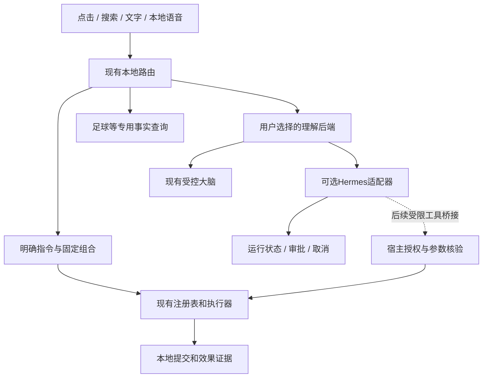

# 路线图：轻量宿主与可选智能后端

**简体中文** | [English](ROADMAP.en.md)

更新：2026-10-22。源码基线：21fcaf4；已发布程序：v1.05.0。本文是后续实施提案，不表示任务已获批准或已经完成。调研依据与局限见[重新调研](RESEARCH.md)。

## 1. 产品目标

Leo继续承担桌面伙伴、快速入口和本机能力宿主。让明确操作更快，让复杂任务有可选大脑，让用户能看懂、停止和控制执行过程。

纯桌宠用户不需要模型服务、Agent运行环境或额外后台进程；已有本地操作不因为接入大脑而绕远路。偏好足球、效率或极客用途的用户，沿用现有使用方案和模块开关组合能力。

下一阶段重心从继续拆内部接口，转为验证现有底座能否低成本连接成熟Agent，并且保持轻量、稳定和可退出。Hermes是首个候选，尚未确定为正式依赖。

## 2. 已完成基线：保留，不重做

| 已有成果 | 当前边界 |
| --- | --- |
| 能力注册、结构化参数/结果、取消、旧动作兼容 | 存在且已用于主要能力，不另造执行器 |
| 搜索、菜单、快捷栏贡献；限定宿主服务及生命周期 | 普通模块闭环已验证，复杂窗口仍需宿主组装 |
| 清单、便签、足球、剪贴板、客户端控制及其既有存储 | 数据源和权限保持原样，不统一重写Store |
| 组合顺序执行、失败恢复和确认后的最多四步计划 | 继续负责本地效果；不直接升级为无限Agent循环 |
| 现有应用包、声明式/worker扩展、兼容检查和恢复 | 不等于任意代码沙箱或全部内置模块独立交付 |
| 模型中转、SenseVoice、使用方案、中英文界面 | 继续可用，不为试验替换现有服务或模型 |
| 定向稳定性检查与发布安装回退 | 短测不是长期无泄漏证明；保留日常观察项 |

依据：[架构参考](Architecture/README.md)、[开发指南](PRODUCT_AND_DEVELOPER_GUIDE.md)、[验证记录](PERFORMANCE.md)。历史Q/C/M等批次不再作为待重做任务。

## 3. 目标职责与调用路径

图中外部适配器、任务事件和工具桥接是计划内容，不是当前已安装能力。

| 请求 | 默认处理 | 模型规则 |
| --- | --- | --- |
| 打开应用、明确清单操作、播放/代理、保存组合 | 原本地执行路径 | 不调用模型 |
| 查询赛程等实时数据 | 原专用查询与缓存 | 查询本身不需要模型；解释或筛选按明确请求另算 |
| 自由对话、模糊意图 | 当前配置的大脑 | 保留原中转配置 |
| 需要多轮工具和长期任务的明确请求 | 用户选择且已启用的外部后端 | 同一任务只有一个规划负责人，不让两套大脑嵌套循环 |
| 后端离线、缺依赖或取消 | 明确状态，本地功能继续可用 | 不自动重发到另一收费服务，不重放未知外部效果 |

模型服务地址、Hermes服务地址和两者凭据不是同一概念，不自动互相复制。费用和工具联网需求分开说明。

## 4. 分阶段任务清单

每阶段完成后先看证据再决定下一阶段，不承诺固定日期。每批具体实施前审批；一次合并相关工作，避免按小接口反复更新。

### R1：场景和最小运行事件，优先

目的：先让已有任务状态可靠、可见，为任何后端提供同一展示语义。

- [ ] R1.1 固定隔离验收场景：明确本地命令、单次事实查询、待确认计划、取消，以及窗口关闭后旧结果返回。优先复用已有夹具。
- [ ] R1.2 对照ActionResult、Workflow和聊天会话，列清提交、运行、待确认、停止中及终态的已有表达；只补不能表达的缺口，不创建第二份执行状态真相。
- [ ] R1.3 在原聊天区域提供紧凑任务状态、必要的工具进度和停止入口；不另建大型任务中心，不展示模型隐式推理。
- [ ] R1.4 校验关闭窗口、后端断连、重复/乱序事件、迟到完成和重复点击。停止已请求与停止已确认分开；未知状态不显示成功。

交付：可重复场景表、最小事件映射、相关界面和故障证据。验收：本地命令仍零模型调用；无新空闲轮询；单任务失败不影响桌宠和本地操作。

若现有结果已足够表达，直接复用，只做展示和映射；没有证据不新增抽象层。

### R2：Hermes独立接入验证，不进入正式功能

依赖：R1的状态与取消语义已明确。目的：证明连接价值和成本，再决定是否集成。

- [ ] R2.1 选定并记录Hermes版本/提交、安装形态、许可证、API能力；核对实际Windows环境与当前中转接口兼容性，不把OpenAI兼容等同所有工具能力兼容。
- [ ] R2.2 用仓库可信假服务验证健康、能力发现、运行编号、事件流、审批拒绝、取消、超时、断连和重连。通过后才申请隔离真实后端验证，不使用个人Key做默认测试。
- [ ] R2.3 比较两条接入路线：HTTP运行API用于最小任务闭环；JSON-RPC仅在必要交互无法表达时评估。ACP暂不作为默认接入路线。
- [ ] R2.4 只选一个非办公的只读场景：从明确提供的模拟关注赛程整理观赛建议，并显示真实工具进度；对比现有大脑，记录操作步骤、等待、调用数量、错误恢复和维护成本。
- [ ] R2.5 在相同隔离环境记录宿主及新增进程的资源、首次就绪时间和关闭后的残留；未启用/纯桌宠时不得启动Agent、自动安装依赖或联网。

交付：接口兼容表、隔离原型、比较报告和“接入/暂缓/放弃”的结论。验收不是某个固定内存数字，而是用户收益明确、资源没有明显不可接受增长、可取消且可移除。若收益仅为换一个聊天窗口，停止该方向。

真实后端和付费中转的小样验证需要单独说明费用/数据范围并获得授权。批准本路线图不等于批准安装Hermes或执行收费测试。

### R3：可选外部大脑最小产品闭环，条件阶段

依赖：R2明确通过，并批准具体集成范围。

- [ ] R3.1 设置中提供现有大脑/外部后端选择，外部默认关闭；连接检查只在用户触发或实际任务时进行，不新增常驻健康轮询。
- [ ] R3.2 固定一个已验证的接入协议，版本与能力不满足时说明原因，缺少审批或停止能力就限制相应操作，不能伪造支持。
- [ ] R3.3 沿用现有聊天、语音识别和任务展示；明确会话、任务、进程及凭据的负责人。默认连接用户已有后端，不同时建设自动安装器。
- [ ] R3.4 故障时保留本地功能和可读结果；重连只核对同一任务，不因事件流断开重新提交。停止用户已有外部服务需独立操作。
- [ ] R3.5 显示本地操作与后端工具操作的不同来源；后端声称完成不能直接作为Leo本地效果证据。

交付：可关闭、可恢复的实验性模块。验收：纯本地用户体验不变；关闭后无Leo自有遗留活动；配置迁移不导出Key；中英文布局可用。未通过前不将Hermes打进默认安装包。

### R4：向外部Agent提供Leo能力，先只读

依赖：R3稳定且确有调用Leo能力的需求；可单独批准，不能默认为R3的一部分。

- [ ] R4.1 评估官方MCP C# SDK的版本、目标框架、依赖和许可；选择最小必要部分。MCP用于工具互通，不取代任务协议和现有LeoModule/1。
- [ ] R4.2 先在隔离配置提供两个白名单只读工具：模块状态与缓存赛程摘要。查询走原注册表；不暴露任意动作执行、路径、shell或完整配置读取。
- [ ] R4.3 定义连接/会话/请求范围授权、参数与返回上限；每次调用重新核对启停。stdio子进程仅传必要环境变量，本机HTTP不能仅因在回环地址就免鉴权。
- [ ] R4.4 统一来源、请求身份、取消和结构化证据；说明外部Agent自身的shell/文件工具可能绕开桥接，工具白名单不等于整个Agent被沙箱限制。
- [ ] R4.5 只读闭环通过后，另批验证一条“建议→用户确认→新增待办”链路。确认只由宿主用户界面作出并绑定实际参数/目标/时效，模型不能自行确认；失败和重试不得重复新增。

交付：受限工具桥接和隔离样例。验收：停用/移除立即拒绝旧请求，正文和本机路径不默认外传，未知结果不重放。若要求强隔离，必须另有操作系统级执行环境；不以MCP或独立进程冒充沙箱。

### R5：确认收益后产品化

- [ ] R5.1 复用现有使用方案提供纯桌宠、本地效率和可选Agent方案；足球等仍独立可选，不复制一套模式配置系统。
- [ ] R5.2 只有用户会重复使用的已确认组合才建议保存为可编辑动作；不自动从私人聊天挖掘偏好或后台创建技能。
- [ ] R5.3 如确有需要，再提供可查看/修改/删除的偏好记忆；原始聊天、剪贴板和凭据不默认入库。优先只保存用户主动要求记住的项目。
- [ ] R5.4 按真实问题做短测与日常观察；制作发布包、截图、自动安装依赖、仓库上传均单独授权。新模式不支持时保留原配置与回退路线。

## 5. 暂缓清单

| 暂缓事项 | 重新启动的条件 |
| --- | --- |
| Electron/React整体迁移、嵌入Hermes Desktop整个工作台 | WinForms确有无法局部解决的产品缺口，且迁移收益可证实 |
| 任意代码市场、全模块独立安装、完整插件SDK | 存在外部开发者需求，并先明确权限、兼容和更新责任 |
| 新建完整邮箱、杀毒引擎、播放器或通用任务管理器 | 集成现有应用无法完成真实场景；目前沿用轻量入口/只读状态 |
| Everything接入、Flow搜索重构 | 原搜索有可复现的覆盖或延迟问题；不因Agent试点扩大范围 |
| 全局数据库、长期记忆平台、多Agent群、通用并行补偿 | 当前单任务与有限组合明确不足，且有可验收场景 |
| 自动安装Hermes、默认后台Agent、自动导入全部技能 | 维护、依赖体积、信任与关闭行为经过单独验证和批准 |

## 6. 每批共同验收

- 保留旧编号、配置、存储格式、显示隐藏/停用区别和现有模块权限。
- 测试只覆盖实际改动及直接链路，报告区分模拟与真实验证；不累计历史检查数冒充全量成绩。
- 不重复测没有问题的功能，不为追求极限占用反复优化；CPU/内存/句柄明显持续增长或退出遗留才是需要定位的证据。
- 本地任务、外部运行和已提交写入分别报告；不宣称全局恰好一次或取消必然回滚。
- 每批先列范围请求批准，完成后本地Git提交；有运行变化才统一更新一次。上传、打包和Release按明确要求执行。

## 7. 建议下一批审批范围

**只建议先批准R1整批：固定场景、核对最小事件语义、在原聊天区域显示任务进度，并验证取消/断连/迟到事件。** 不安装Hermes，不接真实中转，不建设MCP服务，不扩大模型权限。完成R1后再提交R2的具体兼容验证范围。
