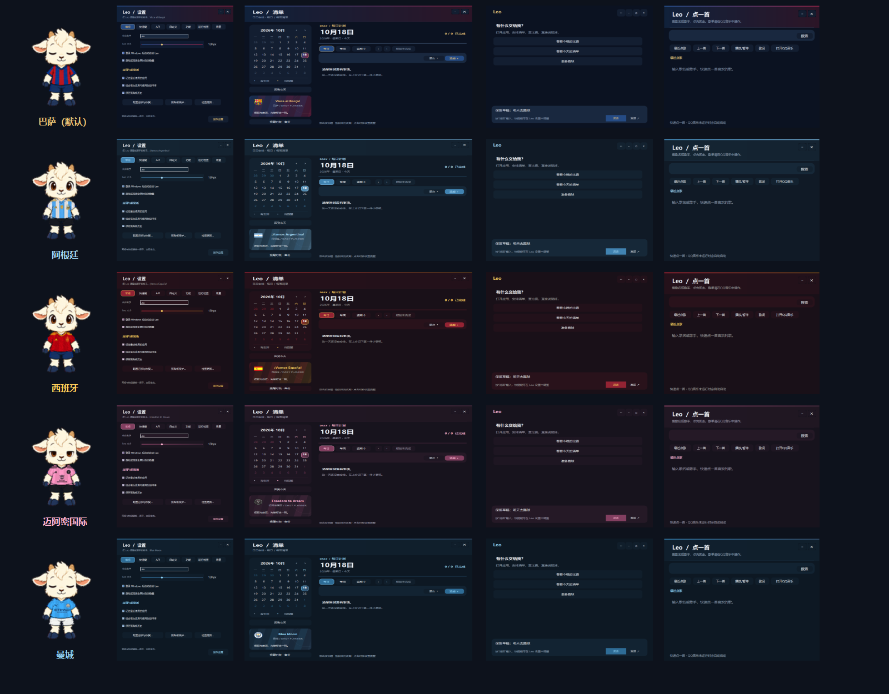
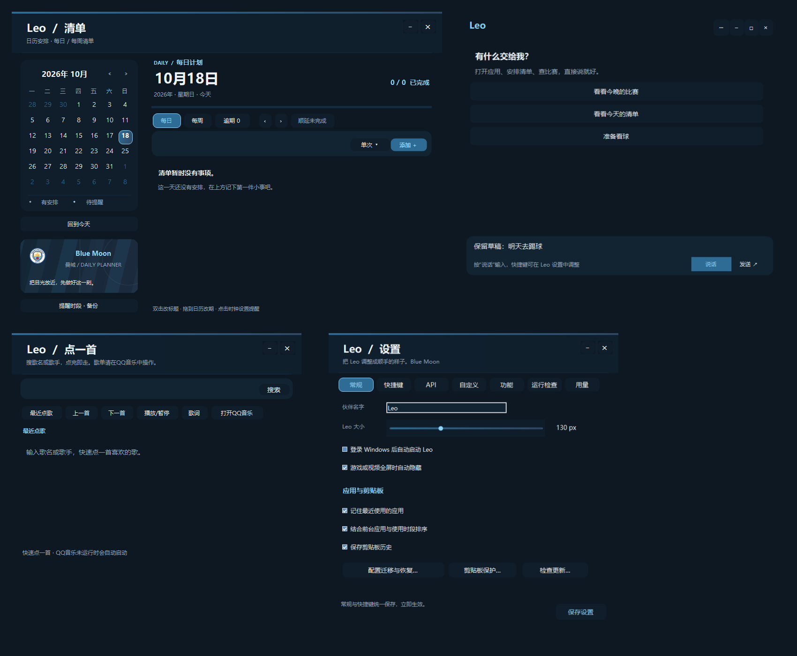
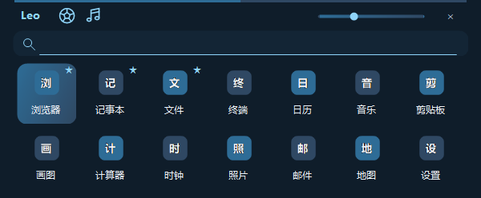

# Leo 使用说明

适用版本：**v0.50.0**。完整操作说明；项目概览与构建方法见仓库首页。

Leo 是 Windows 桌面伙伴，主要用于启动应用、安排清单、查足球赛程、快速点歌和执行桌面快捷动作。默认使用巴萨主题，切换皮肤后，窗口和按钮同步为对应球队的配色。伙伴名字可自定义。

## 阅读顺序

第一次使用可依次阅读 **1 启动 → 2 应用搜索 → 8 设置**，需要某项功能时再查看对应章节。

| 想做什么 | 阅读章节 |
| --- | --- |
| 启动、点击、拖动、边缘吸附 | 第 1 节；第 8 节“边缘停靠” |
| 搜索应用、收藏、设置简称 | 第 2 节 |
| 保存常用文字、找剪贴板记录 | 第 3 节 |
| 每日/每周计划、重复事项、提醒 | 第 4 节 |
| 添加关注、看比赛、积分榜 | 第 5 节 |
| 切换皮肤、关注国家队 | 第 16 节 |
| 点歌、暂停、切歌、歌词 | 第 6 节 |
| 聊天、语音、本地快捷指令 | 第 7 节 |
| 模块路径、开机启动、快捷键、用量 | 第 8、10、11 节 |
| 换电脑、恢复配置、隐私 | 第 9、13 节 |
| 遇到问题 | 第 12 节 |

### 第一次启动建议

1. 等待应用索引完成，试着搜索一个已经安装的软件。
2. 右键 Leo → 设置，调整大小，只开启自己需要的可选模块。
3. 在清单添加一条测试事项，需要提醒时选择明确日期和时间。
4. 在足球 → 管理关注选择俱乐部并保存。
5. API 服务地址、模型和 Key 均需自行填写，代码中的 `api.example.com` 仅作示例，不是可用的中转站。需要自然语言聊天时再配置 API；仅使用搜索、清单和本地动作时可留空。

## 1. 启动与基本操作

- 安装后运行 `app/LeoLauncher.exe`，也可使用 `scripts/Start.ps1`。
- 单击 Leo：打开应用搜索；再单击：收起搜索。
- 搜索窗口打开时，Leo 的位置锁定；关闭搜索后可拖动 Leo。
- 右键 Leo：打开清单、设置、音乐、自定义组合或退出。
- Leo 脚下常驻一排：**聊天、清单、下拉键**。
- 下拉区显示已启用的 **管理员终端、Clash、Edge 搜索**。
- **QQ 音乐在应用搜索窗口上方、足球按钮旁边**，也可以从右键音乐菜单进入。
- Esc 关闭当前功能窗口或收起搜索，不会退出 Leo。退出请使用右键菜单。
- 将鼠标停在 Leo 上，可查看未完成事项和下一场关注比赛摘要。

## 2. 应用搜索与键盘操作

直接输入应用名称、拼音或简称，例如 `wx`、`weixin`、`vsc`。结果最多显示两排，每排七个图标；没有输入时显示收藏和最近使用的应用。

| 操作 | 效果 |
| --- | --- |
| 上、下方向键 | 在两排结果间移动 |
| 左、右方向键 | 在结果中移动；尚未进入结果导航时保留文字编辑 |
| Tab / Shift+Tab | 切换所选结果 |
| Enter | 打开所选应用 |
| Shift+F10 | 打开所选应用的右键菜单 |
| Ctrl+L / Ctrl+F | 回到搜索文字并全选 |
| Esc | 收起搜索 |

右键应用图标可收藏置顶、取消收藏或设置自定义简称。在没有搜索文字时，可拖动收藏图标调整顺序。收藏、简称和排序调整后提供撤销入口。

首次启动需要读取本机应用列表，索引尚未完成时可稍等后重试。

## 3. 剪贴板

在应用搜索中输入“剪贴板”或“剪切板”打开。支持文字、图片和文件记录，可搜索、复制、收藏、删除和撤销。

普通历史最多保留 50 条；收藏另有数量与容量限制。清空历史不会清空收藏。可在设置中关闭记录历史。剪贴板记录只保存在本机，不属于配置导出的内容。

## 4. 每日、每周清单与日历

从脚下清单图标或右键菜单打开。选择日历日期后，输入事项并添加；可选单次、每天重复或每周重复。

- **每日**：查看所选日期的事项。
- **每周**：按日期分组查看所选周的安排。
- **逾期**：单独收纳过去未完成的事项。
- 双击标题可修改；拖到日历日期上可改期。
- 点击时钟设置或取消提醒；改期时提醒时间随之移动。
- “顺延未完成”可批量安排未完成事项。
- “撤销”支持本次运行内最近 20 次清单修改；输入框外也可用 Ctrl+Z。

### 4.1 右键快速操作

右键事项卡片、标题或卡片上的控件，可选择：标记完成或恢复待完成、修改标题、移到明天、选择日期、设置提醒、删除、撤销上一步。重复事项还提供“仅跳过本次”。

修改一次的标题、日期或提醒，不会自动改变后续每次安排。编辑窗口中明确选择修改后续事项时，才应用到后续重复。跳过本次后，这次不会因重新生成而再次出现；仍可撤销跳过。

### 4.2 提醒与备份

提醒窗口支持稍后 10 分钟或 1 小时。在清单左下方的“提醒时段 · 备份”中设置免打扰、手动备份和恢复。

提醒需要 Leo 正在运行。关闭电脑或退出 Leo 期间不会响铃；重新运行后会补报符合条件的逾期提醒。免打扰或全屏隐藏期间会暂缓弹窗。

撤销不会强行覆盖后来发生的提醒或赛程同步变化；遇到冲突时会说明原因。

## 5. 足球

点击应用搜索窗口上方的足球按钮。点击“管理关注”添加或取消球队，可按联赛筛选或搜索中文名、简称和英文名。内置152支球队，包括五大联赛及迈阿密国际等97支俱乐部，以及55支国家队；默认仍保留巴塞罗那、曼城、迈阿密国际，可修改，最多关注24支。支持近期已结束及未来比赛、球队赛程和联赛积分榜。

- 点击俱乐部，在同一窗口切换球队详情，再用返回按钮回到列表。
- 时间显示为本机时区；更新失败时可能显示缓存，请留意更新时间。
- 当天的下一场关注比赛会在悬停摘要中显示距开球时间。
- 尚未开赛、时间已确定的比赛可加入清单，默认提前 10 分钟提醒。
- 关联比赛的赛程变化可同步到清单；手动改期的事项不会被直接覆盖。
- 左下方可保存四个观赛网址。开启 Edge 模块后可使用这些入口。

比赛信息来自联网数据源，可能存在延迟或缺漏。Leo 不提供比赛视频资源。

## 6. QQ 音乐

入口在**应用搜索窗口上方的足球按钮旁边**。关闭 QQ 音乐模块后，该入口和右键音乐菜单一同隐藏。

输入歌名或歌手，选择候选歌曲即可发送给 QQ 音乐。客户端未运行时会尝试先启动，再发送播放请求。支持最近点过的歌曲、播放或暂停、上一首、下一首和歌词控制。

歌单请在 QQ 音乐客户端内操作，Leo 不再维护或同步歌单。登录、会员权限和歌曲可播放性由 QQ 音乐处理。歌词快捷控制需要客户端保留兼容的歌词快捷键设置。

## 7. 聊天、语音与本地指令

Leo 聊天主要用于协调已有功能，以及随手问一句。可以说或输入“打开微信”“看看今天的清单”“开启系统代理”“下一首”等明确指令；能在本地确定的操作会直接执行。

自由聊天、复杂意图理解和任务拆解可能调用配置的模型 API。语音先由本地 SenseVoice 转为文字，再按同样规则处理；语音内容转换成文字后，如果进入模型对话，文字会发送给所配置的服务。

点击“说话”开始录音，停顿后自动转写，也可点击“说完了”。如果无法识别，先检查输入设备、本地模型和麦克风声音。

Leo 没有通用网页浏览能力。赛程查询使用专门数据源；网页搜索会打开浏览器。不要将模型回复当成已经联网核实的实时事实。

## 8. 设置、模块与软件路径

右键 Leo 进入设置。

| 页面 | 主要内容 |
| --- | --- |
| 常规 | 大小、开机启动、全屏隐藏、应用历史、剪贴板、配置迁移 |
| 快捷键 | 修改或停用快捷键，检查冲突 |
| API | 服务地址、接口类型、模型与本机密钥 |
| 自定义 | 新建、排序、编辑或删除组合动作 |
| 功能 | 启停可选模块、边缘停靠、手动选择软件路径 |
| 运行检查 | 启动项、快捷键、语音模型、软件检测和可选的 API 连接检测 |
| 用量 | 今日请求数、接口报告的 Token、每日模型请求限额 |

### 可选模块

管理员终端、Clash、QQ 音乐和 Edge 可分别启停，保存后同步更新图标和菜单。关闭模块不会卸载软件，也不会关闭已经播放的音乐或已经开启的代理。

聊天、清单和下拉键常驻。终端、Clash、Edge 放在下拉区；QQ 音乐保留在应用搜索窗口上方。

### 手动指定路径

进入 **设置 → 功能 → 软件路径**，为相应模块选择程序文件。留空或点击“自动”恢复自动检测。确定后还需点击设置中的“保存设置”。

支持 QQ 音乐的 `QQMusic.exe`、Clash Verge 的 `clash-verge.exe`、Edge 的 `msedge.exe`；终端可选择受支持的 Windows Terminal、PowerShell 或命令提示符程序。程序名必须与模块匹配，不要填写命令参数。

管理员终端仍通过 Windows 的权限确认启动。Clash 未运行时，开启代理会先尝试静默启动客户端。Leo 会在客户端尚未运行时，将其原生 `enable_silent_start` 设置为 `true`，避免弹出主界面；不会修改订阅、节点或其他代理配置。静默冷启动可能不创建首页，因此 Leo 优先使用 Clash 原生系统代理快捷控制，并等待进程、快捷控制和本机代理端口就绪；首页已存在时也可使用后台控件操作。原有系统代理快捷键保留，未配置时自动选择空闲组合；需要启用 Clash 的全局快捷键。整个流程不恢复、激活或最小化 Clash 主界面，成功前会校验系统代理实际状态。

### 边缘停靠

#### 开启与收起

在 **设置 → 功能** 中开启边缘停靠。关闭应用搜索后，将 Leo 拖近屏幕边缘并松手，触发吸附。搜索打开期间位置锁定，不能拖动。

| 方向 | 收起动作 | 收起后 |
| --- | --- | --- |
| 左侧 | 朝屏幕中央探身、逐步收起身体 | 左侧探头 |
| 右侧 | 与左侧相反方向收身 | 右侧探头 |
| 顶部 | 转身翻转、身体逐步收起 | 倒挂探头 |
| 底部 | 逐步蹲下、收起身体 | 向上探头 |

每个方向有 **6 张不同动作帧**，合计 24 帧；按当前收起进度逐帧显示，不是两张图片淡入淡出。完整头部、耳朵和角保持在屏幕内，只有身体隐藏，脚下按钮暂时不可用。底部按工作区边缘定位，避开任务栏。

#### 展开与直接拖出

- **想使用功能**：将鼠标移到露出的头部，收起动作倒序播放。恢复完整体型后脚下按钮出现，再使用搜索、聊天、清单等入口。
- **只点一下**：唤醒 Leo，不在同一次点击中打开应用搜索。
- **想换位置**：直接按住露出的头部拖向屏幕内部，松手即可恢复待机。无需先悬停等待展开，也无需额外再点一次。
- **再次贴边**：拖近另一条边缘松手，播放对应方向的动作。
- **希望保持展开**：可关闭边缘停靠。开启停靠且仍贴边时，闲置后会再次收起；输入搜索时不会自动收起。

如果更新后仍表现异常，先确认只运行固定 `app` 目录中的最新版本，不要同时启动旧副本。当前版本已修复直接拖出后动画状态未清理的问题。

## 9. 配置迁移与恢复

进入 **设置 → 常规 → 配置迁移与恢复**。

1. 点击“导出配置”，保存 `.leo.json` 文件。可选择是否包含清单、重复事项和提醒。
2. 在目标电脑打开同一入口，选择“导入配置”。
3. 查看内容摘要与路径提示，确认后导入。应用名称能够唯一匹配时，会重新关联本机的收藏、简称和组合动作中的应用。
4. 导入前自动保存备份；需要返回之前的状态时，点击“恢复上次导入前”。

导出包含球队关注列表；导入旧版本未包含关注列表的文件时，保留本机关注。

导入会替换文件中包含的配置；未包含清单时保留本机清单。开机启动和窗口位置沿用本机设置。无法使用的软件路径会提示并改为自动检测；没有安装或不能唯一匹配的应用需要重新选择。

导出不包含 API 配置或 Key、聊天、剪贴板、应用使用历史、语音模型。**导出的文件仍可能含待办、网址、简称和软件路径，属于个人文件，不应上传到源码仓库。**

## 10. 快捷键默认值

| 快捷键 | 功能 |
| --- | --- |
| Ctrl+Alt+Space | 打开或收起应用搜索 |
| Ctrl+Alt+V | 打开聊天并直接语音输入 |
| Ctrl+Alt+L | 显示或隐藏 QQ 桌面歌词 |
| Esc | 关闭当前功能窗口或收起面板 |

快捷键可在设置中修改。歌词快捷键随 QQ 音乐模块停用；冲突时请换用其他组合。

## 11. 联网与 API 用量

应用搜索、剪贴板、清单、提醒、设置、自定义组合和本地语音识别不需要模型 API。足球更新、歌曲搜索等功能需要联网；网络请求不等于模型 API 调用。

默认每天最多发出 100 次模型生成请求，可在“用量”页修改，0 表示不限。工具调用的多轮回复按实际模型请求计次；失败和取消也可能已经发出请求，因此计入上限。读取模型列表不计入此限额。

Token 只累计服务实际返回的数值，缺失时记为未报告；Leo 不根据这些数值猜测费用。中转站不支持流式用量参数时，可关闭“请求 Token 统计”。达到上限后，本地功能仍可使用。

## 12. 常见问题

- **开机没有出现 Leo**：先看“运行检查”，核实 Windows 启动应用状态，必要时修复启动项；真正的登录启动需要重新登录验证。
- **软件未找到或手动路径失效**：重新选择程序，或清空路径恢复自动检测；同时确认模块已经启用。
- **歌没有播放**：检查 QQ 音乐是否就绪、已登录、歌曲是否允许播放；必要时在客户端确认。
- **语音没有声音**：检查输入设备、麦克风权限、本地 SenseVoice 模型，以及是否实际录到了声音。
- **没有收到提醒**：确认 Leo 正在运行，提醒时间已设置，并检查免打扰和全屏隐藏状态。
- **快捷键无效**：查看运行检查或快捷键页，处理占用；不要让多个程序使用同一组合。
- **导入失败**：先看提示。文件格式、路径、快捷键或写入权限可能导致失败；导入前备份保存在运行目录的 `config-backups` 中。

## 13. 从源码构建与隐私边界

在 Windows x64 上准备 .NET SDK 9 和 PowerShell，在仓库目录执行：

```powershell
./scripts/Build.ps1 -Locked
./scripts/Test.ps1
./scripts/Install-Local.ps1
./scripts/Install-VoiceModel.ps1
./scripts/Start.ps1
```

语音模型首次安装需要联网；模型不随源码仓库上传。构建产物在 `.build/Release`，固定运行目录为 `app`。更新会保留个人配置与模型。

API Key 使用 Windows 当前用户的 DPAPI 本机加密保存，不应复制到说明书、截图、日志或源码。`app`、备份、个人 JSON、模型、编译缓存和导出配置均应留在本机。提交或推送前仍需检查 Git 跟踪清单与历史；忽略规则不能自动清除已经提交的内容。

第三方软件、球队标识、模型和依赖的权利与许可由各自权利人保留。相关来源及许可证请查看仓库中的素材来源说明与 `licenses`。

### 13.1 本机数据与公开仓库的区别

| 内容 | 保存或处理位置 | 是否随源码公开 |
| --- | --- | --- |
| 应用代码、通用素材、依赖许可 | Git 仓库 | 是 |
| API Key、API 服务配置 | 本机运行目录，Key 使用当前用户加密 | 否 |
| 清单、聊天、剪贴板、应用历史 | 本机运行目录 | 否 |
| 收藏、个人简称、窗口位置、软件路径 | 本机配置 | 否 |
| 观赛网址、自定义组合、导出的配置 | 本机配置或自行选择的文件 | 否 |
| 语音模型、录音、缓存、备份 | 本机运行目录及对应子目录 | 否 |
| 模型请求内容 | 发送给自行配置的模型服务 | 不上传 GitHub，但服务方会收到请求 |

“本地保存”不代表所有功能完全离线。足球、歌曲查询及模型请求仍会按各自用途联网。发布 Issue 或截图前，请自行隐藏个人信息。

### 13.2 后续更新与定向验证

1. 保留本机 `app` 和个人配置，不把它们复制进源码提交。
2. 获取新源码后执行构建，并安装到原来的固定目录；安装脚本保留个人数据。
3. 普通小改动只执行变更功能及直接影响范围的检查，不重复运行无关功能。
4. 吸附动画相关检查可单独执行：

```powershell
./scripts/Build.ps1 -Locked
New-Item -ItemType Directory -Path .build/dock-check -Force
$report = Join-Path (Resolve-Path .build/dock-check) 'result.json'
Start-Process .build/Release/LeoLauncher.exe -ArgumentList @('--dock-animation-test', $report) -Wait
Get-Content $report
```

`ok: true` 表示这组吸附检查通过，报告和预览保存在 `.build`。完整测试脚本保留供初次构建或需要覆盖多个模块时使用，日常单点修改不默认运行全量检查。


## 14. 软件启动、离线使用与安装更新

### 14.1 外部软件的启动与反馈

Clash 系统代理、QQ 音乐点歌及播放控制统一排队：检查客户端 → 必要时静默启动 → 等待可用 → 发送动作 → 检查状态或客户端接收结果。同一个操作在等待中重复触发，只执行一次；同一软件的不同动作按顺序执行。

Leo 旁显示具体阶段。等待超过约 1.8 秒出现“取消”，停止等待及尚未发送的后续动作；已经启动的软件、已经完成的代理切换或点歌不会被强行撤销。失败可点“重试”。QQ 音乐的点歌回执表示客户端已接收，歌曲实际可播放性仍受客户端登录、会员和版权限制。

### 14.2 自然输入清单

在每日或每周清单的添加框直接输入：

| 输入示例 | 自动填写 |
| --- | --- |
| 明天下午三点取快递 | 明天、15:00、取快递 |
| 每周六晚上踢球 | 下一个周六、每周重复、踢球；建议 20:00 |
| 每天早上八点运动 | 每天、08:00、运动；已过去的本次顺延 |
| 2026-10-23晚上八点三十分训练 | 指定日期、20:30、训练 |
| 15:30开会 | 当前选中日期、15:30、开会 |

识别在本机进行，不调用模型 API。添加前会弹出确认窗口，可修改标题、日期、提醒及重复规则。仅写“晚上”等模糊时段时会提示建议时间；取消不会添加事项。普通标题仍按原方式直接添加。提醒依赖 Leo 运行。

### 14.3 足球也是可选模块

在“设置 → 功能”取消足球并保存，会隐藏足球入口、关闭足球窗口、取消正在进行的足球查询并停止后续赛程更新。关注名单、赛程缓存和已加入清单的提醒保留；已保存提醒仍由清单处理。需要最新赛程变化时重新启用足球。聊天中请求足球功能会提示先开启模块。

赛程页面显示缓存时间。断网或来源失败时保留原内容，可用刷新重试；部分来源失败时会标注旧缓存。音乐搜索失败保留原结果并显示“重试搜索”。聊天失败可重试；若该次回复已调用工具，重试会先恢复输入并提醒核对结果，避免自动重复添加任务等操作。

### 14.4 运行检查与吸附

“设置 → 运行检查”中，检测到启动项未生效时可启用或修复；软件路径未找到或失效时可打开路径选择；快捷键被占用时可直接进入对应配置页更换组合。路径修复在确认所选程序后保存，快捷键不会擅自恢复默认值。

吸附动画开头与普通动作渐变衔接，展开中按下拖动会短暂过渡到拖动动作。在角落松手时按最后的拖动方向选择吸附边，减少左右、上下方向突然跳转。

### 14.5 给普通用户的 Windows 安装包

下载 Windows x64 发布压缩包后完整解压，双击 `Install-Leo.cmd`。选择专用安装文件夹，首次启动选择所需模块。包内包含 Windows 桌面运行组件，无需安装 SDK、Python 或其他开发环境；外部客户端和本地语音模型需自行配置。

更新时重新打开安装入口，选原安装目录并点击“安装 / 更新”。先验证发布文件，再备份原程序和本机 `leo-*.json` 配置，更新只替换发布清单中的程序文件。失败自动恢复原程序；个人数据不覆盖。安装入口的“回退上次更新”恢复上个程序版本，保留当前个人配置；更新前配置副本在安装目录 `update-backups` 的对应时间文件夹中。更新和回退会退出目标目录中的 Leo，不关闭其他安装目录或外部软件。

发布包只从构建输出、通用素材和说明生成，不读取开发者的 `app`、配置、模型或缓存，不包含个人 API Key。它不会自动连接或上传 GitHub。

开发者打包入口：`src/Packaging/Build-Package.ps1`，输出在被 Git 忽略的 `.build/distribution`。包内 SHA-256 文件清单用于检查损坏，不能替代发布者签名或可信下载来源。


## 15. 通知、专注与剪贴板保护

### 15.1 通知收纳盒

右键 Leo → **通知收纳盒**；存在未读通知时，也可以点击 Leo 右上方的小金点。收纳盒保留最近200条清单提醒、操作结果和失败信息，支持逐条已读、全部已读和清理已读。相同操作的重复反馈合并，进度变化不占用历史。

清单提醒可直接返回对应日期。失败操作在当前运行会话内保留重试入口；重启后保留通知文字，重试回调不保存到文件。聊天失败提供“回到聊天”，由聊天窗口确认是否重发。重试会遵守模块开关，停用模块后不通过历史通知偷偷启动客户端。

通知文件为本机 `leo-notices.json`，不上传模型服务或源码仓库。清单中已删除的事项仍可保留历史文字，但不能打开已删除的事项。

### 15.2 临时专注

右键 Leo → **临时专注**，选择25、45或60分钟，可随时结束。普通动作安静待机，悬停摘要和专注窗口显示剩余时间；聊天、应用搜索等主动操作仍然可用。

专注期间普通清单提醒进入通知盒；勾选“重要事项和开赛提醒仍然弹出”时，右键标为重要的事项及比赛提醒继续显示。取消勾选后，这些提醒也收进通知盒。结束专注不会一次弹出积压的普通提醒，可到收纳盒查看。

在清单事项上右键选择“标为重要”，设置作用于该条事项。专注截止时间保存在本机，重启不会重新计时；到期只完成一次，免打扰时段内安静记录完成通知。专注只管理 Leo 的反馈，不改变 Windows 或其他软件的通知设置。

### 15.3 剪贴板敏感内容保护

入口：**设置 → 常规 → 剪贴板保护**，或剪贴板窗口的“隐私保护”。

- 暂停10分钟、60分钟，或立即恢复；暂停期间的内容不会恢复后补录。
- 按程序名排除应用，支持选择 `.exe` 自动提取程序名。默认排除常见密码管理器；不记录完整安装路径。
- 默认跳过常见密钥、Bearer令牌和私钥文本，并始终尊重 Windows 敏感剪贴板标记。自动识别无法覆盖所有密码，处理敏感内容可先暂停。
- 非收藏历史默认保留7天，可改为1天、30天或不自动过期。收藏不参与自动过期；过期清理不能通过“撤销”恢复。

排除规则优先检查剪贴板来源应用，并结合前台应用；恢复记录或修改规则时跳过当前剪贴板，避免补录。规则不会追溯删除现有收藏。不要把“自动识别”当成所有敏感内容都可识别的保证。

## 16. 皮肤与国家队

### 16.1 自选皮肤

右键 Leo → **皮肤**，选择后立即生效并保存在本机：

| 皮肤 | 外观 |
| --- | --- |
| 巴萨（默认） | 原始红蓝球衣与原动作素材 |
| 阿根廷 | 2024主场蓝白条纹、金色标识、黑短裤 |
| 西班牙 | 2024主场红色球衣、黄色肩饰与领口、海军蓝短裤 |
| 迈阿密国际 | 2024粉色主场球衣、黑色肩饰与胸前标识、黑短裤 |
| 曼城 | 2024/25天蓝主场球衣、0161领口装饰与胸前标识、白短裤 |

皮肤与足球模块、比赛日期、球队关注和专注状态无关，不会自动切换。不启用足球也可以选择皮肤；想恢复默认时选择“巴萨（默认）”。首次使用为巴萨；旧设置中的手动球衣选择会保留，旧自动/关闭状态迁移为默认巴萨。

五套皮肤覆盖待机、互动、思考、左右移动、上下拖动，以及四向收起与展开。右侧吸附的角色动作由左侧对称生成，眼睛朝向屏幕内侧；球衣纹样在对称后贴合，文字保持正向。

角色采用逐像素半透明轮廓。球衣先贴合原动作，再一次缩放到桌宠大小；在很小尺寸下，球衣微型文字仍会简化。放大 Leo 可看更多细节。

当前有效纹样及完整生成提示词见 `src/Assets/MatchDay/Kits`。使用内置 imagegen 在开发时生成；切换皮肤不联网、不调用用户的模型API。

### 16.2 全界面随皮肤切换

皮肤同时控制球衣与应用界面：应用搜索、脚下按钮、右键菜单与子菜单、清单日历、足球、点歌、聊天、设置、操作反馈和其他应用内对话框。窗口已经打开时也立即切换，输入中的聊天草稿不会被清空，无需关闭窗口或重启。

| 皮肤 | 界面配色 |
| --- | --- |
| 巴萨 | 深蓝底、红蓝渐变、金色重点 |
| 阿根廷 | 深蓝灰底、蓝白与浅蓝重点 |
| 西班牙 | 深酒红底、红金重点 |
| 迈阿密国际 | 炭黑紫底、粉色重点 |
| 曼城 | 深海军蓝底、天蓝重点 |

状态错误和成功提示保留可辨识的语义色。文件选择等 Windows 自带系统对话框遵循系统外观。皮肤不会改动第三方软件的主题。



### 16.3 自定义伙伴名字

右键伙伴 → **设置 → 常规 → 伙伴名字**，填写 1～24 个字符后点击“保存设置”。可用中文、英文或其他文字；不接受空白名字、换行和控制字符。默认名字为 Leo。

名字会同步到窗口标题、应用搜索栏、聊天称呼、主要右键菜单和托盘说明；新对话请求也会告诉模型使用该名字。改名不改变安装目录、启动项标识、配置文件名或 GitHub 项目名，不会丢失既有清单、聊天历史及设置。配置导出与导入包含名字。

### 16.4 国家队关注

足球 → **管理关注 → 国家队**，可选55支成年男子国家队，包含阿根廷、西班牙、巴西、法国、德国、葡萄牙、英格兰、中国、日本等。原有97支俱乐部保留，总目录152支，关注上限仍为24支。

国家队与俱乐部共用赛程、最近赛果、比赛加入清单和开赛提醒。点开国家队仍在同一窗口查看详情，返回键回到原列表。国家队详情提供**赛事积分榜**，可切换世界杯、对应洲际杯赛和世预赛等；缓存按球队及赛事分别保存，避免串榜。

国家队没有俱乐部联赛积分榜。页面显示来源当前可提供的赛事及赛季；淘汰赛阶段或无公开小组数据时明确显示暂无积分榜，不用旧赛季假充本赛季。队名显示中文，来源及队徽出处保存在素材目录的国家队来源说明中。

## 17. 手动检查更新

入口：**设置 → 常规 → 检查更新**。只有点击“检查更新”才访问项目 GitHub，不会后台自动检查或下载。

1. 检查正式 Release，并显示版本和更新说明。
2. 只有源码标签时提示“只有源码”；没有匹配安装包及SHA-256校验文件时不提供自动安装。
3. 新版本同时提供 `Leo-v版本-win-x64.zip` 和同名 `.zip.sha256` 时，才可点击“下载并安装”。
4. 下载可取消。完成后先校验压缩包，再检查安全路径、文件清单和版本，最后打开安装确认窗口。
5. 安装窗口预填当前目录。确认更新时才退出目标目录中的 Leo，沿用既有备份及回退流程。

更新来源固定为本项目的公开 GitHub Release，不读取本机 GitHub 凭据；不会为你上传或发布版本。网络异常、限流或取消下载不影响当前运行版本。下载暂存在当前用户本机的 `LeoUpdates` 目录，不随源码上传。

新增运行功能无需模型 API；足球和更新检查仍会联网读取公开数据。公开仓库未发布安装包时，更新页提示尚无可安装版本属于正常情况。

## 18. 多屏吸附

开启 **设置 → 功能 → 边缘停靠** 后，可拖动伙伴穿过连接的显示器。

- 显示器之间的共享接缝不吸附，横向、竖向排列都可穿过。
- 只在整个桌面的外侧边缘吸附；错位排列时，没有邻屏遮挡的外侧台阶仍可停靠。
- 如果头部所在边缘有一部分通向邻屏，就不收起，避免角色跨屏被截断。
- 跨屏经过侧边任务栏时允许连续拖动；释放后仍按工作区安置，底部停靠为脚下按钮预留空间。
- 支持副屏位于主屏左侧或上方的负坐标；移除显示器或改变布局后，伙伴恢复到可见工作区并展开。
- 吸附后隐藏脚下按钮，悬停展开；也可以直接拖出。

当前定向检查覆盖模拟横排、竖排、错位、负坐标、间隙及侧边任务栏布局；不同硬件和混合缩放比例下仍建议按自己的屏幕排列试拖一次。

## 19. 版本截图

以下为使用空白示例数据渲染的应用截图，不包含个人清单、账号、Key、安装路径或桌面。






